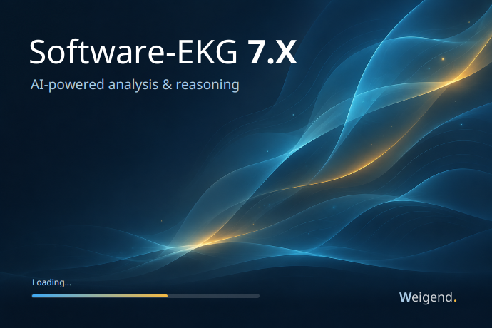
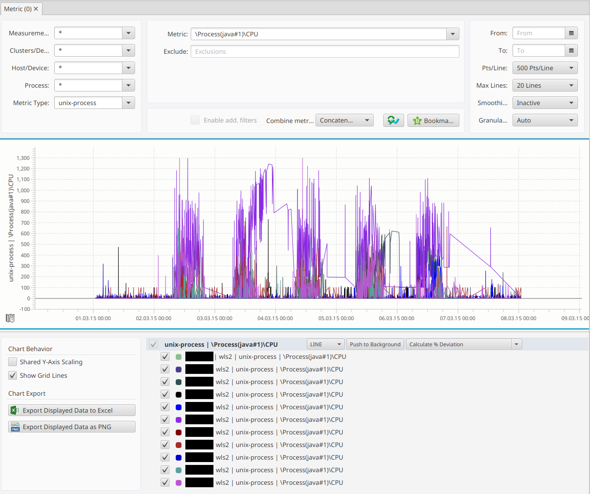
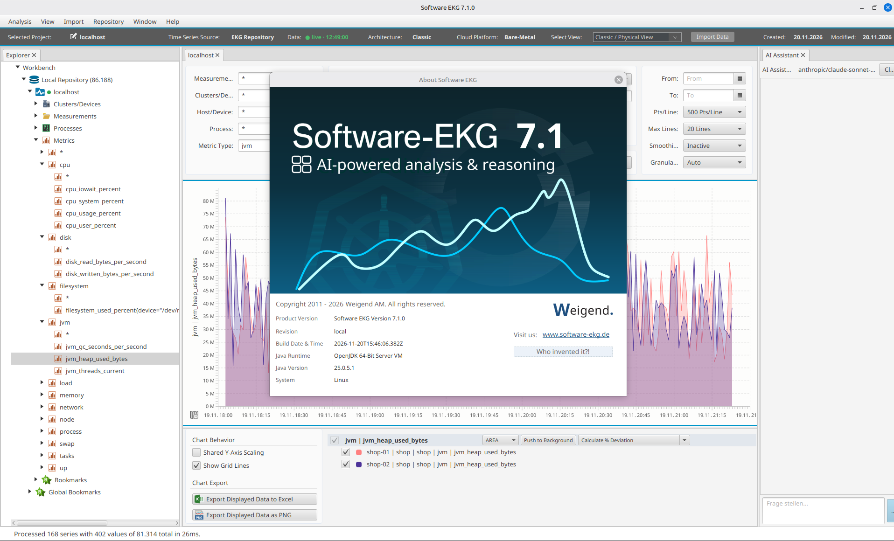

<p align="center">
  
</p>

<p align="center"><a href="README.md">English</a> | <b>Deutsch</b></p>

# Software-EKG

[](https://github.com/Weigend/Software-EKG/actions/workflows/build.yml)
[](https://github.com/Weigend/Software-EKG/releases/latest)
[](LICENSE)

> Mit dem Software-EKG sucht ein Analyst die Nadel im Heuhaufen.

Das Software-EKG ist eine Workbench für die vergleichende Analyse von Softwaresystemen. Der Name ist wörtlich gemeint: Wie ein EKG die Signale des Herzens über die Zeit aufzeichnet, zeichnet das Software-EKG gezielt die Messwerte der Systeme, Server und Anwendungen auf, die zusammen einen Anwendungscluster, ein verteiltes System oder einen Serververbund bilden. Legt man die Kurven übereinander, fällt auf, welche Komponente wann aus dem Takt gerät.



Das Bild zeigt die CPU-Last desselben Java-Prozesses auf elf Knoten eines Clusters über eine Woche. Man sieht, dass die Anwendung nur tagsüber von Montag bis Freitag genutzt wird und dass ein Server die ganze Woche deutlich über den anderen liegt. Warum das so ist, sagt das Bild nicht. Es liefert aber die drei Angaben, auf die es ankommt: welcher Server, welcher Zeitraum und womit man ihn vergleicht. Die Ursache war am Ende ein fehlerhaftes Load Balancing im Client; der ganze Fall steht in [docs/positioning.de.md](docs/positioning.de.md#ein-beispiel).

## Die Fragen, um die es geht

Der Kern ist der Vergleich. Der Analyst findet Muster, nach denen er vorher nicht gesucht hat, und viele davon liegen innerhalb aller Grenzwerte, bei denen ein Alarm auslösen würde:

- Warum steigt der Heap bei drei von fünfzig Systemen stetig?
- Warum tritt ein Lastmuster alle vierzehn Tage auf?
- Warum hat sich das Verhalten nach einem bestimmten Release verändert?
- Warum zeigen zwei eigentlich gleiche Systeme unterschiedliche Verläufe?

## Für wen

Das Software-EKG ist ein Expertenwerkzeug für den Software-Notarzt, den Performance Engineer oder den Troubleshooter: für jemanden, der schnell verstehen will, was wo läuft und welche Probleme die Systeme haben.

Neben schon vorhandenen Monitoring- und Alerting-Lösungen ist es oft der Einstieg in das Verständnis von Produktionsproblemen, die komplexe verteilte Systeme verursachen. Es dient dem Analysten als Umgebung, um die relevanten Daten aus den betroffenen Systemen zu sammeln und auszuwerten, Hypothesen zu bilden und zeitliche Unterschiede zu sehen. Falls nötig, skaliert es über Milliarden von Datenpunkten.

Es ist der erste Schritt einer Root-Cause-Analyse, nicht ihr Ende: Das EKG zeigt, seit wann, wo und im Vergleich womit etwas auffällig ist.

## So arbeitet man damit



1. **Sammeln.** Die Workbench importiert Zeitreihen aus Prometheus. Weitere Quellen liefert der Collector, etwa Systemmetriken und Logs per SSH, JMX, Jolokia und Windows Performance Counter. Die Daten liegen lokal im eingebetteten Solr; ausgewertet wird auf dem eigenen Rechner, nicht auf den Produktionssystemen.
2. **Vergleichen.** Der Analyst legt viele Zeitreihen in ein Bild, per Wildcard auf Cluster, Host, Prozess und Metrik, verändert das Zeitfenster und nimmt weitere Systeme dazu. Eine klare Frage hat er am Anfang oft nicht; sie entsteht beim Vergleichen.
3. **Festhalten.** Auffällige Stellen werden als Bookmarks gespeichert und als PNG oder Excel exportiert.
4. **Prüfen.** Der eingebaute AI Assistant hilft, eine Hypothese an den Rohdaten zu prüfen, siehe [Die Rolle der AI](#die-rolle-der-ai).
5. **Vertiefen.** Ausgehend davon wird festgelegt, was genau tiefer untersucht werden soll. Speicherprofiler, CPU-Profiler, Netzwerk-Tracing-Tools oder andere Visualisierungen kommen dann gezielt für die Komponenten zum Einsatz, die bereits in der Metrikanalyse auffällig sind.

Die vollständige Anwender- und Erweiterungsdokumentation steht im
[Software-EKG-Handbuch](docs/handbook/README.md) (auf Englisch).

## Die Rolle der AI

AI kommt an zwei Stellen ins Spiel:

1. **Bei der Analyse.** Die Workbench unterstützt die Analyse der Zeitreihen direkt durch AI. Der eingebaute AI Assistant hat Zugriff auf alle gesammelten Daten: Er sieht den aktuellen Chart-Ausschnitt, kennt die Metriken und fragt Zeitreihen selbst ab. Bei Bedarf greift er per SSH auf die Systeme selbst zu, etwa um Logs oder Prozesse anzusehen; jedes Kommando führt er erst nach Freigabe durch den Analysten aus. Der Assistant spricht mit einem OpenAI-kompatiblen Endpunkt. Derzeit ist das OpenRouter mit einem Claude-Modell, der API-Schlüssel kommt aus der Umgebungsvariablen `OPENROUTER_API_KEY`; das Modell lässt sich in der Anwendung noch nicht wählen.
2. **Beim Erweitern.** Eine Collector Source ist ein kleines Plugin: Die mitgelieferte Mock-Quelle besteht aus einer Klasse mit rund 90 Zeilen und einem ServiceLoader-Eintrag. Ein Coding-Agent schreibt eine solche Source für eine proprietäre Metrik-Schnittstelle in Minuten. So lässt sich das Werkzeug erweitern, bis es die Metriken beliebiger Schnittstellen anzeigt, siehe [Erweiterungen](#erweiterungen).

## Was es nicht ist

- **Kein Ersatz für das zentrale Monitoring.** Dashboards und Alarme auf dem laufenden System bleiben Sache von Werkzeugen wie Grafana. Die Workbench hat eine laufende Anzeige, sie bestätigt aber vor allem, dass Daten ankommen.
- **Kein Anomalie-Detektor.** Die Muster findet der Mensch im Vergleich.
- **Kein Werkzeug, das die Ursache verspricht.** Das Bild führt zum richtigen Server und zur richtigen Frage. Die Antwort steht oft in keiner Zeitreihe; sie braucht Wissen über die Architektur.

## Ausprobieren

Fertige Pakete für Linux x64, macOS (Apple Silicon) und Windows x64, jeweils mit eigener Java-Laufzeit, liegen auf der [Release-Seite](https://github.com/Weigend/Software-EKG/releases/latest). Entpacken und starten:

| | Linux, macOS | Windows |
| --- | --- | --- |
| Workbench | `bin/software-ekg.sh` | `bin\software-ekg.bat` |
| Collector mit Beispielwerten | `./ekg-collector.sh` | `ekg-collector.cmd` |

Unter Linux und macOS prüfen die Startskripte, was sie brauchen, und sagen, was fehlt: Java 25, JavaFX und für die Workbench unter Linux eine Desktop-Sitzung und GTK 3. `bin/software-ekg.sh --check` und `./ekg-collector.sh --check` führen nur diese Prüfungen aus.

Die Pakete sind nicht signiert. macOS stellt unter Quarantäne, was ein Browser herunterlädt, und verweigert dann den Start der Java-Laufzeit im ZIP; `xattr -dr com.apple.quarantine <entpacktes Verzeichnis>` hebt das auf.

Für andere Plattformen, etwa macOS auf Intel, wird aus dem Quellcode gebaut, siehe [Distributionen](#distributionen).

## Struktur

Dieses Repository ist die konsolidierte Variante von AWB, AWB-SDK und Collector. Es gibt keine Gitlinks oder voneinander versionierte EKG-Teilprojekte mehr. Implementierungsdetails der Workbench sind Java-Pakete statt Maven-Artefakte; echte Laufzeit- und Erweiterungsgrenzen des Collectors bleiben Module.

| Verzeichnis | Zweck |
| --- | --- |
| `workbench` | Eine JavaFX-Anwendung mit UI, Chart Engine, Importern, lokaler Speicherung und eingebettetem Collector |
| `collector/core` | Konfiguration, Collector Engine, SSH, Speicher- und Source-Verträge |
| `collector/sources/*` | Per ServiceLoader ladbare Datenquellen, etwa Prometheus, Unix, Windows, JMX und Logs |
| `collector/repositories/*` | CSV-, Solr- und Elasticsearch-Speicheradapter einschließlich Kompression |
| `collector/apps/cli` | Eigenständiger Collector und dessen Distribution; ohne Bildschirm, solange die Anzeige nicht eingeschaltet ist |
| `collector/apps/ui` | Anzeige des Collectors für einen kleinen Touchscreen: Jobs, ihr Zustand und Werte; aus, solange nicht eingeschaltet (`--ui`) |
| `collector/apps/jolokia-agent` | Jolokia-Agent als WAR |
| `build/collector-parent` | Gemeinsame interne Build-Konfiguration der Collector-Module |

Die historische Zuordnung und die bewusst entfernten Teile sind in [docs/architecture/single-repository.de.md](docs/architecture/single-repository.de.md) dokumentiert.

## Voraussetzungen

- JDK 25 mit JavaFX 25 (zum Beispiel Liberica Full JDK)
- Maven 3.9 oder neuer
- ein Display für JavaFX-Tests; in headless Linux-Umgebungen funktioniert `xvfb-run`
- WFX 1.4.1 im lokalen Maven-Repository

WFX ist ein eigenständiges UI-Framework und bleibt eine normale externe Abhängigkeit. Die passende Version wird einmalig installiert:

```bash
./install-wfx.sh
```

## Bauen und testen

```bash
# kompletter Build
mvn clean package

# kompletter Testlauf unter Linux
xvfb-run -a mvn test

# schneller Build ohne Tests
mvn clean package -DskipTests
```

`.mvn/jvm.config` gibt Maven zwei JVM-Optionen mit, damit Java 25 nicht bei jedem Aufruf vor
Bibliotheken warnt, die Maven selbst mitbringt (jansi, guava).

Die Core-Tests öffnen lokale SSH-Ports. In eingeschränkten CI-Schritten können sie getrennt ausgeführt werden:

```bash
mvn test -Dskip.core.tests=true
mvn -pl collector/core test
```

### End-to-End-Tests

`mvn test` startet die Workbench nicht. Die End-to-End-Tests tun es: Sie starten die ganze
Anwendung mit eigenem Datenverzeichnis, wählen jeden Importer im Menü **Import**, füllen seinen
Dialog aus, importieren kleine Dateien, die bei den Tests liegen (und die Zeitreihen eines
Prometheus-Servers, der Teil des Tests ist), und fragen dann das Repository, was angekommen ist.
Außerdem prüfen sie die Reihenfolge des Menüs und das Layout in einem Fenster von 1600 Pixeln.

```bash
./run-e2e-tests.sh              # auf einem virtuellen Display (xvfb-run), wenn vorhanden
./run-e2e-tests.sh --show       # auf dem Display der Sitzung, zum Zuschauen
mvn -pl workbench -am test -Pe2e -Dskip.core.tests=true   # was das Skript aufruft
```

Die Tests sind die Klassen `*E2ETest` in `workbench/src/test/java/io/softwareecg/awb/e2e`. Die
Klassen daneben bedienen die Workbench: `Workbench` startet sie und findet Menüs und
Bedienelemente über Text und Id, `ImportDialog` füllt den Dialog eines Importers aus,
`ImportedProject` fragt das Repository. Die Bilder, die die Tests von den Dialogen machen,
liegen in `workbench/target/e2e/screenshots`.

## Starten

Aus dem Quellbaum, jeweils mit vorherigem Build (ohne Tests):

```bash
./run-workbench.sh                  # Workbench
./run-collector.sh                  # Collector mit Beispielwerten (Quelle "mock")
./run-collector.sh meine.yaml       # Collector mit eigener Konfiguration
```

Mit `--no-build` als erstem Argument starten beide, was zuletzt gebaut wurde. Die Skripte
verwenden die Startskripte der Distributionen; es gibt also nur einen Weg, wie die Programme
gestartet werden.

## Distributionen

```bash
mvn package -DskipTests           # startbare Verzeichnisse
mvn package -DskipTests -Pdist    # zusätzlich mit eigener Java-Laufzeit und als ZIP
```

| | Verzeichnis | ZIP (`-Pdist`) | Start |
| --- | --- | --- | --- |
| Workbench | `workbench/target/software-ekg-workbench-<Version>/` | `workbench/target/software-ekg-workbench-<Version>.zip` | `bin/software-ekg.sh`, `bin\software-ekg.bat` |
| Collector | `collector/apps/cli/product/software-ekg-collector-<Version>/` | `collector/apps/cli/product/software-ekg-collector-<Version>.zip` | `ekg-collector.sh`, `ekg-collector.cmd`; als Dienst `ekg-collector start\|stop\|status` |

Ohne `-Pdist` brauchen die Distributionen ein installiertes Java 25 (die Workbench eines mit
JavaFX). Mit `-Pdist` schneidet `jlink` die Laufzeit aus dem JDK, mit dem gebaut wird; das ZIP
passt dann zum Betriebssystem des Builds und braucht kein installiertes Java. Für die Workbench
muss dieses JDK JavaFX enthalten (Liberica Full JDK).

Die Pakete eines Releases baut der Workflow [Release](.github/workflows/release.yml) für Linux x64, macOS (Apple Silicon) und Windows x64: Er läuft, wenn ein Tag `v<Version>` gepusht wird, startet Workbench und Collector aus jedem ZIP auf seiner Plattform und hängt die ZIPs an einen Release-Entwurf.

Die Version steht an genau einer Stelle, `revision` im Root-`pom.xml`. Programme und Skripte
lesen sie aus dem Build (`build.properties`, `version.properties`) und nennen keine eigene.

## Collector-Konfiguration

Eine Konfiguration ist eine YAML-Datei mit vier Teilen: *was* gemessen wird (`metricGroups`),
*von welchen Prozessen* (`processGroups`), *auf welchen Maschinen* (`hostGroups`) und den
`collectors`, die die drei kombinieren:

```yaml
metricGroups:
  host:
    type: unix                      # die Quelle: top über SSH
    metrics:
      - '\CPU\us'
      - '\Load\one'

processGroups:
  system:
    - name: global
      source: '${REF:hostAddress}:22'

hostGroups:
  db:
    username: ekg
    password: '${ENV:EKG_SSH_PASSWORD}'   # Passwörter stehen nie in der Datei
    hosts: [db-01, db-02]

collectors:
  - metricGroup: host
    processGroup: system
    hostGroup: db
    interval: 15s
```

Alle Einstellungen erklärt `config/current/config-template.yaml` in der Collector-Distribution;
daneben liegen Beispiele je Quelle. Die Datei wird streng gelesen: Ein unbekannter Schlüssel ist
ein Fehler mit Zeilenangabe, keine stillschweigend wirkungslose Einstellung.

Konfigurationen im XML-Format früherer Versionen (`config.xml`, ab Collector 6.1) werden weiterhin
gelesen und lassen sich umwandeln:

```bash
./ekg-collector.sh --convert config.xml      # schreibt config.yaml daneben
```

Die Workbench erzeugt für ihre Datenquellen dieselben YAML-Dateien (Export im Dialog
"Data Sources") und liest ältere, als XML gespeicherte weiter.

## Daten der Workbench

Projekte, Zeitreihen und Zugangsdaten liegen im Benutzerverzeichnis, nie im Quellbaum oder in
der Distribution:

| Ort | Inhalt |
| --- | --- |
| `~/.ekg/metadata.mv.db` | Projekte, Repositories, Lesezeichen, Datenquellen |
| `~/.ekg/solr` | Zeitreihen (eingebettetes Solr); verlegbar mit `EKG_SOLR_HOME` |
| `~/.ekg/logs` | Logdateien beim Start über `software-ekg.sh` |

Ein `mvn clean` löscht deshalb keine Messdaten mehr.

## Architekturregeln

Die Workbench ist ein Modul; ihre Schichten sind Pakete. Dass die Paketgrenzen halten - keine
JavaFX-Typen in der Geschäftslogik, kein Zugriff der Oberfläche an der Geschäftslogik vorbei auf
die Datenhaltung -, prüft `LayerArchitectureTest` (ArchUnit) bei jedem Testlauf.

## Erweiterungen

Eine neue Collector Source oder ein neues Repository ist weiterhin ein kleines Plugin mit ServiceLoader-Registrierung. Ein neuer Workbench-Importer wird dagegen direkt als Paket in `workbench` implementiert. Das frühere öffentliche SDK und sein Archetype sind entfallen, weil sie eine stabile Drittanbieter-API suggerierten, die für den heutigen, dienstleistungsnahen Einsatz nicht benötigt wird.

## Lizenz

Apache License 2.0, siehe [LICENSE](LICENSE) und [NOTICE](NOTICE).

Sicherheitslücken bitte nicht als öffentliches Issue melden. Der vertrauliche Meldeweg und die
unterstützten Versionen stehen in [SECURITY.de.md](SECURITY.de.md). Hinweise für Beiträge finden sich
in [CONTRIBUTING.de.md](CONTRIBUTING.de.md).
