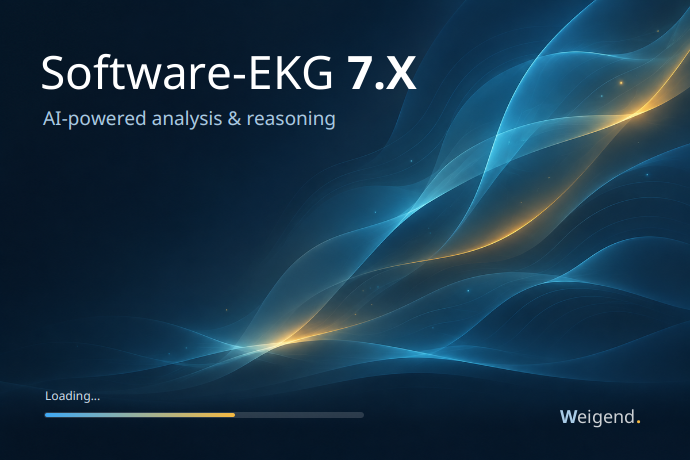
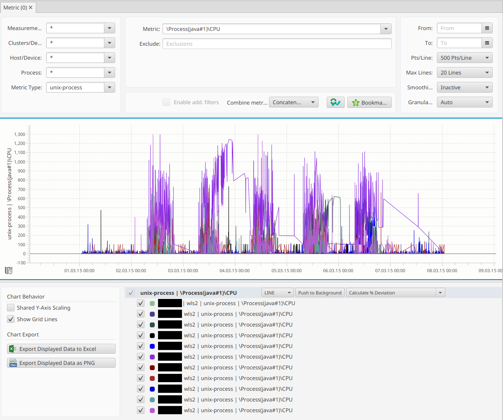
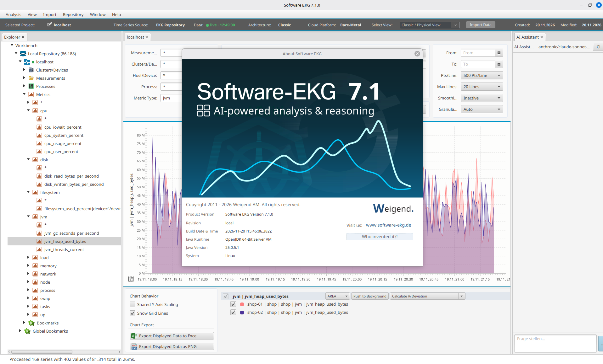

<p align="center">
  
</p>

<p align="center"><b>English</b> | <a href="README.de.md">Deutsch</a></p>

# Software-EKG

[](https://github.com/Weigend/Software-EKG/actions/workflows/build.yml)
[](https://github.com/Weigend/Software-EKG/releases/latest)
[](LICENSE)

> With Software-EKG, an analyst looks for the needle in the haystack.

Software-EKG is a workbench for the comparative analysis of software systems. The name is meant literally: EKG is the German abbreviation for an electrocardiogram (ECG). Just as an ECG records the signals of the heart over time, Software-EKG records selected measurements of the systems, servers and applications that together form an application cluster, a distributed system or a group of servers. Put the curves on top of each other and you see which component falls out of rhythm, and when.

It is an expert instrument for the *software emergency doctor*: a diagnostic recorder configured
for one concrete investigation. The analyst starts with a broad view, compares many systems and
then records more specific metrics or narrows the time, systems and processes until the relevant
difference becomes visible. It is not a permanently prescribed monitoring catalogue; what matters
enough to record depends on the case.



The picture shows the CPU load of the same Java process on eleven nodes of a cluster over one week. You can see that the application is only used during the day from Monday to Friday, and that one server stays well above the others all week. The picture does not say why. It does give the three facts that matter: which server, which period, and what to compare it with. In the end the cause was faulty load balancing in the client; the whole case is described in [docs/positioning.md](docs/positioning.md#an-example).

## The questions it is about

The core is comparison. The analyst finds patterns they were not looking for, and many of them lie within every threshold that would trigger an alert:

- Why does the heap grow steadily on three out of fifty systems?
- Why does a load pattern occur every fourteen days?
- Why did the behaviour change after a particular release?
- Why do two systems that should be identical show different curves?

## Who it is for

Software-EKG is an expert tool for the software emergency doctor, the performance engineer or the troubleshooter: for someone who needs to understand quickly what is running where and which problems the systems have.

Alongside existing monitoring and alerting solutions, it is often the entry point for understanding production problems caused by complex distributed systems. It gives the analyst an environment for collecting and evaluating the relevant data from the affected systems, forming hypotheses and seeing differences over time. If necessary, it scales to billions of data points.

It is the first step of a root cause analysis, not the end of it: Software-EKG shows since when, where and compared with what something is conspicuous.

## How you work with it



1. **Collect.** The workbench imports time series from Prometheus. The collector supplies further sources, such as system metrics and logs via SSH, JMX, Jolokia and Windows performance counters. The data is stored locally in the embedded Solr; the analysis runs on your own machine, not on the production systems.
2. **Compare.** The analyst puts many time series into one picture, using wildcards on cluster, host, process and metric, changes the time window and adds further systems. Often there is no clear question at the start; it emerges while comparing.
3. **Record.** Conspicuous places are saved as bookmarks and exported as PNG or Excel.
4. **Verify.** The built-in AI Assistant helps to check a hypothesis against the raw data, see [The role of AI](#the-role-of-ai).
5. **Go deeper.** Based on this, you decide what exactly to investigate further. Memory profilers, CPU profilers, network tracing tools or other visualisations are then used specifically for the components that already stood out in the metric analysis.

A bookmark deliberately records the useful view rather than trying to become a case-management or
document-authoring system. The final finding normally belongs in a presentation, incident report or
customer document. The picture of the bookmarked chart and its exported data provide the evidence;
an AI can help turn those artefacts into the document without making the recorder itself a
presentation tool.

The complete English user and extension documentation is available in the
[Software-EKG Handbook](docs/handbook/README.md).

## The role of AI

AI comes into play in two places:

1. **During the analysis.** The workbench supports the analysis of time series directly with AI. The built-in AI Assistant has access to all collected data: it sees the current chart section, knows the metrics and queries time series itself. If needed, it accesses the systems themselves via SSH, for example to look at logs or processes; it runs each command only after the analyst has approved it. The assistant talks to an OpenAI-compatible endpoint. At present this is OpenRouter with a Claude model, and the API key is read from the environment variable `OPENROUTER_API_KEY`; the model cannot be chosen in the application yet.
2. **When extending the tool.** A collector source is a small plugin: the bundled mock source consists of one class with about 90 lines and a ServiceLoader entry. A coding agent writes such a source for a proprietary metrics interface in minutes. This way the tool can be extended until it displays the metrics of any interface, see [Extensions](#extensions).

## What it is not

- **Not a replacement for central monitoring.** Dashboards and alerts on the running system remain the job of tools such as Grafana. The workbench has a live display, but it mainly confirms that data is arriving.
- **Not an anomaly detector.** The patterns are found by a human, by comparison.
- **Not a tool that promises the cause.** The picture leads to the right server and to the right question. The answer is often not in any time series; it takes knowledge of the architecture.

## Try it

Ready-made packages for Linux x64, macOS (Apple Silicon) and Windows x64, each with its own Java runtime, are available on the [release page](https://github.com/Weigend/Software-EKG/releases/latest). Unpack and start:

| | Linux, macOS | Windows |
| --- | --- | --- |
| Workbench | `bin/software-ekg.sh` | `bin\software-ekg.bat` |
| Collector with sample values | `./ekg-collector.sh` | `ekg-collector.cmd` |

On Linux and macOS the start scripts check what they need and say what is missing: Java 25, JavaFX, and for the workbench on Linux a desktop session and GTK 3. `bin/software-ekg.sh --check` and `./ekg-collector.sh --check` run only these checks.

The packages are not signed. macOS quarantines what a browser downloads and then refuses to start the Java runtime in the ZIP; `xattr -dr com.apple.quarantine <unpacked directory>` lifts that.

For other platforms, such as macOS on Intel, build from source, see [Distributions](#distributions).

## Structure

This repository is the consolidated variant of AWB, AWB-SDK and Collector. There are no gitlinks or separately versioned EKG subprojects any more. Implementation details of the workbench are Java packages instead of Maven artifacts; real runtime and extension boundaries of the collector remain modules.

| Directory | Purpose |
| --- | --- |
| `workbench` | One JavaFX application with UI, chart engine, importers, local storage and embedded collector |
| `collector` | The collector as a product of its own, with its own `pom.xml`: modules, shared build configuration and distribution |
| `collector/core` | Configuration, collector engine, SSH, storage and source contracts |
| `collector/sources/*` | Data sources loaded via ServiceLoader, such as Prometheus, Unix, Windows, JMX and logs |
| `collector/repositories/*` | CSV, Solr and Elasticsearch storage adapters including compression |
| `collector/apps/cli` | Standalone collector and its distribution; headless unless its display is switched on |
| `collector/apps/ui` | Display of the collector for a small touch screen: jobs, their state and values; off unless switched on (`--ui`) |
| `collector/apps/jolokia-agent` | Jolokia agent as a WAR |

The historical mapping and the parts that were deliberately removed are documented in [docs/architecture/single-repository.md](docs/architecture/single-repository.md).

The components and their structure are described, with pictures, for the [Workbench](docs/architecture/workbench-components.md) and for the [Collector](docs/architecture/collector-components.md).

## Prerequisites

- JDK 25 with JavaFX 25 (for example Liberica Full JDK)
- Maven 3.9 or newer
- a display for JavaFX tests; in headless Linux environments `xvfb-run` works
- WFX 1.4.2 in the local Maven repository

WFX is an independent UI framework and remains a normal external dependency. The matching version is installed once:

```bash
./install-wfx.sh
```

## Build and test

```bash
# complete build
mvn clean package

# complete test run on Linux
xvfb-run -a mvn test

# fast build without tests
mvn clean package -DskipTests

# only the collector, or only the workbench with the modules of the collector it contains
mvn -f collector clean package
mvn -pl workbench -am clean package
```

`.mvn/jvm.config` passes two JVM options to Maven so that Java 25 does not warn on every call
about libraries that Maven itself ships (jansi, guava).

The core tests open local SSH ports. In restricted CI steps they can be run separately:

```bash
mvn test -Dskip.core.tests=true
mvn -pl collector/core test
```

### End-to-end tests

`mvn test` does not start the workbench. The end-to-end tests do: they start the whole
application with a data directory of its own, choose every importer in the menu **Import**, fill
in its dialog, import small files that lie with the tests (and the series of a Prometheus server
that is part of the test), and then ask the repository what arrived. They also check the order
of the menu and the layout in a window of 1600 pixels.

```bash
./run-e2e-tests.sh              # on a virtual display (xvfb-run), where there is one
./run-e2e-tests.sh --show       # on the display of the session, to watch
mvn -pl workbench -am test -Pe2e -Dskip.core.tests=true   # what the script calls
```

The tests are the classes `*E2ETest` in `workbench/src/test/java/io/softwareecg/awb/e2e`. The
classes beside them operate the workbench: `Workbench` starts it and finds menus and controls
by their text and id, `ImportDialog` fills in the dialog of an importer, `ImportedProject` asks
the repository. The pictures the tests take of the dialogs are in
`workbench/target/e2e/screenshots`.

## Run

From the source tree, each with a preceding build (without tests):

```bash
./run-workbench.sh                  # workbench
./run-collector.sh                  # collector with sample values (source "mock")
./run-collector.sh my.yaml          # collector with your own configuration
```

With `--no-build` as the first argument, both start whatever was built last. The scripts use the
start scripts of the distributions, so there is only one way in which the programs are started.

## Distributions

```bash
mvn package -DskipTests           # runnable directories
mvn package -DskipTests -Pdist    # additionally with their own Java runtime and as a ZIP
```

| | Directory | ZIP (`-Pdist`) | Start |
| --- | --- | --- | --- |
| Workbench | `workbench/target/software-ekg-workbench-<version>/` | `workbench/target/software-ekg-workbench-<version>.zip` | `bin/software-ekg.sh`, `bin\software-ekg.bat` |
| Collector | `collector/apps/cli/product/software-ekg-collector-<version>/` | `collector/apps/cli/product/software-ekg-collector-<version>.zip` | `ekg-collector.sh`, `ekg-collector.cmd`; as a service `ekg-collector start\|stop\|status` |

Without `-Pdist` the distributions need an installed Java 25 (the workbench one with JavaFX). With
`-Pdist`, `jlink` cuts the runtime out of the JDK used for the build; the ZIP then matches the
operating system of the build and needs no installed Java. For the workbench this JDK must
contain JavaFX (Liberica Full JDK).

The packages of a release are built by the workflow [Release](.github/workflows/release.yml) for Linux x64, macOS (Apple Silicon) and Windows x64: it runs when a tag `v<version>` is pushed, starts workbench and collector from each ZIP on its platform and attaches the ZIPs to a draft release.

The version is defined in exactly one place, `revision` in the root `pom.xml`. Programs and
scripts read it from the build (`build.properties`, `version.properties`) and do not state their own.

## Collector configuration

A configuration is a YAML file with four parts: *what* is measured (`metricGroups`), *from which
processes* (`processGroups`), *on which machines* (`hostGroups`), and the `collectors` that
combine the three:

```yaml
metricGroups:
  host:
    type: unix                      # the source: top via SSH
    metrics:
      - '\CPU\us'
      - '\Load\one'

processGroups:
  system:
    - name: global
      source: '${REF:hostAddress}:22'

hostGroups:
  db:
    username: ekg
    password: '${ENV:EKG_SSH_PASSWORD}'   # passwords are never stored in the file
    hosts: [db-01, db-02]

collectors:
  - metricGroup: host
    processGroup: system
    hostGroup: db
    interval: 15s
```

All settings are explained in `config/current/config-template.yaml` in the collector
distribution; examples for each source are next to it. The file is read strictly: an unknown key
is an error with a line number, not a setting that silently has no effect.

Configurations in the XML format of earlier versions (`config.xml`, from Collector 6.1 on) are
still read and can be converted:

```bash
./ekg-collector.sh --convert config.xml      # writes config.yaml next to it
```

The workbench generates the same YAML files for its data sources (export in the "Data Sources"
dialog) and still reads older ones stored as XML.

## Workbench data

Projects, time series and credentials are stored in the user's home directory, never in the
source tree or in the distribution:

| Location | Content |
| --- | --- |
| `~/.ekg/metadata.mv.db` | Projects, repositories, bookmarks, data sources |
| `~/.ekg/solr` | Time series (embedded Solr); can be moved with `EKG_SOLR_HOME` |
| `~/.ekg/logs` | Log files when started via `software-ekg.sh` |

A `mvn clean` therefore no longer deletes any measurement data.

## Architecture rules

The workbench is one module; its layers are packages. That the package boundaries hold - no
JavaFX types in the business logic, no access from the UI to the data layer that bypasses the
business logic - is checked by `LayerArchitectureTest` (ArchUnit) on every test run.

## Extensions

A new collector source or a new repository is still a small plugin with ServiceLoader registration. A new workbench importer, by contrast, is implemented directly as a package in `workbench`. The former public SDK and its archetype have been dropped because they suggested a stable third-party API that is not needed for today's service-oriented use.

## License

Apache License 2.0, see [LICENSE](LICENSE) and [NOTICE](NOTICE).

Please do not report security vulnerabilities as a public issue. The confidential reporting
channel and the supported versions are described in [SECURITY.md](SECURITY.md). Notes for
contributors can be found in [CONTRIBUTING.md](CONTRIBUTING.md).
