# Die Komponenten des Collectors

[English](collector-components.md) | **Deutsch**

Dieses Dokument zeigt, aus welchen Komponenten der Collector besteht, was jede von ihnen tut, wie
die Plugins gefunden werden und wie alles innen aufgebaut ist. Es richtet sich an alle, die am Code
des Collectors arbeiten oder eine Quelle oder ein Repository dafür schreiben. Für die Workbench
gibt es [ein eigenes Dokument](workbench-components.de.md).

Die Bilder stammen aus [S202](https://github.com/Weigend/S202) 1.4.0, das die Abhängigkeiten aus
dem Bytecode liest. Geladen sind die JARs aller Module des Collectors zusammen. Stand:
7.5.0-SNAPSHOT, Commit `a7c64da`, 24.11.2026.

- [So sind die Bilder zu lesen](#so-sind-die-bilder-zu-lesen)
- [Module und Verträge](#module-und-verträge)
- [Level 0: alle Top-Pakete](#level-0-alle-top-pakete)
- [Wer wen braucht](#wer-wen-braucht)
- Kern: [control](#control) · [config](#config) · [dt](#dt) · [source](#source) ·
  [repository](#repository) · [memory](#memory) · [connector](#connector) · [ssh](#ssh) ·
  [common](#common)
- Quellen: [unix](#unix) · [windows](#windows) · [prometheus](#prometheus) · [log](#log) · [jmx](#jmx) ·
  [jolokia](#jolokia) · [mock](#mock) · [calc](#calc)
- Repositories: [csv und archive](#csv-und-archive) · [rdb, solr und elasticsearch](#rdb-solr-und-elasticsearch)
- Programme: [cli](#cli) · [ui](#ui) · [jolokia-agent](#jolokia-agent)
- [Was S202 meldet](#was-s202-meldet)
- [Die Bilder erneuern](#die-bilder-erneuern)

## So sind die Bilder zu lesen

| Zeichen | Bedeutung |
| --- | --- |
| gelber Kasten | ein Paket; **+** zugeklappt, **−** aufgeklappt |
| blauer Kasten mit **C** | eine Klasse, auch Record oder Enum |
| blauer Kasten mit grünem **I** | ein Interface |
| **L:n** | die Schicht innerhalb des umgebenden Pakets, 0 ist unten |

Eine Schicht benutzt nur, was unter ihr liegt. Die Ausnahme steht unter
[Was S202 meldet](#was-s202-meldet). In den Bildern der einzelnen Pakete sind zwei Ebenen
aufgeklappt. Ein Klick öffnet ein Bild in voller Größe.

## Module und Verträge

Die Workbench ist ein Modul, und ihre Komponenten sind Pakete. Beim Collector ist es anders: Seine
Grenzen sind **Maven-Module**, weil Quellen und Repositories Plugins sind, die zur Laufzeit gefunden
werden. Eine eigene Quelle oder ein eigenes Repository ist ein JAR im Verzeichnis `lib`.

| Modul | Klassen | braucht | Inhalt |
| --- | ---: | --- | --- |
| `core` | 100 | – | Engine, Konfiguration, Verträge, SSH, die Quelle `calc` |
| `sources/unix` | 31 | `core` | `top`, `iostat` und `df`, auf dieser Maschine oder per SSH |
| `sources/windows` | 5 | `core` | Windows-Leistungsindikatoren |
| `sources/prometheus` | 5 | `core` | HTTP-API eines Prometheus-Servers |
| `sources/log` | 9 | `core` | Zeilen von Logdateien, auf dieser Maschine oder per SSH |
| `sources/jmx` | 2 | `core` | JMX über RMI |
| `sources/jolokia` | 4 | `core` | JMX über HTTP, zwei Quellen |
| `sources/mock` | 1 | `core` | erzeugte Werte |
| `repositories/csv` | 9 | `core` | CSV-Dateien und ein Archiv daraus |
| `repositories/rdb` | 34 | `core` | was Solr und Elasticsearch gemeinsam haben |
| `repositories/solr` | 10 | `core`, `rdb` | Solr |
| `repositories/elasticsearch` | 11 | `core`, `rdb` | Elasticsearch |
| `apps/ui` | 6 | `core` | die Anzeige auf einem kleinen Touchscreen |
| `apps/cli` | – | alle oben | die Distribution; keine eigenen Klassen |
| `apps/jolokia-agent` | 6 | – | ein Jolokia-Agent als WAR, unabhängig vom Rest |

„Klassen“ sind die Quelldateien ohne Tests. Die Quellen kennen einander nicht, `solr` und
`elasticsearch` auch nicht: Ihre Module hängen nicht voneinander ab, dafür sorgt der Compiler.

Fünf Verträge in `core` werden mit `ServiceLoader` gefunden, eingetragen in `META-INF/services`:

| Vertrag | Implementiert von |
| --- | --- |
| `source.CounterSource` | jeder Quelle |
| `repository.RepositoryFactory` | `csv`, `archive`, `solr`, `elasticsearch` |
| `control.CollectorFrontend` | `ui` |
| `connector.ICollectorConnector` | `connector.nop`, der nichts tut |
| `ssh.ConnectionFactory` | `ssh.impl` |

Die Workbench enthält `core` und die Quellen `prometheus`, `unix` und `windows`, ohne die
JavaScript-Engine, die `calc` braucht. Sie schreibt, was diese sammeln, in das Repository eines
Projekts.

## Level 0: alle Top-Pakete

[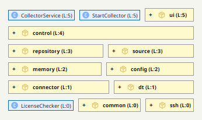](../images/collector-components/level0.png)

Die Pakete unter `io.softwareecg.collector`, über alle Module:

| Schicht | Pakete | Was dort geschieht |
| --- | --- | --- |
| 5 | [ui](#ui), `StartCollector`, `CollectorService` | die Anzeige; der Start als Programm und als Windows-Dienst |
| 4 | [control](#control) | lässt die Jobs laufen |
| 3 | [source](#source), [repository](#repository) | woher Werte kommen und wohin sie gehen |
| 2 | [config](#config), [memory](#memory) | die Konfiguration; die zuletzt gelesenen Werte |
| 1 | [dt](#dt), [connector](#connector) | woraus ein Job besteht; Werte nach außen geben |
| 0 | [common](#common), [ssh](#ssh), `LicenseChecker` | Grundlagen, die nichts anderes brauchen |

`source` und `repository` enthalten die Verträge aus `core` und in ihren Unterpaketen die Plugins
aus den anderen Modulen.

## Wer wen braucht

Aus dem Bytecode aller Module:

| Paket | Modul | braucht | wird gebraucht von |
| --- | --- | --- | --- |
| control | core | source, repository, config, connector, memory, dt, common | ui, den zwei Startklassen |
| config | core | dt | control, dt, repository, ui und allen Quellen und Repositories außer `rdb.api` |
| dt | core | config, common | config, control, memory, source, repository, allen Quellen, `csv`, `archive`, `rdb.api` |
| source (Verträge) | core | config, dt, common | control, allen Quellen |
| repository (Verträge) | core | config, dt | control, allen Repositories |
| memory | core | dt | control, calc |
| connector | core | common | control |
| ssh | core | – | unix, log |
| common | core | – | den meisten |
| unix | sources/unix | source, config, dt, ssh, common | – |
| wincount | sources/windows | source, config, dt, common | – |
| prometheus | sources/prometheus | source, config, dt | – |
| log | sources/log | source, config, dt, ssh | – |
| jmx | sources/jmx | source, config, dt, common | – |
| jolokia, ekgjolokia | sources/jolokia | source, config, dt, common | – |
| mock | sources/mock | source, config, dt | – |
| calc | core | source, config, dt, memory, common | – |
| csv | repositories/csv | repository, config, dt, common | archive |
| archive | repositories/csv | csv, repository, config, dt, common | – |
| rdb.api | repositories/rdb | repository, dt, common | rdb.solr, rdb.elasticsearch |
| rdb.solr | repositories/solr | rdb.api, repository, config, common | – |
| rdb.elasticsearch | repositories/elasticsearch | rdb.api, repository, config, common | – |
| ui | apps/ui | control, config, common | – |

Ein Plugin braucht niemand: control kennt nur die Verträge.

---

## control

**Kern.** Lässt den Collector laufen: ein Job und ein Thread für jede Kombination aus Host, Prozess und
Metrikgruppe.

[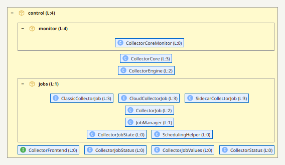](../images/collector-components/control.png)

| Teil | Inhalt |
| --- | --- |
| (direkt) | `CollectorCore` ist der eigenständige Collector, `CollectorEngine` lässt sich starten und stoppen und wird von der Workbench benutzt; Status und Werte für alle, die zusehen; `CollectorFrontend` ist der Vertrag einer Anzeige |
| `jobs` | die Jobs für einzelne Hosts, für eine Cloud-Plattform und neben einem Programm (Sidecar) und ihr Zustand |
| `monitor` | startet und stoppt einen Collector aus einem eigenen Thread |

## config

**Kern.** Liest und schreibt die Konfiguration, YAML oder das XML früherer Versionen, und multipliziert sie
zu Jobs aus.

[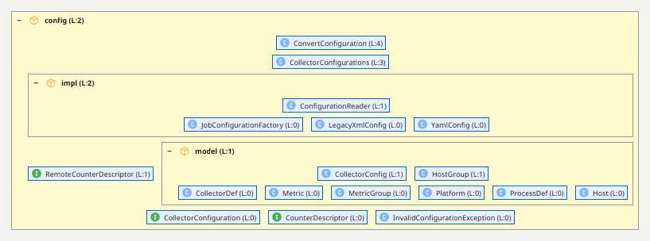](../images/collector-components/config.png)

| Teil | Inhalt |
| --- | --- |
| (direkt) | `CollectorConfigurations` ist der Einstieg: aus einer Datei, einem Text oder einem Modell; `ConvertConfiguration` macht YAML aus XML; `CounterDescriptor` ist, wie eine Quelle ihren Job sieht |
| `impl` | die zwei Formate und die Fabrik der Jobs |
| `model` | die Konfiguration ohne Format; die Workbench baut sie direkt |

## dt

**Kern.** Die Datentypen: woraus ein Job besteht, zum Beispiel Hosts, Pods, Prozesse und Metriken, und der
Kopf einer Zeitreihe. `dt` und `config` brauchen sich gegenseitig, siehe
[Was S202 meldet](#was-s202-meldet).

[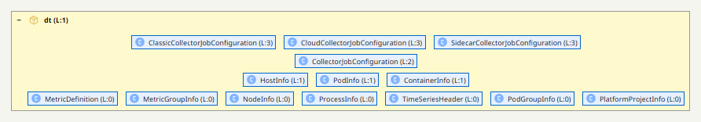](../images/collector-components/dt.png)

## source

**Kern.** Der Vertrag einer Quelle, `CounterSource`, was eine Quelle zusätzlich können kann und wie sie
gefunden wird. In den Unterpaketen stehen die Plugins; sie sind weiter unten beschrieben.

Level 1:

[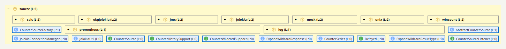](../images/collector-components/source-level1.png)

Level 2:

[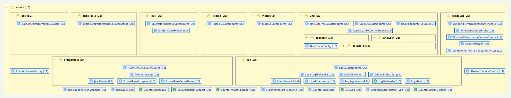](../images/collector-components/source.png)

| Teil | Inhalt |
| --- | --- |
| `CounterSource`, `AbstractCounterSource` | der Vertrag und eine Basis dafür |
| `CounterWildcardSupport` | eine Quelle, die Platzhalter auflösen kann |
| `CounterHistorySupport` | eine Quelle, die vergangene Werte liefern kann |
| `Delayed` | eine Quelle, die nach den anderen an der Reihe ist |
| `CounterSourceFactory` | findet die Quellen |

`JolokiaConnectionManager` und `JolokiaUtil` stehen in diesem Paket, kommen aber aus dem Modul
`sources/jolokia`.

## repository

**Kern.** Der Vertrag eines Speichers: `RepositoryFactory` erzeugt ein `StaticTimeSeriesRepository` für die
Serien eines Jobs. In den Unterpaketen stehen die Plugins; sie sind weiter unten beschrieben.

[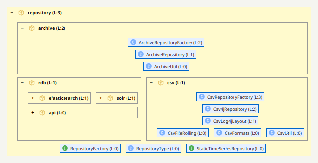](../images/collector-components/repository.png)

## memory

**Kern.** Die zuletzt gelesenen Werte, für [calc](#calc).

[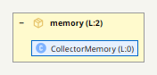](../images/collector-components/memory.png)

## connector

**Kern.** Der Vertrag, um Werte an andere Programme zu geben. Die Distribution hat nur einen, der nichts tut
(`nop`).

[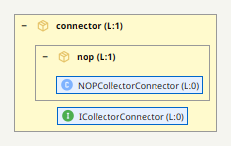](../images/collector-components/connector.png)

## ssh

**Kern.** SSH-Verbindungen, Sitzungen und Portweiterleitung hinter Interfaces; `impl` ist die
Implementierung. Benutzt von [unix](#unix) und [log](#log).

[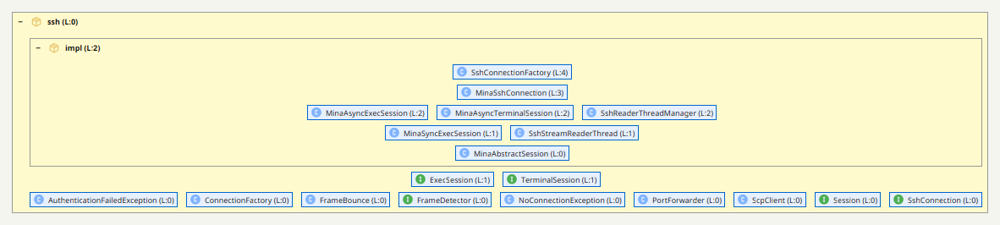](../images/collector-components/ssh.png)

## common

**Kern.** Hilfen ohne eigenes Thema: Properties, Logging, Konsole, die Registry, die die Plugins findet.

[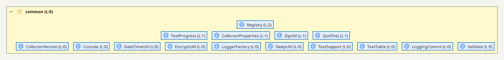](../images/collector-components/common.png)

---

## unix

**Quelle** `unix` (`top`), `unixio` (`iostat`) und `unixdf` (`df`). Modul `sources/unix`.

[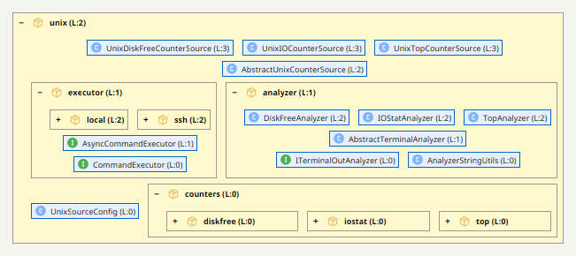](../images/collector-components/source-unix.png)

| Teil | Inhalt |
| --- | --- |
| (direkt) | die drei Quellen und ihre Einstellungen |
| `executor` | führt ein Kommando aus: auf dieser Maschine oder per SSH |
| `analyzer` | liest die Ausgabe der Kommandos |
| `counters` | die Zähler, die die Kommandos kennen |

## windows

**Quelle** `win`: Windows-Leistungsindikatoren über eine native Bibliothek. Modul `sources/windows`, Paket
`source.wincount`.

[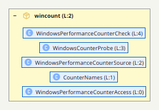](../images/collector-components/source-wincount.png)

## prometheus

**Quelle** `prometheus`: fragt einen Prometheus-Server ab, mit Platzhaltern und mit Vergangenheit. Modul
`sources/prometheus`.

[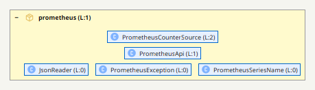](../images/collector-components/source-prometheus.png)

## log

**Quelle** `log`: verfolgt Logdateien und macht aus ihren Zeilen Werte. Modul `sources/log`.

[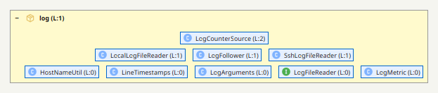](../images/collector-components/source-log.png)

## jmx

**Quelle** `jmx`: MBeans über RMI. Modul `sources/jmx`.

[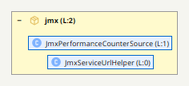](../images/collector-components/source-jmx.png)

## jolokia

**Quelle** `jolokia`: MBeans über HTTP, und `ekgjolokia` für einen älteren Endpunkt. Modul
`sources/jolokia`.

[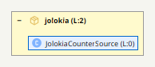](../images/collector-components/source-jolokia.png)

[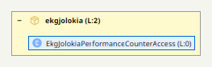](../images/collector-components/source-ekgjolokia.png)

## mock

**Quelle** `mock`: erzeugte Werte, um einen Collector auszuprobieren. Modul `sources/mock`.

[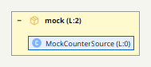](../images/collector-components/source-mock.png)

## calc

**Quelle** `calc`: berechnet mit JavaScript Werte aus anderen. In `core`; ihre Engine wird erst gestartet,
wenn eine solche Metrik abgefragt wird.

[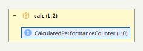](../images/collector-components/source-calc.png)

---

## csv und archive

**Repository.** CSV-Dateien, die die Workbench importiert; `archive` packt sie. Modul `repositories/csv`.

[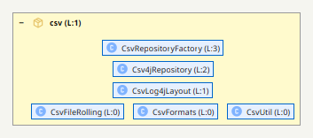](../images/collector-components/repository-csv.png)

[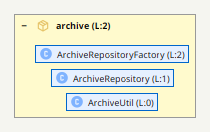](../images/collector-components/repository-archive.png)

## rdb, solr und elasticsearch

**Repository.** Server, die die Workbench direkt abfragt. Module `repositories/rdb`, `repositories/solr` und
`repositories/elasticsearch`.

[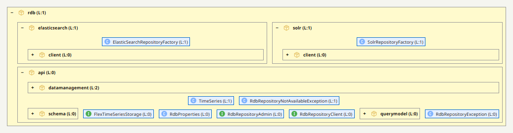](../images/collector-components/repository-rdb.png)

| Teil | Inhalt |
| --- | --- |
| `rdb.api` | was beide gemeinsam haben: Client, Schema, Abfragemodell, Verdichten |
| `rdb.solr` | Fabrik und Client für Solr |
| `rdb.elasticsearch` | Fabrik und Client für Elasticsearch |

---

## cli

**Programm.** Die Distribution des eigenständigen Collectors: Skripte, Beispielkonfiguration und die JARs
aller Module. Sie hat keine eigenen Klassen; die Startklassen liegen in `core`. Hier sind auch die
Integrationstests, die prüfen, dass die Plugins gefunden werden.

## ui

**Programm.** Die Anzeige auf einem kleinen Touchscreen, als Plugin von [control](#control): aus, solange
nicht eingeschaltet. Sie sieht den Collector über den Status und ändert nichts.

[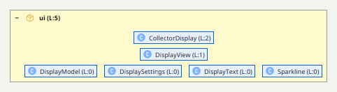](../images/collector-components/ui.png)

## jolokia-agent

**Programm.** Ein Jolokia-Agent als WAR, mit Filtern. Er liegt in den Paketen von Jolokia (`org.jolokia`),
braucht nichts vom Collector und ist deshalb nicht in den Bildern.

---

## Was S202 meldet

Bericht vom 24.11.2026 für den oben genannten Stand:

| Prüfung | Funde |
| --- | ---: |
| Zugriffe an einer `api` vorbei | 0 |
| `api`, die Inneres nach außen gibt | 0 |
| Paketzyklen | 1 |
| Klassenzyklen, beide innerhalb eines Pakets | 2 |
| Abhängigkeiten gegen die Schichten | 5 |

- **`config` und `dt` brauchen sich gegenseitig.** Die Jobs in `dt` implementieren `CounterDescriptor` und
  `RemoteCounterDescriptor` aus `config` und werfen dessen `InvalidConfigurationException`; `config`
  erzeugt sie. Vier der fünf Abhängigkeiten gegen die Schichten sind dieser Zyklus.
- **`JobManager` und `CollectorJob`** in `control.jobs` kennen sich gegenseitig, das ist die fünfte.
- **`CollectorConfig` und `HostGroup`** in `config.model` kennen sich gegenseitig.

Anders als bei der Workbench wacht kein Test über die Pakete des Collectors. Zwischen den Modulen tut
es der Compiler; innerhalb von `core` tut es nichts, und dort liegt auch der Paketzyklus.

## Die Bilder erneuern

1. Die JARs bauen: `mvn -o clean package -DskipTests`
2. Diese JARs zusammen in S202 öffnen: `core`, `apps/ui` und alle unter `sources` und `repositories`,
   jeweils `target/*-SNAPSHOT.jar` ohne `-sources` und `-tests`.
3. **Depth** auf 0 setzen, **Refresh**, dann **File → Export Image…** (Strg+E): `level0.png`.
4. Für jedes Paket im Outline Explorer **Open Scope**, **Depth** auf 2, **Refresh** und exportieren:
   `<paket>.png`. Ist das Bild breiter als 1400 Pixel, zusätzlich mit **Depth** 1:
   `<paket>-level1.png`.
5. Die Bilder liegen in `docs/images/collector-components`. Beschnitten ist nur der graue Rand.
