# The components of the Collector

**English** | [Deutsch](collector-components.de.md)

This document shows which components the Collector consists of, what each of them does, how the
plugins are found and how everything is built inside. It is meant for everybody who works on the
code of the Collector or writes a source or a repository for it. For the Workbench there is
[a document of its own](workbench-components.md).

The pictures are from [S202](https://github.com/Weigend/S202) 1.4.0, which reads the dependencies
from the bytecode. Loaded are the JARs of all modules of the Collector together. State:
7.6.0-SNAPSHOT, commit `f5d7178`, 2026-11-24.

- [How to read the pictures](#how-to-read-the-pictures)
- [Modules and contracts](#modules-and-contracts)
- [The rules](#the-rules)
- [Level 0: all top packages](#level-0-all-top-packages)
- [Who needs whom](#who-needs-whom)
- Core: [control](#control) · [config](#config) · [dt](#dt) · [source](#source) ·
  [repository](#repository) · [memory](#memory) · [connector](#connector) · [ssh](#ssh) ·
  [common](#common)
- Sources: [unix](#unix) · [windows](#windows) · [prometheus](#prometheus) · [log](#log) · [jmx](#jmx) ·
  [jolokia](#jolokia) · [mock](#mock) · [calc](#calc)
- Repositories: [csv and archive](#csv-and-archive) · [rdb, solr and elasticsearch](#rdb-solr-and-elasticsearch)
- Programs: [cli](#cli) · [ui](#ui) · [jolokia-agent](#jolokia-agent)
- [What S202 reports](#what-s202-reports)
- [Renewing the pictures](#renewing-the-pictures)

## How to read the pictures

| Sign | Meaning |
| --- | --- |
| yellow box | a package; **+** collapsed, **−** expanded |
| blue box with **C** | a class, also a record or an enum |
| blue box with a green **I** | an interface |
| **L:n** | the layer inside the surrounding package, 0 is at the bottom |

A layer only uses what is below it. The pictures of the single packages have two levels expanded. A click opens a picture in full size.

## Modules and contracts

The Workbench is one module, and its components are packages. The Collector is different: its
boundaries are **Maven modules**, because sources and repositories are plugins which are found at
runtime. A source or repository of one's own is a JAR in the `lib` directory.

`collector/pom.xml` lists the modules and holds what their builds have in common. With it the
Collector is built on its own: `mvn -f collector package`, with `-Pdist` also its Java runtime and the
ZIP.

| Module | Classes | needs | Content |
| --- | ---: | --- | --- |
| `core` | 100 | – | engine, configuration, contracts, SSH, the source `calc` |
| `sources/unix` | 31 | `core` | `top`, `iostat` and `df`, on this machine or by SSH |
| `sources/windows` | 5 | `core` | Windows performance counters |
| `sources/prometheus` | 5 | `core` | HTTP API of a Prometheus server |
| `sources/log` | 9 | `core` | lines of log files, on this machine or by SSH |
| `sources/jmx` | 2 | `core` | JMX over RMI |
| `sources/jolokia` | 4 | `core` | JMX over HTTP, two sources |
| `sources/mock` | 1 | `core` | generated values |
| `repositories/csv` | 9 | `core` | CSV files, and an archive of them |
| `repositories/rdb` | 34 | `core` | what Solr and Elasticsearch have in common |
| `repositories/solr` | 10 | `core`, `rdb` | Solr |
| `repositories/elasticsearch` | 11 | `core`, `rdb` | Elasticsearch |
| `apps/ui` | 6 | `core` | the display on a small touch screen |
| `apps/cli` | – | all above | the distribution; no classes of its own |
| `apps/jolokia-agent` | 6 | – | a Jolokia agent as a WAR, independent of the rest |

"Classes" are the source files without tests. The sources do not know each other, and neither do
`solr` and `elasticsearch`: their modules do not depend on each other, so the compiler makes sure.

Five contracts in `core` are found with `ServiceLoader`, registered in `META-INF/services`:

| Contract | Implemented by |
| --- | --- |
| `source.CounterSource` | every source |
| `repository.RepositoryFactory` | `csv`, `archive`, `solr`, `elasticsearch` |
| `control.CollectorFrontend` | `ui` |
| `connector.ICollectorConnector` | `connector.nop`, which does nothing |
| `ssh.ConnectionFactory` | `ssh.impl` |

The Workbench contains `core` and the sources `prometheus`, `unix` and `windows`, without the
JavaScript engine `calc` needs. It writes what they collect into the repository of a project.

## The rules

Between the modules the compiler keeps the parts apart. `CollectorArchitectureTest` in `apps/cli`, where
all modules come together, does it for the packages, with every build:

| Rule | Reason |
| --- | --- |
| No package has a cycle of its parts, on any level | packages that need each other are in truth one |
| Nobody needs a plugin | a source, a repository or the display can be added and removed |
| Sources do not know each other, nor do repositories | the same; `archive` is made of CSV files, Solr and Elasticsearch share `rdb.api` |
| A source knows neither engine nor storage, a repository neither engine nor sources | a source only reads, a repository only writes |
| `dt`, `common` and `ssh` need nothing else | they are the foundations |
| `config.impl`, `control.jobs`, `control.monitor`, `connector.nop` and `ssh.impl` are used by their own part only | they are inside |
| Every plugin is registered | one that is not is not found, and nothing says so |

## Level 0: all top packages

[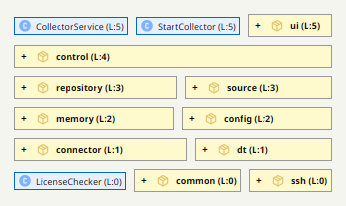](../images/collector-components/level0.png)

The packages below `io.softwareecg.collector`, over all modules:

| Layer | Packages | What happens there |
| --- | --- | --- |
| 4 | [ui](#ui), `StartCollector`, `CollectorService` | the display; the start as a program and as a Windows service |
| 3 | [control](#control) | runs the jobs |
| 2 | [source](#source), [repository](#repository) | where values come from and where they go |
| 1 | [config](#config), [memory](#memory), [connector](#connector) | the configuration and its jobs; the values read last; serving values to others |
| 0 | [dt](#dt), [common](#common), [ssh](#ssh), `LicenseChecker` | foundations that need nothing else |

`source` and `repository` hold the contracts of `core` and, in their sub-packages, the plugins of
the other modules.

## Who needs whom

From the bytecode of all modules:

| Package | Module | needs | is needed by |
| --- | --- | --- | --- |
| control | core | source, repository, config, connector, memory, dt, common | ui, the two start classes |
| config | core | dt, common | control, source, repository, ui and all sources and repositories but `rdb.api` |
| dt | core | – | config, control, memory, source, repository, all sources, `csv`, `archive`, `rdb.api` |
| source (contracts) | core | config, dt, common | control, all sources |
| repository (contracts) | core | config, dt | control, all repositories |
| memory | core | dt | control, calc |
| connector | core | common | control |
| ssh | core | – | unix, log |
| common | core | – | most |
| unix | sources/unix | source, config, dt, ssh, common | – |
| wincount | sources/windows | source, config, dt, common | – |
| prometheus | sources/prometheus | source, config, dt | – |
| log | sources/log | source, config, dt, ssh | – |
| jmx | sources/jmx | source, config, dt, common | – |
| jolokia, ekgjolokia | sources/jolokia | source, config, dt, common | – |
| mock | sources/mock | source, config, dt | – |
| calc | core | source, config, dt, memory, common | – |
| csv | repositories/csv | repository, config, dt, common | archive |
| archive | repositories/csv | csv, repository, config, dt, common | – |
| rdb.api | repositories/rdb | repository, dt, common | rdb.solr, rdb.elasticsearch |
| rdb.solr | repositories/solr | rdb.api, repository, config, common | – |
| rdb.elasticsearch | repositories/elasticsearch | rdb.api, repository, config, common | – |
| ui | apps/ui | control, config, common | – |

Nobody needs a plugin: control only knows the contracts.

---

## control

**Core.** Runs the Collector: one job, and one thread, for each combination of host, process and metric
group.

[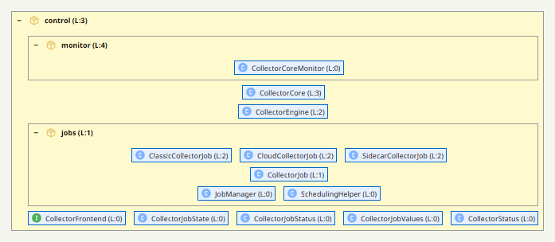](../images/collector-components/control.png)

| Part | Content |
| --- | --- |
| (direct) | `CollectorCore` is the stand-alone Collector, `CollectorEngine` can be started and stopped and is what the Workbench uses; status, state and values of the jobs for those who look; `CollectorFrontend` is the contract of a display |
| `jobs` | the jobs for single hosts, for a cloud platform and beside a program (sidecar) |
| `monitor` | starts and stops a Collector from a thread of its own |

## config

**Core.** Reads and writes the configuration, YAML or the XML of earlier versions, and multiplies it out
into jobs.

[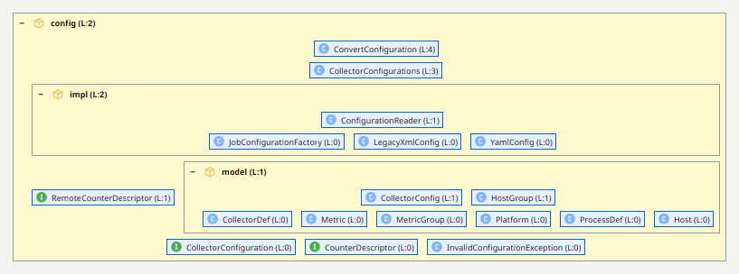](../images/collector-components/config.png)

| Part | Content |
| --- | --- |
| (direct) | `CollectorConfigurations` is the entry: from a file, a text or a model; `ConvertConfiguration` makes YAML of XML; `CounterDescriptor` is how a source sees its job; `CollectorJobConfiguration` and its three kinds are the jobs: for single hosts, for a cloud platform and beside a program (sidecar) |
| `impl` | the two formats and the factory of the jobs |
| `model` | the configuration without a format; the Workbench builds it directly |

## dt

**Core.** The data types: what a job is made of, such as hosts, pods, processes and metrics, and the head of
a time series.

[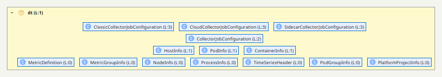](../images/collector-components/dt.png)

## source

**Core.** The contract of a source, `CounterSource`, what a source can do in addition, and how it is
found. The plugins are in the sub-packages; they are described below.

Level 1:

[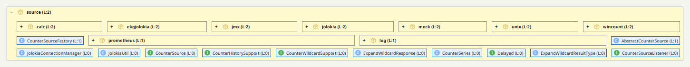](../images/collector-components/source-level1.png)

Level 2:

[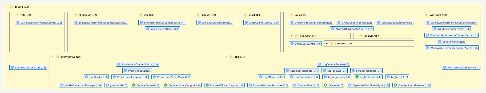](../images/collector-components/source.png)

| Part | Content |
| --- | --- |
| `CounterSource`, `AbstractCounterSource` | the contract, and a base for it |
| `CounterWildcardSupport` | a source that can expand wildcards |
| `CounterHistorySupport` | a source that can deliver values of the past |
| `Delayed` | a source that has its turn after the others |
| `CounterSourceFactory` | finds the sources |

`JolokiaConnectionManager` and `JolokiaUtil` stand in this package but come from the module
`sources/jolokia`.

## repository

**Core.** The contract of a storage: `RepositoryFactory` creates a `StaticTimeSeriesRepository` for the
series of a job. The plugins are in the sub-packages; they are described below.

[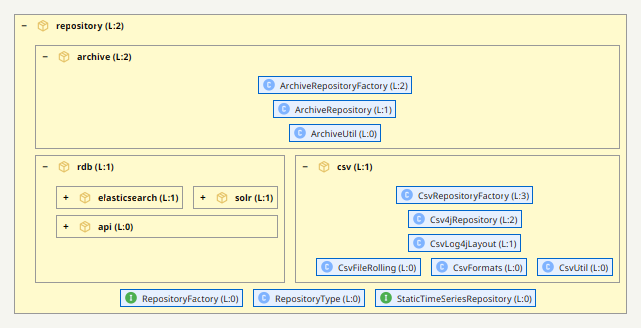](../images/collector-components/repository.png)

## memory

**Core.** The values read last, for [calc](#calc).

[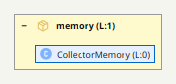](../images/collector-components/memory.png)

## connector

**Core.** The contract for serving the values to other programs. The distribution has only one that does
nothing (`nop`).

[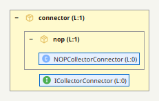](../images/collector-components/connector.png)

## ssh

**Core.** SSH connections, sessions and port forwarding behind interfaces; `impl` is the implementation. Used
by [unix](#unix) and [log](#log).

[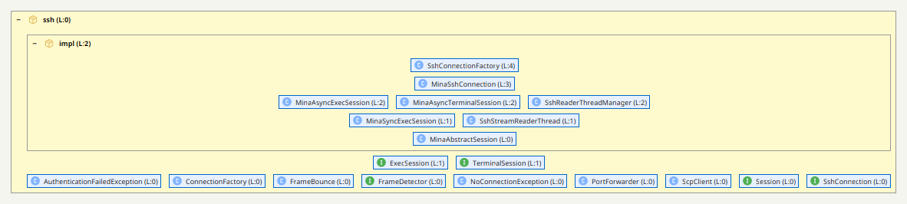](../images/collector-components/ssh.png)

## common

**Core.** Helpers without a subject of their own: properties, logging, console, the registry that finds the
plugins.

[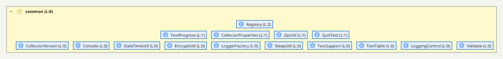](../images/collector-components/common.png)

---

## unix

**Source** `unix` (`top`), `unixio` (`iostat`) and `unixdf` (`df`). Module `sources/unix`.

[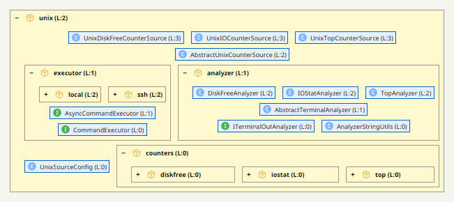](../images/collector-components/source-unix.png)

| Part | Content |
| --- | --- |
| (direct) | the three sources and their settings |
| `executor` | runs a command: on this machine or by SSH |
| `analyzer` | reads the output of the commands |
| `counters` | the counters the commands know |

## windows

**Source** `win`: Windows performance counters through a native library. Module `sources/windows`, package
`source.wincount`.

[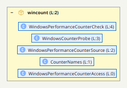](../images/collector-components/source-wincount.png)

## prometheus

**Source** `prometheus`: queries a Prometheus server, with wildcards and with history. Module
`sources/prometheus`.

[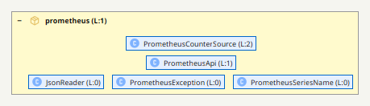](../images/collector-components/source-prometheus.png)

## log

**Source** `log`: follows log files and makes values of their lines. Module `sources/log`.

[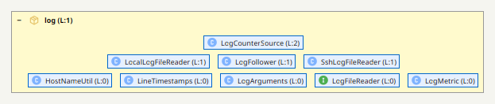](../images/collector-components/source-log.png)

## jmx

**Source** `jmx`: MBeans over RMI. Module `sources/jmx`.

[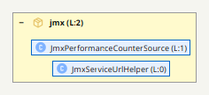](../images/collector-components/source-jmx.png)

## jolokia

**Source** `jolokia`: MBeans over HTTP, and `ekgjolokia` for an older endpoint. Module `sources/jolokia`.

[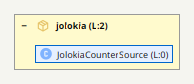](../images/collector-components/source-jolokia.png)

[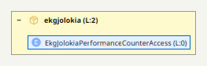](../images/collector-components/source-ekgjolokia.png)

## mock

**Source** `mock`: generated values, to try out a Collector. Module `sources/mock`.

[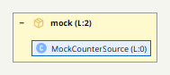](../images/collector-components/source-mock.png)

## calc

**Source** `calc`: calculates values from others with JavaScript. In `core`; its engine is only started when
such a metric is queried.

[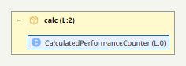](../images/collector-components/source-calc.png)

---

## csv and archive

**Repository.** CSV files, which the Workbench imports; `archive` packs them. Module `repositories/csv`.

[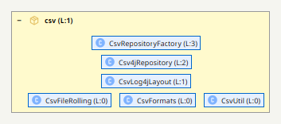](../images/collector-components/repository-csv.png)

[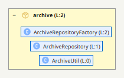](../images/collector-components/repository-archive.png)

## rdb, solr and elasticsearch

**Repository.** Servers which the Workbench queries directly. Modules `repositories/rdb`, `repositories/solr`
and `repositories/elasticsearch`.

[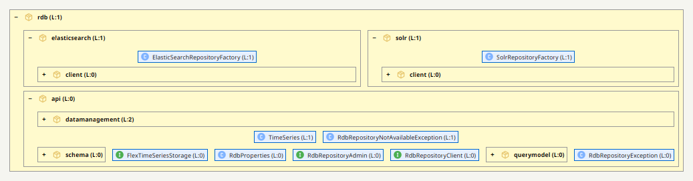](../images/collector-components/repository-rdb.png)

| Part | Content |
| --- | --- |
| `rdb.api` | what both have in common: client, schema, query model, compaction |
| `rdb.solr` | factory and client for Solr |
| `rdb.elasticsearch` | factory and client for Elasticsearch |

---

## cli

**Program.** The distribution of the stand-alone Collector: scripts, sample configuration and the JARs of all
modules. It has no classes of its own; the start classes are in `core`. It also has the integration
tests, which check that the plugins are found.

## ui

**Program.** The display on a small touch screen, as a plugin of [control](#control): off unless switched on.
It looks at the Collector through the status and does not change anything.

[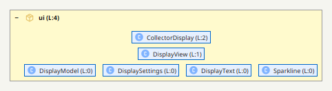](../images/collector-components/ui.png)

## jolokia-agent

**Program.** A Jolokia agent as a WAR, with filters. It lies in the packages of Jolokia (`org.jolokia`), needs
nothing of the Collector and is therefore not in the pictures.

---

## What S202 reports

Report of 2026-11-24 for the state named above:

| Check | Findings |
| --- | ---: |
| accesses past an `api` | 0 |
| `api` that gives the inside away | 0 |
| package cycles | 0 |
| class cycles, both inside one package | 2 |
| dependencies against the layers, part of a class cycle | 1 |

- **`JobManager` and `CollectorJob`** in `control.jobs` know each other, which is the dependency
  against the layers.
- **`CollectorConfig` and `HostGroup`** in `config.model` know each other.

Both class cycles are inside one package and stay.

## Renewing the pictures

1. Build the JARs: `mvn -o -f collector clean package -DskipTests`
2. Open these JARs in S202 together: `core`, `apps/ui`, and all of `sources` and `repositories`, each
   `target/*-SNAPSHOT.jar` without `-sources` and `-tests`.
3. Set **Depth** to 0, **Refresh**, then **File → Export Image…** (Ctrl+E): `level0.png`.
4. For every package **Open Scope** in the Outline Explorer, set **Depth** to 2, **Refresh** and
   export: `<package>.png`. If the picture is wider than 1400 pixels, also with **Depth** 1:
   `<package>-level1.png`.
5. The pictures are in `docs/images/collector-components`. Only the grey border is cut off.
