# Die Komponenten der Workbench

[English](workbench-components.md) | **Deutsch**

Dieses Dokument zeigt, aus welchen Komponenten die Workbench besteht, was jede von ihnen tut, was
sie nach außen gibt und wie sie innen aufgebaut ist. Es richtet sich an alle, die am Code der
Workbench arbeiten. Für den Collector gibt es [ein eigenes Dokument](collector-components.de.md).

Die Bilder stammen aus [S202](https://github.com/Weigend/S202) 1.4.0, das die Abhängigkeiten aus
dem Bytecode liest. Stand: Workbench 7.5.0-SNAPSHOT, Commit `9cc6fd5`, 24.11.2026.

- [So sind die Bilder zu lesen](#so-sind-die-bilder-zu-lesen)
- [Die Regeln](#die-regeln)
- [Level 0: alle Top-Pakete](#level-0-alle-top-pakete)
- [Wer wen braucht](#wer-wen-braucht)
- Komponenten: [aichat](#aichat) · [metricview](#metricview) · [explorer](#explorer) ·
  [datasource](#datasource) · [bookmark](#bookmark) · [importer](#importer) · [query](#query) ·
  [projectcontext](#projectcontext) · [repository](#repository) · [application](#application) ·
  [evidence](#evidence) · [secrets](#secrets) · [metadata](#metadata)
- Bibliotheken: [uitoolkit](#uitoolkit) · [timeseries](#timeseries) · [runtime](#runtime) ·
  [infrastructure](#infrastructure) – und [tools](#tools)
- [Was S202 meldet](#was-s202-meldet)
- [Die Bilder erneuern](#die-bilder-erneuern)

## So sind die Bilder zu lesen

| Zeichen | Bedeutung |
| --- | --- |
| gelber Kasten | ein Paket; **+** zugeklappt, **−** aufgeklappt |
| blauer Kasten mit **C** | eine Klasse, auch Record oder Enum |
| blauer Kasten mit grünem **I** | ein Interface |
| **L:n** | die Schicht innerhalb des umgebenden Pakets, 0 ist unten |

Eine Schicht benutzt nur, was unter ihr liegt. Was nebeneinander in derselben Schicht steht,
braucht sich gegenseitig nicht.

In den Bildern der einzelnen Komponenten sind zwei Ebenen aufgeklappt (Level 2): die Pakete der
Komponente mit ihren Klassen. Ist dieses Bild sehr breit, steht davor eines mit einer Ebene
(Level 1). Ein Klick auf ein Bild öffnet es in voller Größe.

## Die Regeln

Die Pakete direkt unter `io.softwareecg.awb` sind die Teile der Workbench.

1. **Komponenten** haben eine Außenkante. Andere benutzen nur
   - `api`: wird von anderen aufgerufen und von der eigenen Komponente implementiert,
   - `spi`: wird von anderen implementiert und deshalb auch von außen importiert.

   Alles andere ist innen. Die inneren Pakete heißen nach dem, was sie tun.
2. **Bibliotheken** (`uitoolkit`, `timeseries`, `runtime`, `infrastructure`) haben keine
   Außenkante: Alle ihre öffentlichen Klassen dürfen benutzt werden. Sie kennen keine Komponente.
3. **Zyklen** gibt es nicht, weder zwischen den Top-Paketen noch zwischen den Teilen irgendeines
   Pakets. Ein Kreis aus Klassen desselben Pakets ist erlaubt.

Das prüft jeder Build:

| Test | Was er prüft |
| --- | --- |
| `LayerArchitectureTest` | Außenkanten, Schichten und Zyklen im Code, mit ArchUnit |
| `ViewArchitectureTest` | dieselben Außenkanten in FXML und CSS; dort stehen Klassen und Dateien als Text, weder S202 noch ArchUnit sehen sie |

## Level 0: alle Top-Pakete

[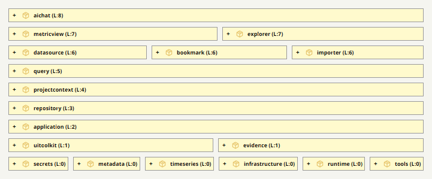](../images/components/level0.png)

Die Workbench hat 18 Top-Pakete in neun Schichten: 13 Komponenten, 4 Bibliotheken und ein
Werkzeug.

| Schicht | Pakete | Was dort geschieht |
| --- | --- | --- |
| 8 | [aichat](#aichat) | der Assistent, der die Analyse von außen benutzt |
| 7 | [metricview](#metricview), [explorer](#explorer) | Serien zeigen und finden |
| 6 | [datasource](#datasource), [bookmark](#bookmark), [importer](#importer) | Daten hereinholen, Ansichten merken |
| 5 | [query](#query) | Serien abfragen und umformen |
| 4 | [projectcontext](#projectcontext) | das Projekt, in dem untersucht wird |
| 3 | [repository](#repository) | wo die Serien gespeichert sind |
| 2 | [application](#application) | das Fenster, in das sich die Teile einhängen |
| 1 | [uitoolkit](#uitoolkit), [evidence](#evidence) | Bedienelemente; Bild und Excel |
| 0 | [secrets](#secrets), [metadata](#metadata), [timeseries](#timeseries), [infrastructure](#infrastructure), [runtime](#runtime), [tools](#tools) | Grundlagen, die nichts anderes brauchen |

So sieht dieselbe Ansicht in S202 aus. Links oben steht unter **Depth** die Ebene, bis zu der
aufgeklappt wird, hier 0:

[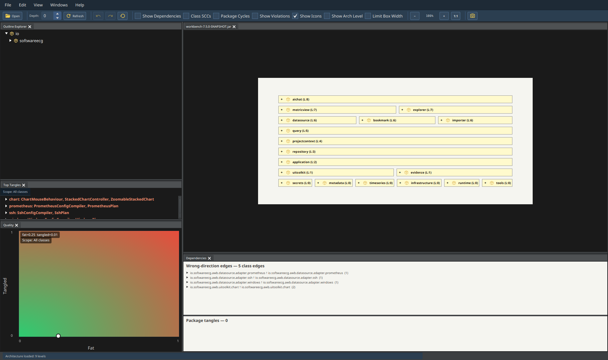](../images/components/s202-window.png)

## Wer wen braucht

Gezählt sind Abhängigkeiten zwischen Klassen im Bytecode, ohne die generierten Klassen der
Dependency Injection. „Klassen“ sind die Quelldateien.

| Paket | Klassen | braucht | wird gebraucht von |
| --- | ---: | --- | --- |
| aichat | 20 | query, metricview, timeseries, uitoolkit, runtime, infrastructure | – |
| metricview | 38 | query, bookmark, projectcontext, repository, application, evidence, uitoolkit, timeseries, runtime | aichat |
| explorer | 68 | bookmark, query, projectcontext, repository, uitoolkit, timeseries, runtime | – |
| datasource | 40 | query, projectcontext, repository, application, secrets, metadata, uitoolkit, timeseries, runtime | – |
| bookmark | 15 | query, repository, metadata, uitoolkit, runtime | explorer, metricview |
| importer | 87 | query, projectcontext, repository, timeseries, runtime | – |
| query | 33 | projectcontext, repository, uitoolkit, timeseries, runtime | aichat, metricview, explorer, datasource, bookmark, importer |
| projectcontext | 37 | repository, application, metadata, uitoolkit, timeseries, runtime | metricview, explorer, datasource, importer, query |
| repository | 118 | application, metadata, uitoolkit, timeseries, runtime | metricview, explorer, datasource, bookmark, importer, query, projectcontext |
| application | 9 | uitoolkit, runtime | metricview, datasource, projectcontext, repository |
| evidence | 8 | runtime | metricview |
| secrets | 2 | – | datasource |
| metadata | 18 | – | datasource, bookmark, projectcontext, repository |
| uitoolkit | 44 | runtime | aichat, metricview, explorer, datasource, bookmark, query, projectcontext, repository, application |
| timeseries | 19 | – | aichat, metricview, explorer, datasource, importer, query, projectcontext, repository |
| runtime | 17 | – | alle außer secrets, metadata, timeseries, infrastructure, tools |
| infrastructure | 3 | – | aichat |
| tools | 1 | – | – |

Vier Komponenten werden von niemandem benutzt: `aichat`, `explorer`, `datasource` und `importer`.
Sie haben eine Oberfläche, hören auf Ereignisse und hängen sich beim Start selbst ein. Deshalb
haben sie keine `api`.

---

## aichat

**Aufgabe:** Der Assistent. Er beantwortet Fragen zu den Daten, die die Workbench zeigt, mit Hilfe
eines Sprachmodells.

**Außenkante:** keine; niemand benutzt ihn. Was die Analyse angeht, benutzt er nur die `api` von
`query` und `metricview`.

[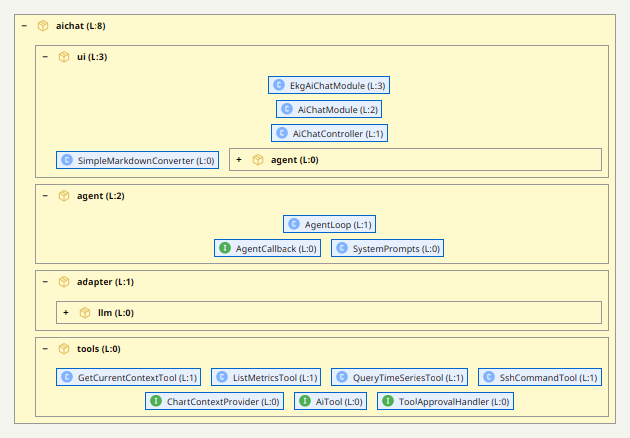](../images/components/aichat.png)

| Paket | Inhalt |
| --- | --- |
| `ui` | das Panel mit dem Gespräch und der Darstellung von Markdown |
| `agent` | die Schleife aus Frage, Werkzeugaufruf und Antwort (`AgentLoop`) |
| `adapter.llm` | der Zugang zu einem Sprachmodell mit OpenAI-kompatibler Schnittstelle |
| `tools` | was das Modell aufrufen darf: Metriken auflisten, Serien abfragen, den Kontext des Charts lesen, ein Kommando per SSH ausführen; das letzte nur, wenn der Benutzer jedes Mal zustimmt |

## metricview

**Aufgabe:** Das Chart-Panel: zeigt die Serien einer Abfrage, mit Filterkopf, Ebenen und Befehlen.

**Außenkante:** `api` mit `ChartInUse` und `ShownChart`. Darüber erfährt `aichat`, welches Chart
gerade benutzt wird und was es zeigt.

Level 1:

[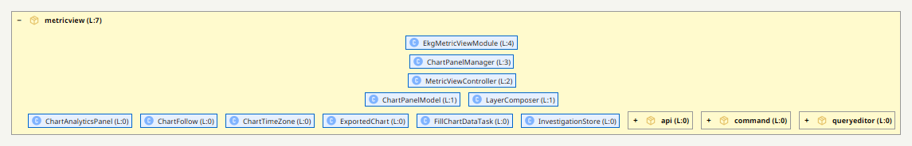](../images/components/metricview-level1.png)

Level 2:

[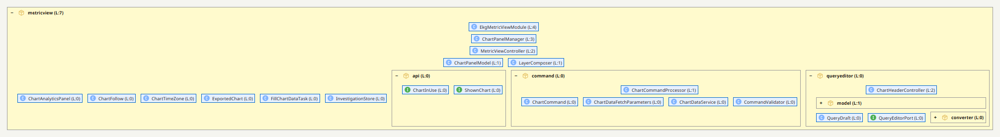](../images/components/metricview.png)

| Paket | Inhalt |
| --- | --- |
| (direkt) | `ChartPanelManager` hält die offenen Chart-Ansichten, `MetricViewController` steuert eine davon, `LayerComposer` ihre Ebenen; `ExportedChart` stellt zusammen, was ein Export braucht |
| `command` | jede Änderung an Daten, Aufbau oder Aussehen eines Charts geht durch den `ChartCommandProcessor` |
| `queryeditor` | der Filterkopf; die Ansicht spricht ihn über `QueryEditorPort` an |
| `api` | siehe Außenkante |

Das Diagramm selbst ist nicht hier, sondern in [uitoolkit](#uitoolkit) (`chart`): Es weiß nichts von
der Anwendung.

## explorer

**Aufgabe:** Der Baum links: Repositories, Projekte, Dimensionen, Metriken und Bookmarks.

**Außenkante:** keine; niemand benutzt ihn. Was er öffnet, verlangt er durch Ereignisse, zum
Beispiel `OpenInvestigationCommand` aus `query` oder `AddRepositoryRequest` aus `repository`.

[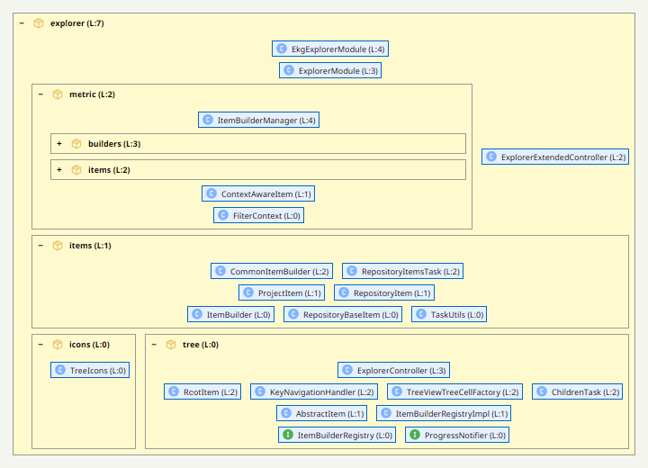](../images/components/explorer.png)

| Paket | Inhalt |
| --- | --- |
| (direkt) | das Modul, das den Baum in das Fenster hängt, und die Reaktion auf die Auswahl |
| `metric` | die Knoten unterhalb eines Projekts und wie sie entstehen: Hosts, Namespaces, Prozesse, Messungen, Metriken, Bookmarks |
| `items` | Repository und Projekt als Knoten |
| `tree` | der Baum selbst: Knoten, Nachladen im Hintergrund, Tastatur, Menüs |
| `icons` | die Symbole |

## datasource

**Aufgabe:** **Analysis → New Analysis** und **Data Sources**: richtet Datenquellen ein und lässt für
jede den eingebauten Collector laufen, der in das Repository des Projekts schreibt.

**Außenkante:** `spi` mit `AnalysisSourceProvider` und den Typen dazu, für neue Arten von
Datenquellen. `projectcontext.spi.ProjectDataCollection` implementiert die Komponente selbst;
darüber sehen andere, ob für ein Projekt gesammelt wird.

[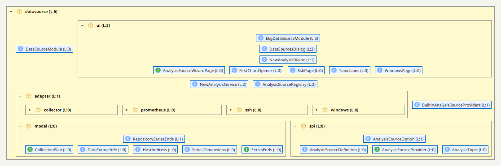](../images/components/datasource.png)

| Paket | Inhalt |
| --- | --- |
| `ui` | der Dialog für eine neue Analyse und der für die Datenquellen |
| (direkt) | `NewAnalysisService` beginnt, unterbricht und beendet das Sammeln; `AnalysisSourceRegistry` kennt die Arten von Quellen |
| `adapter` | je ein Paket für Prometheus, SSH und Windows, die einander nicht kennen, und `collector` für das, was alle Konfigurationen gemeinsam haben |
| `model` | der Plan einer Sammlung, Hosts und Dimensionen |
| `spi` | siehe Außenkante |

## bookmark

**Aufgabe:** Merkt sich Charts, für ein Projekt oder für alle.

**Außenkante:** `api` mit `MetricsBookmarkService`, den Typen `Bookmark`, `BookmarkGroup`,
`BookmarkContent`, dem Ereignis `BookmarkEvent` und den Dialogen als `BookmarkDialogs`.

[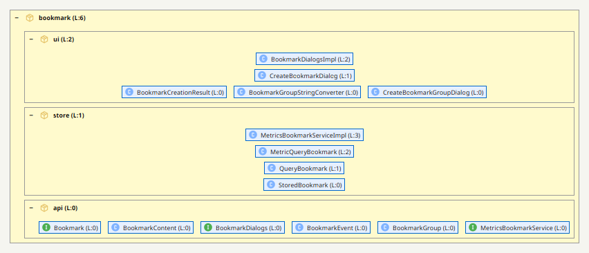](../images/components/bookmark.png)

| Paket | Inhalt |
| --- | --- |
| `ui` | die Dialoge |
| `store` | wie ein Bookmark in den Metadaten steht |
| `api` | siehe Außenkante |

## importer

**Aufgabe:** Das Menü **Import**: liest fremde Daten in das Repository eines Projekts, oder nur ihre
Beschreibung, wenn die Werte auf ihrem Server bleiben.

**Außenkante:** `spi` mit den Verträgen für eigene Importer (`LocalProjectSupport`,
`SplitSourceProjectSupport` und die Merkmale für die Sichten). Die Komponente implementiert
außerdem `projectcontext.spi.ProjectImporter` und `AliasMappingProvider`, und für entfernte
Projekte `query.spi.RemoteSeriesSource`.

[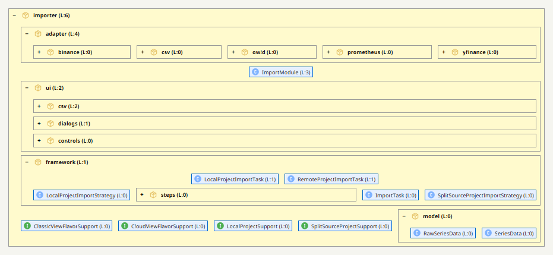](../images/components/importer.png)

| Paket | Inhalt |
| --- | --- |
| `adapter` | die Importer: Collector-Logs (`csv`), Prometheus, OWID, Binance, Yahoo Finance |
| (direkt) | `ImportModule`, die Basis jedes Importers |
| `ui` | die Dialoge für Dateien und für Server |
| `framework` | der Ablauf eines Imports: Strategie, Task und die Schritte lesen, filtern, abbilden, schreiben; jeder Import hat eine eigene Strategie |
| `model` | eine Serie vor und nach der Abbildung auf die Dimensionen |
| `spi` | siehe Außenkante |

## query

**Aufgabe:** Fragt Zeitreihen ab und formt sie um: zusammenfassen, glätten, vereinfachen.

**Außenkante:** `api` mit `MetricQueryService` (Serien), `MetricDataAccessService` (was es in einem
Repository gibt), `QuerySpec` und `ComputationSpec` und dem Ereignis `OpenInvestigationCommand`. `spi` mit
`RemoteSeriesSource`: Wer Werte entfernter Projekte liefern kann, implementiert es; zurzeit der
Prometheus-Importer.

Level 1:

[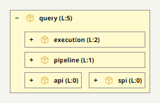](../images/components/query-level1.png)

Level 2:

[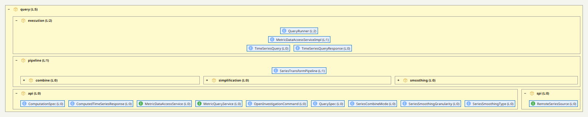](../images/components/query.png)

| Paket | Inhalt |
| --- | --- |
| `execution` | führt eine Abfrage aus: im Repository oder bei der entfernten Quelle |
| `pipeline` | die Umformungen, unabhängig davon, woher die Serien kommen |
| `api`, `spi` | siehe Außenkante |

## projectcontext

**Aufgabe:** Das Projekt, in dem eine Untersuchung stattfindet: seine Daten, seine Auswahl, seine
Dialoge und die Projektleiste.

**Außenkante:** `api` mit `Project`, `ProjectDataAccessService`, der Auswahl als Bedienelement
(`ProjectSelector`) und den Ereignissen rund um das Projekt. `spi` für `importer`
(`ProjectImporter`, `AliasMappingProvider`, `AliasMappingDefinition`) und `datasource`
(`ProjectDataCollection`).

Level 1:

[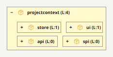](../images/components/projectcontext-level1.png)

Level 2:

[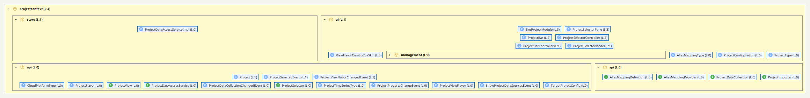](../images/components/projectcontext.png)

| Paket | Inhalt |
| --- | --- |
| `ui` | die Projektleiste und die Auswahl; in `management` die Dialoge zum Anlegen und Bearbeiten |
| `store` | liest und schreibt Projekte in den Metadaten |
| `api`, `spi` | siehe Außenkante |

## repository

**Aufgabe:** Wo die Zeitreihen gespeichert sind: Solr (eingebettet, einzeln, Cloud), Elasticsearch
und ClickHouse. Verwaltet auch die Verbindungen dorthin und die Server, von denen importiert wird.

**Außenkante:** `api` mit `Repository`, den Diensten zum Suchen und Schreiben von Serien
(`SeriesSearch`, `TimeSeriesWriteService`), der Verwaltung (`RepositoryService`,
`SourceRepositoryService`), zwei Bedienelementen als Interface (`RepositorySelector`,
`QuerySourceSelector`) und den Ereignissen. Andere setzen die Bedienelemente mit
`asJfxComponent()` in ihre Dialoge. Wie ein Repository verbunden ist, erfährt niemand.

Level 1:

[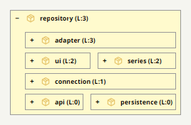](../images/components/repository-level1.png)

Level 2:

[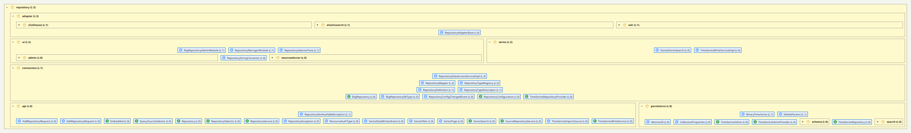](../images/components/repository.png)

| Paket | Inhalt |
| --- | --- |
| `adapter` | je ein Paket für Solr, Elasticsearch und ClickHouse; sie kennen einander nicht |
| `ui` | der Dialog für ein Repository und die zwei Bedienelemente |
| `series` | Suchen und Schreiben von Serien, gleich für alle Techniken |
| `connection` | eingerichtete Repositories und die Registry ihrer Arten. Der Vertrag für eine neue Technik, `TimeSeriesRepositoryProvider`, ist innen |
| `persistence` | was ein Adapter implementiert: Client, Schema, Suche |
| `api` | siehe Außenkante |

## application

**Aufgabe:** Start und Hauptfenster.

**Außenkante:** `api` mit `EkgApplicationController`: Darüber hängen sich die anderen in Menü und
Fenster ein. Dazu ein Ereignis für das Zurücksetzen der Anordnung.

[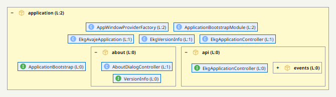](../images/components/application.png)

| Paket | Inhalt |
| --- | --- |
| (direkt) | `EkgAvajeApplication` startet, `EkgApplicationController` ist das Hauptfenster, die übrigen Klassen bereiten es vor |
| `about` | der Dialog **About** |
| `api` | siehe Außenkante |

`EkgApplicationController` gibt es zweimal: als Interface in `api` und als Klasse daneben.

## evidence

**Aufgabe:** Nimmt ein Chart aus der Workbench mit: als Bild (PNG) oder als Excel-Tabelle.

**Außenkante:** `api` mit `ChartExport` und `ExportedSeries`. Die Komponente kennt kein Diagramm: Für das
Bild bekommt sie ein Bedienelement und die Breite der Achse, für Excel die Serien.

[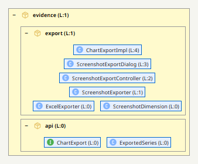](../images/components/evidence.png)

| Paket | Inhalt |
| --- | --- |
| `export` | der Dialog für das Bild, seine Größen und die zwei Formate |
| `api` | siehe Außenkante |

## secrets

**Aufgabe:** Bewahrt Passwörter und Tokens der Datenquellen getrennt von allem anderen auf.

**Außenkante:** `api` mit `SecretStore`.

[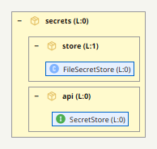](../images/components/secrets.png)

| Paket | Inhalt |
| --- | --- |
| `store` | Dateien unter `~/.ekg/secrets`, die nur ihr Besitzer lesen kann; sie sind nicht verschlüsselt |
| `api` | siehe Außenkante |

## metadata

**Aufgabe:** Speichert alles, was keine Zeitreihe ist: Projekte, Repositories, Bookmarks,
Datenquellen, Namen der Dimensionen.

**Außenkante:** `api` mit einem Store pro Thema und seinen Zeilen. Jeder Store hat genau eine
Komponente, die ihn benutzt.

Level 1:

[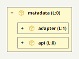](../images/components/metadata-level1.png)

Level 2:

[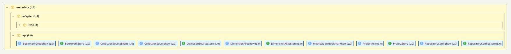](../images/components/metadata.png)

| Paket | Inhalt |
| --- | --- |
| `adapter.h2` | die Stores auf der eingebetteten Datenbank H2; ein anderer Adapter könnte an ihre Stelle treten |
| `api` | siehe Außenkante |

---

## uitoolkit

**Bibliothek.** Bedienelemente und Hilfen für die Oberfläche, darunter das Diagramm. Braucht nur
`runtime`.

Level 1:

[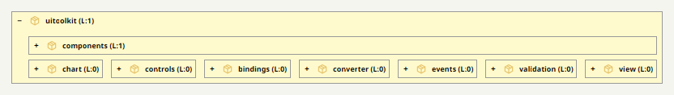](../images/components/uitoolkit-level1.png)

Level 2:

[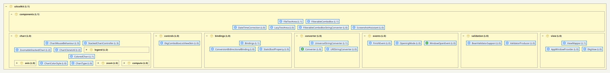](../images/components/uitoolkit.png)

| Paket | Inhalt |
| --- | --- |
| `chart` | das Diagramm mit Achsen, Zoom und Legende. Es braucht von der ganzen Workbench nur den Logger und wird nur von `metricview` benutzt |
| `components`, `controls` | Bedienelemente, zum Beispiel eine Auswahl mit Filter |
| `bindings`, `converter` | Hilfen für JavaFX-Properties |
| `view`, `events` | Ansichten im Fenster und wie sie geöffnet werden |
| `validation` | Prüfung von Eingaben |

## timeseries

**Bibliothek.** Die Zeitreihe und ihre Dimensionen. Braucht nichts.

[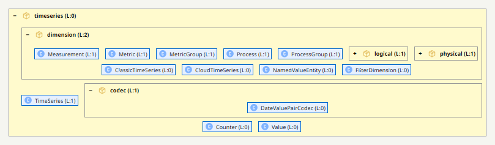](../images/components/timeseries.png)

| Paket | Inhalt |
| --- | --- |
| (direkt) | `TimeSeries`, `Value`, `Counter` |
| `dimension` | woran man eine Serie findet: physisch (Host, Host-Gruppe), logisch (Namespace, Service, Pod, Container) und gemeinsam (Prozess, Messung, Metrik) |
| `codec` | die kompakte Form der Werte |

## runtime

**Bibliothek.** Was jede Komponente zum Laufen braucht. Braucht nichts.

Level 1:

[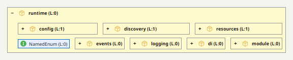](../images/components/runtime-level1.png)

Level 2:

[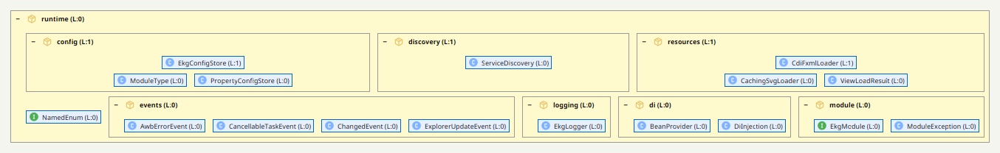](../images/components/runtime.png)

| Paket | Inhalt |
| --- | --- |
| `discovery` | erzeugt einen Dienst für ein bestimmtes Repository (`ServiceDiscovery`) |
| `di` | Dependency Injection für Objekte, die der Container nicht selbst erzeugt |
| `events` | Ereignisse, die viele angehen: Fehler, abbrechbare Aufgaben, Änderungen |
| `resources` | FXML und Symbole laden |
| `config`, `logging`, `module` | Einstellungen, Logger, Start eines Moduls |

## infrastructure

**Bibliothek.** Der SSH-Client, den `aichat` für seine Kommandos benutzt.

[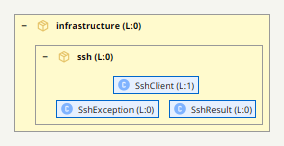](../images/components/infrastructure.png)

## tools

**Werkzeug für Entwickler.** Ein eigenes Programm, das die Metadaten in H2 nur lesend anzeigt. Die
Workbench benutzt es nicht.

[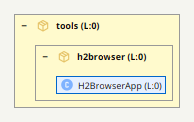](../images/components/tools.png)

---

## Was S202 meldet

Bericht vom 24.11.2026 für den oben genannten Stand:

| Prüfung | Funde |
| --- | ---: |
| Zugriffe an der `api` vorbei | 0 |
| `api`, die Inneres nach außen gibt | 0 |
| Paketzyklen | 0 |
| Klassenzyklen, alle innerhalb eines Pakets | 4 |
| Abhängigkeiten gegen die Schichten, alle aus diesen Klassenzyklen | 5 |

Die vier Klassenzyklen sind bekannt und bleiben:

- **`Plan` und `ConfigCompiler`** in `datasource.adapter`, je einmal für Prometheus, SSH und Windows:
  ein Plan und die Funktion, die ihn in die Konfiguration des Collectors übersetzt. Getrennt
  bräuchte der Aufrufer eine Fallunterscheidung über die Arten von Plänen.
- **`ZoomableStackedChart`** in `uitoolkit.chart` mit `StackedChartController` und
  `ChartMouseBehaviour`: ein Diagramm und zwei Teile davon.

## Die Bilder erneuern

1. Das JAR bauen. Mit `clean`, sonst stehen Klassen aus früheren Paketen darin:

   ```
   mvn -o -pl workbench -am clean package -DskipTests
   ```

2. In S202 `workbench/target/workbench-7.5.0-SNAPSHOT.jar` öffnen. Die generierten Klassen der
   Dependency Injection (`*.AwbModule`, `*$DI`) müssen in `excluded-prefixes.txt` von S202
   ausgeschlossen sein.
3. **Depth** auf 0 setzen, **Refresh**, dann **File → Export Image…** (Strg+E): `level0.png`.
4. Für jedes Top-Paket im Outline Explorer **Open Scope**, **Depth** auf 2, **Refresh** und
   exportieren: `<paket>.png`. Ist das Bild breiter als 1400 Pixel, zusätzlich mit **Depth** 1:
   `<paket>-level1.png`.
5. Die Bilder liegen in `docs/images/components`. Beschnitten ist nur der graue Rand.
