# The components of the Workbench

**English** | [Deutsch](workbench-components.de.md)

This document shows which components the Workbench consists of, what each of them does, what it
offers to the others and how it is built inside. It is meant for everybody who works on the code
of the Workbench. For the Collector there is [a document of its own](collector-components.md).

The pictures are from [S202](https://github.com/Weigend/S202) 1.4.0, which reads the dependencies
from the bytecode. State: Workbench 7.5.0-SNAPSHOT, commit `9cc6fd5`, 2026-11-24.

- [How to read the pictures](#how-to-read-the-pictures)
- [The rules](#the-rules)
- [Level 0: all top packages](#level-0-all-top-packages)
- [Who needs whom](#who-needs-whom)
- Components: [aichat](#aichat) · [metricview](#metricview) · [explorer](#explorer) ·
  [datasource](#datasource) · [bookmark](#bookmark) · [importer](#importer) · [query](#query) ·
  [projectcontext](#projectcontext) · [repository](#repository) · [application](#application) ·
  [evidence](#evidence) · [secrets](#secrets) · [metadata](#metadata)
- Libraries: [uitoolkit](#uitoolkit) · [timeseries](#timeseries) · [runtime](#runtime) ·
  [infrastructure](#infrastructure) – and [tools](#tools)
- [What S202 reports](#what-s202-reports)
- [Renewing the pictures](#renewing-the-pictures)

## How to read the pictures

| Sign | Meaning |
| --- | --- |
| yellow box | a package; **+** collapsed, **−** expanded |
| blue box with **C** | a class, also a record or an enum |
| blue box with a green **I** | an interface |
| **L:n** | the layer inside the surrounding package, 0 is at the bottom |

A layer only uses what is below it. What stands side by side in the same layer does not need each
other.

The pictures of the single components have two levels expanded (level 2): the packages of the
component with their classes. Where this picture is very wide, one with a single level (level 1)
comes first. A click on a picture opens it in full size.

## The rules

The packages directly below `io.softwareecg.awb` are the parts of the Workbench.

1. **Components** have an outer edge. The others only use
   - `api`: called by others and implemented by the component itself,
   - `spi`: implemented by others, and therefore imported from outside as well.

   Everything else is inside. The inner packages are named by what they do.
2. **Libraries** (`uitoolkit`, `timeseries`, `runtime`, `infrastructure`) have no outer edge: all
   their public classes may be used. They do not know any component.
3. **Cycles** do not exist, neither between the top packages nor between the parts of any package.
   A circle of classes of the same package is allowed.

Every build checks this:

| Test | What it checks |
| --- | --- |
| `LayerArchitectureTest` | outer edges, layers and cycles in the code, with ArchUnit |
| `ViewArchitectureTest` | the same outer edges in FXML and CSS; classes and files stand there as text, which neither S202 nor ArchUnit sees |

## Level 0: all top packages

[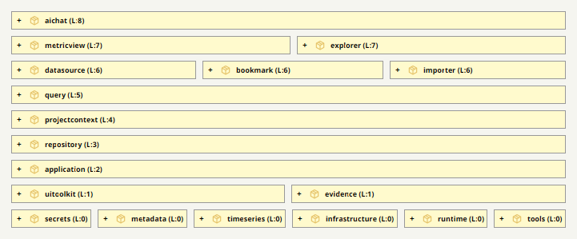](../images/components/level0.png)

The Workbench has 18 top packages in nine layers: 13 components, 4 libraries and a tool.

| Layer | Packages | What happens there |
| --- | --- | --- |
| 8 | [aichat](#aichat) | the assistant, which uses the analysis from outside |
| 7 | [metricview](#metricview), [explorer](#explorer) | showing and finding series |
| 6 | [datasource](#datasource), [bookmark](#bookmark), [importer](#importer) | getting data in, keeping views |
| 5 | [query](#query) | querying and transforming series |
| 4 | [projectcontext](#projectcontext) | the project an investigation works in |
| 3 | [repository](#repository) | where the series are stored |
| 2 | [application](#application) | the window the parts hook into |
| 1 | [uitoolkit](#uitoolkit), [evidence](#evidence) | controls; picture and Excel |
| 0 | [secrets](#secrets), [metadata](#metadata), [timeseries](#timeseries), [infrastructure](#infrastructure), [runtime](#runtime), [tools](#tools) | foundations that need nothing else |

This is what the same view looks like in S202. **Depth** at the top left is the level up to which
the packages are expanded, 0 here:

[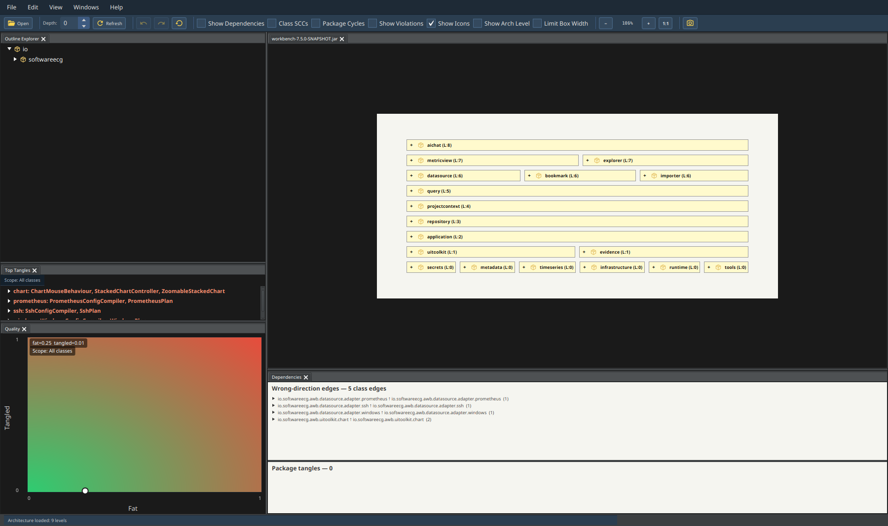](../images/components/s202-window.png)

## Who needs whom

Counted are dependencies between classes in the bytecode, without the generated classes of the
dependency injection. "Classes" are the source files.

| Package | Classes | needs | is needed by |
| --- | ---: | --- | --- |
| aichat | 20 | query, metricview, timeseries, uitoolkit, runtime, infrastructure | – |
| metricview | 38 | query, bookmark, projectcontext, repository, application, evidence, uitoolkit, timeseries, runtime | aichat |
| explorer | 68 | bookmark, query, projectcontext, repository, uitoolkit, timeseries, runtime | – |
| datasource | 40 | query, projectcontext, repository, application, secrets, metadata, uitoolkit, timeseries, runtime | – |
| bookmark | 15 | query, repository, metadata, uitoolkit, runtime | explorer, metricview |
| importer | 87 | query, projectcontext, repository, timeseries, runtime | – |
| query | 33 | projectcontext, repository, uitoolkit, timeseries, runtime | aichat, metricview, explorer, datasource, bookmark, importer |
| projectcontext | 37 | repository, application, metadata, uitoolkit, timeseries, runtime | metricview, explorer, datasource, importer, query |
| repository | 118 | application, metadata, uitoolkit, timeseries, runtime | metricview, explorer, datasource, bookmark, importer, query, projectcontext |
| application | 9 | uitoolkit, runtime | metricview, datasource, projectcontext, repository |
| evidence | 8 | runtime | metricview |
| secrets | 2 | – | datasource |
| metadata | 18 | – | datasource, bookmark, projectcontext, repository |
| uitoolkit | 44 | runtime | aichat, metricview, explorer, datasource, bookmark, query, projectcontext, repository, application |
| timeseries | 19 | – | aichat, metricview, explorer, datasource, importer, query, projectcontext, repository |
| runtime | 17 | – | all but secrets, metadata, timeseries, infrastructure, tools |
| infrastructure | 3 | – | aichat |
| tools | 1 | – | – |

Four components are used by nobody: `aichat`, `explorer`, `datasource` and `importer`. They have a
user interface, listen to events and hook themselves in when the Workbench starts. That is why
they have no `api`.

---

## aichat

**Task:** The assistant. It answers questions about the data the Workbench shows, with the help of
a language model.

**Outer edge:** none; nobody uses it. Of the analysis it only uses the `api` of `query` and
`metricview`.

[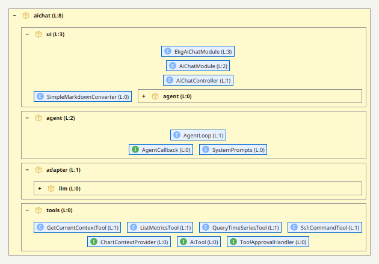](../images/components/aichat.png)

| Package | Content |
| --- | --- |
| `ui` | the panel with the conversation, and the rendering of Markdown |
| `agent` | the loop of question, tool call and answer (`AgentLoop`) |
| `adapter.llm` | the access to a language model with an OpenAI-compatible interface |
| `tools` | what the model may call: list metrics, query series, read the context of the chart, run a command by SSH; the last one only if the user agrees every time |

## metricview

**Task:** The chart panel: shows the series of a query, with filter header, layers and commands.

**Outer edge:** `api` with `ChartInUse` and `ShownChart`. They tell `aichat` which chart is in use
and what it shows.

Level 1:

[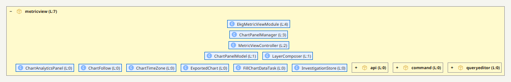](../images/components/metricview-level1.png)

Level 2:

[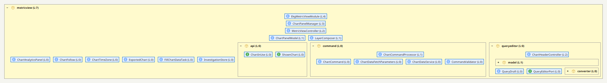](../images/components/metricview.png)

| Package | Content |
| --- | --- |
| (direct) | `ChartPanelManager` holds the open chart views, `MetricViewController` controls one of them, `LayerComposer` its layers; `ExportedChart` collects what an export needs |
| `command` | every change of the data, the structure or the look of a chart goes through the `ChartCommandProcessor` |
| `queryeditor` | the filter header; the view talks to it through `QueryEditorPort` |
| `api` | see outer edge |

The chart itself is not here but in [uitoolkit](#uitoolkit) (`chart`): it knows nothing of the
application.

## explorer

**Task:** The tree on the left: repositories, projects, dimensions, metrics and bookmarks.

**Outer edge:** none; nobody uses it. What it opens it asks for with events, for example
`OpenInvestigationCommand` of `query` or `AddRepositoryRequest` of `repository`.

[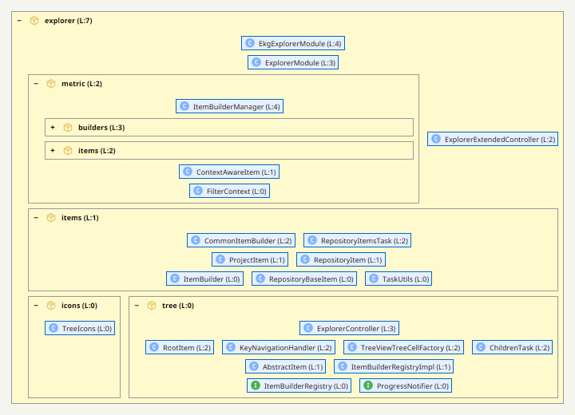](../images/components/explorer.png)

| Package | Content |
| --- | --- |
| (direct) | the module that puts the tree into the window, and the reaction to the selection |
| `metric` | the nodes below a project and how they come into being: hosts, namespaces, processes, measurements, metrics, bookmarks |
| `items` | repository and project as nodes |
| `tree` | the tree itself: nodes, loading in the background, keyboard, menus |
| `icons` | the icons |

## datasource

**Task:** **Analysis → New Analysis** and **Data Sources**: sets up data sources and runs the
built-in Collector for each of them, which writes into the repository of the project.

**Outer edge:** `spi` with `AnalysisSourceProvider` and its types, for new kinds of data sources.
The component itself implements `projectcontext.spi.ProjectDataCollection`, which tells the others
whether data is being collected for a project.

[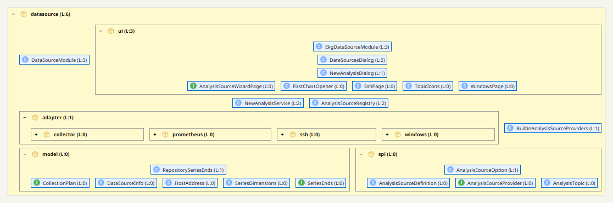](../images/components/datasource.png)

| Package | Content |
| --- | --- |
| `ui` | the dialog for a new analysis and the one for the data sources |
| (direct) | `NewAnalysisService` starts, pauses and ends the collecting; `AnalysisSourceRegistry` knows the kinds of sources |
| `adapter` | one package each for Prometheus, SSH and Windows, which do not know each other, and `collector` for what all configurations have in common |
| `model` | the plan of a collection, hosts and dimensions |
| `spi` | see outer edge |

## bookmark

**Task:** Keeps charts, for one project or for all.

**Outer edge:** `api` with `MetricsBookmarkService`, the types `Bookmark`, `BookmarkGroup`,
`BookmarkContent`, the event `BookmarkEvent`, and the dialogs as `BookmarkDialogs`.

[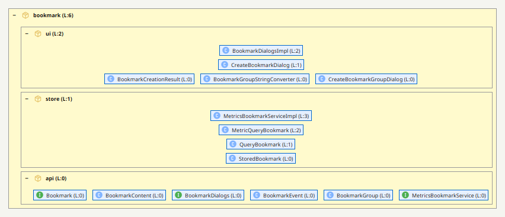](../images/components/bookmark.png)

| Package | Content |
| --- | --- |
| `ui` | the dialogs |
| `store` | how a bookmark is stored in the metadata |
| `api` | see outer edge |

## importer

**Task:** The menu **Import**: reads foreign data into the repository of a project, or only their
description if the values stay on their server.

**Outer edge:** `spi` with the contracts for importers of one's own (`LocalProjectSupport`,
`SplitSourceProjectSupport` and the markers for the views). The component also implements
`projectcontext.spi.ProjectImporter` and `AliasMappingProvider`, and for remote projects
`query.spi.RemoteSeriesSource`.

[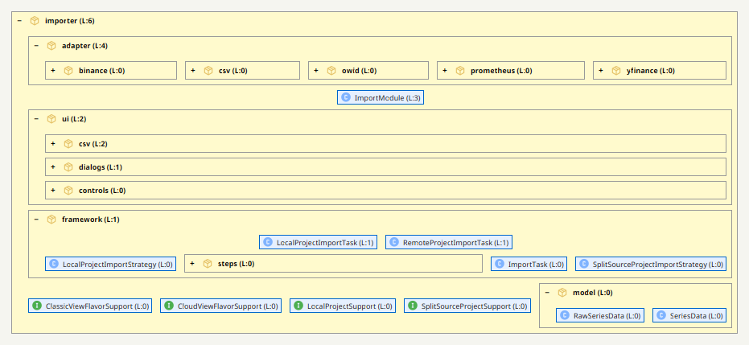](../images/components/importer.png)

| Package | Content |
| --- | --- |
| `adapter` | the importers: Collector logs (`csv`), Prometheus, OWID, Binance, Yahoo Finance |
| (direct) | `ImportModule`, the base of every importer |
| `ui` | the dialogs for files and for servers |
| `framework` | how an import runs: strategy, task and the steps read, filter, map, write; every import has a strategy of its own |
| `model` | a series before and after it was mapped to the dimensions |
| `spi` | see outer edge |

## query

**Task:** Queries time series and transforms them: combining, smoothing, simplifying.

**Outer edge:** `api` with `MetricQueryService` (series), `MetricDataAccessService` (what there is
in a repository), `QuerySpec` and `ComputationSpec`, and the event `OpenInvestigationCommand`.
`spi` with `RemoteSeriesSource`: implemented by whoever can deliver the values of remote projects,
at present the Prometheus importer.

Level 1:

[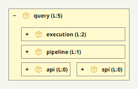](../images/components/query-level1.png)

Level 2:

[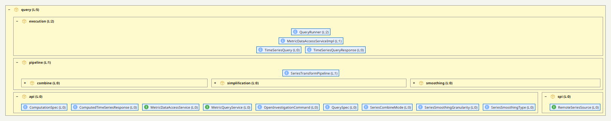](../images/components/query.png)

| Package | Content |
| --- | --- |
| `execution` | runs a query: in the repository or at the remote source |
| `pipeline` | the transformations, independent of where the series come from |
| `api`, `spi` | see outer edge |

## projectcontext

**Task:** The project an investigation works in: its data, its selection, its dialogs and the
project bar.

**Outer edge:** `api` with `Project`, `ProjectDataAccessService`, the selection as a control
(`ProjectSelector`) and the events around the project. `spi` for `importer` (`ProjectImporter`,
`AliasMappingProvider`, `AliasMappingDefinition`) and `datasource` (`ProjectDataCollection`).

Level 1:

[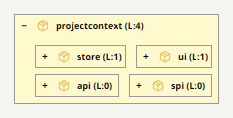](../images/components/projectcontext-level1.png)

Level 2:

[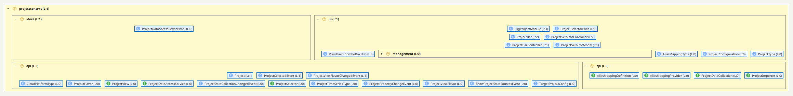](../images/components/projectcontext.png)

| Package | Content |
| --- | --- |
| `ui` | the project bar and the selection; in `management` the dialogs that add and edit a project |
| `store` | reads and writes projects in the metadata |
| `api`, `spi` | see outer edge |

## repository

**Task:** Where the time series are stored: Solr (embedded, standalone, cloud), Elasticsearch and
ClickHouse. It also manages the connections to them, and the servers that are imported from.

**Outer edge:** `api` with `Repository`, the services that search and write series (`SeriesSearch`,
`TimeSeriesWriteService`), the administration (`RepositoryService`, `SourceRepositoryService`), two
controls as interfaces (`RepositorySelector`, `QuerySourceSelector`) and the events. Others put the
controls into their dialogs with `asJfxComponent()`. How a repository is connected, nobody learns.

Level 1:

[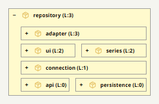](../images/components/repository-level1.png)

Level 2:

[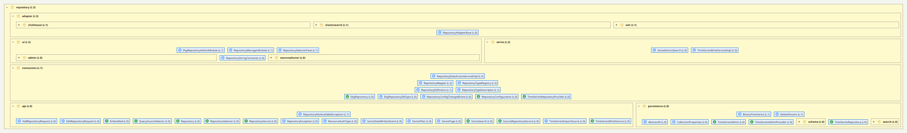](../images/components/repository.png)

| Package | Content |
| --- | --- |
| `adapter` | one package each for Solr, Elasticsearch and ClickHouse; they do not know each other |
| `ui` | the dialog for a repository and the two controls |
| `series` | searching and writing series, the same for all technologies |
| `connection` | the repositories that were set up, and the registry of their kinds. The contract for a new technology, `TimeSeriesRepositoryProvider`, is inside |
| `persistence` | what an adapter implements: client, schema, search |
| `api` | see outer edge |

## application

**Task:** Start and main window.

**Outer edge:** `api` with `EkgApplicationController`: the others use it to hook into menu and
window. And an event for restoring the layout.

[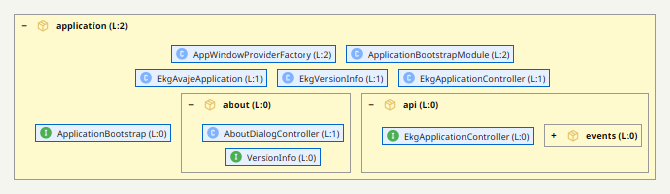](../images/components/application.png)

| Package | Content |
| --- | --- |
| (direct) | `EkgAvajeApplication` starts, `EkgApplicationController` is the main window, the other classes prepare it |
| `about` | the dialog **About** |
| `api` | see outer edge |

There are two `EkgApplicationController`: the interface in `api` and the class beside it.

## evidence

**Task:** Takes a chart out of the Workbench: as a picture (PNG) or as an Excel sheet.

**Outer edge:** `api` with `ChartExport` and `ExportedSeries`. The component does not know any
chart: for the picture it gets a control and the width of the axis, for Excel the series.

[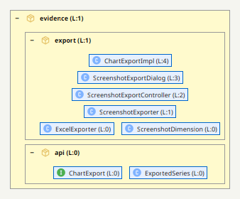](../images/components/evidence.png)

| Package | Content |
| --- | --- |
| `export` | the dialog for the picture, its sizes, and the two formats |
| `api` | see outer edge |

## secrets

**Task:** Keeps passwords and tokens of the data sources apart from everything else.

**Outer edge:** `api` with `SecretStore`.

[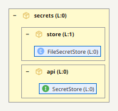](../images/components/secrets.png)

| Package | Content |
| --- | --- |
| `store` | files in `~/.ekg/secrets` which only their owner can read; they are not encrypted |
| `api` | see outer edge |

## metadata

**Task:** Stores everything that is not a time series: projects, repositories, bookmarks, data
sources, names of the dimensions.

**Outer edge:** `api` with one store per subject and its rows. Every store has exactly one
component that uses it.

Level 1:

[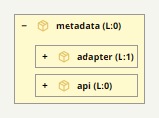](../images/components/metadata-level1.png)

Level 2:

[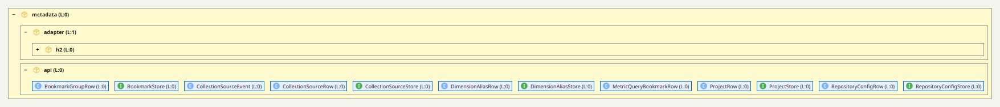](../images/components/metadata.png)

| Package | Content |
| --- | --- |
| `adapter.h2` | the stores on the embedded database H2; another adapter could take their place |
| `api` | see outer edge |

---

## uitoolkit

**Library.** Controls and helpers for the user interface, among them the chart. Needs only
`runtime`.

Level 1:

[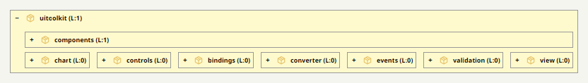](../images/components/uitoolkit-level1.png)

Level 2:

[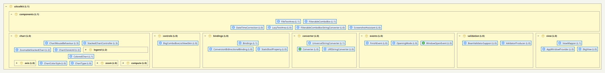](../images/components/uitoolkit.png)

| Package | Content |
| --- | --- |
| `chart` | the chart with axes, zoom and legend. Of the whole Workbench it needs only the logger, and only `metricview` uses it |
| `components`, `controls` | controls, for example a selection with a filter |
| `bindings`, `converter` | helpers for JavaFX properties |
| `view`, `events` | views in the window, and how they are opened |
| `validation` | checking what was entered |

## timeseries

**Library.** The time series and its dimensions. Needs nothing.

[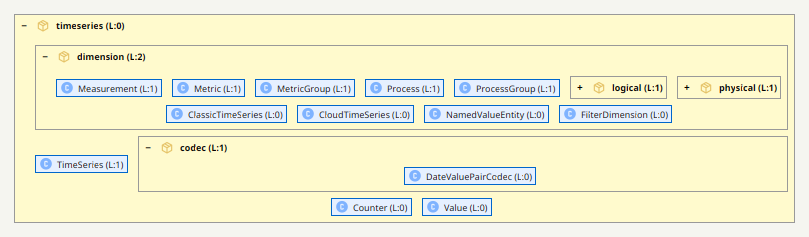](../images/components/timeseries.png)

| Package | Content |
| --- | --- |
| (direct) | `TimeSeries`, `Value`, `Counter` |
| `dimension` | what a series is found by: physical (host, host group), logical (namespace, service, pod, container) and common (process, measurement, metric) |
| `codec` | the compact form of the values |

## runtime

**Library.** What every component needs to run. Needs nothing.

Level 1:

[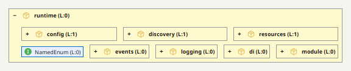](../images/components/runtime-level1.png)

Level 2:

[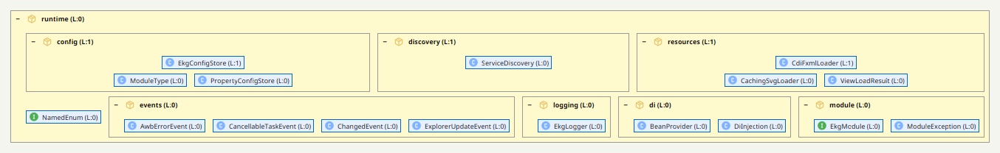](../images/components/runtime.png)

| Package | Content |
| --- | --- |
| `discovery` | creates a service for a certain repository (`ServiceDiscovery`) |
| `di` | dependency injection for objects the container does not create itself |
| `events` | events that concern many: errors, tasks that can be cancelled, changes |
| `resources` | loading FXML and icons |
| `config`, `logging`, `module` | settings, logger, start of a module |

## infrastructure

**Library.** The SSH client which `aichat` uses for its commands.

[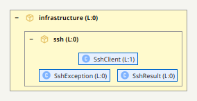](../images/components/infrastructure.png)

## tools

**Tool for developers.** A program of its own that shows the metadata in H2, read only. The
Workbench does not use it.

[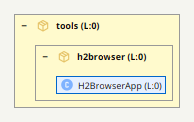](../images/components/tools.png)

---

## What S202 reports

Report of 2026-11-24 for the state named above:

| Check | Findings |
| --- | ---: |
| accesses past an `api` | 0 |
| `api` that gives the inside away | 0 |
| package cycles | 0 |
| class cycles, all inside one package | 4 |
| dependencies against the layers, all of them part of these class cycles | 5 |

The four class cycles are known and stay:

- **`Plan` and `ConfigCompiler`** in `datasource.adapter`, once each for Prometheus, SSH and
  Windows: a plan and the function that translates it into the configuration of the Collector.
  Apart from each other, the caller would have to distinguish the kinds of plans.
- **`ZoomableStackedChart`** in `uitoolkit.chart` with `StackedChartController` and
  `ChartMouseBehaviour`: a chart and two parts of it.

## Renewing the pictures

1. Build the JAR. With `clean`, otherwise it contains classes of former packages:

   ```
   mvn -o -pl workbench -am clean package -DskipTests
   ```

2. Open `workbench/target/workbench-7.5.0-SNAPSHOT.jar` in S202. The generated classes of the
   dependency injection (`*.AwbModule`, `*$DI`) have to be excluded in `excluded-prefixes.txt` of
   S202.
3. Set **Depth** to 0, **Refresh**, then **File → Export Image…** (Ctrl+E): `level0.png`.
4. For every top package **Open Scope** in the Outline Explorer, set **Depth** to 2, **Refresh**
   and export: `<package>.png`. If the picture is wider than 1400 pixels, also with **Depth** 1:
   `<package>-level1.png`.
5. The pictures are in `docs/images/components`. Only the grey border is cut off.
