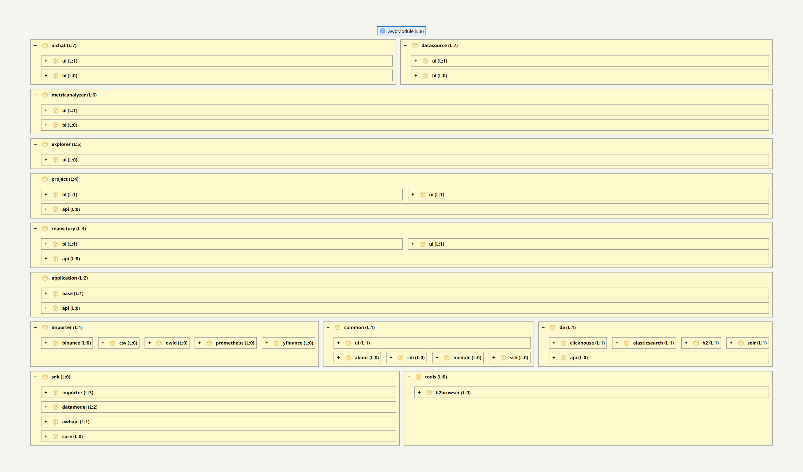
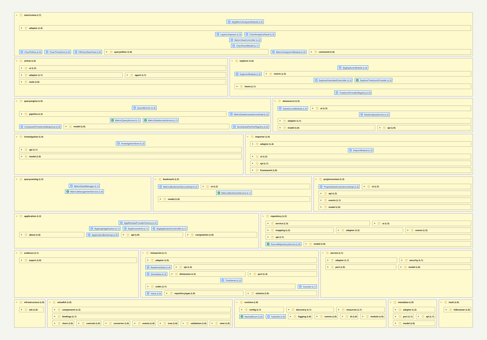
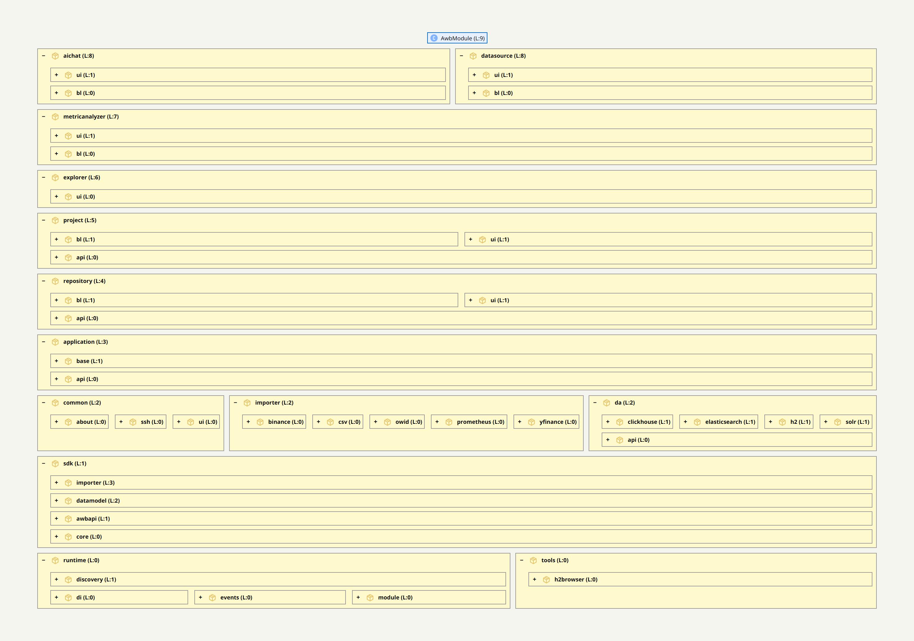
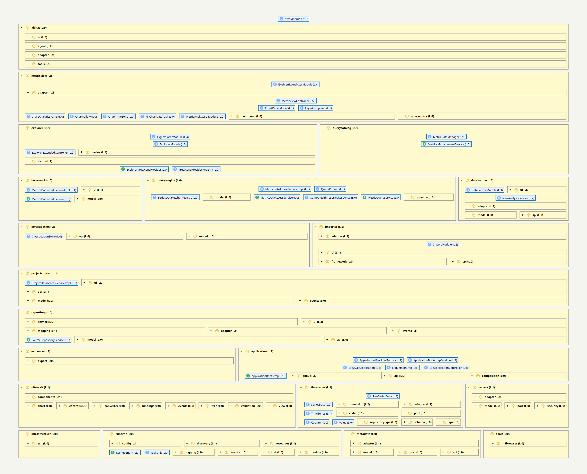
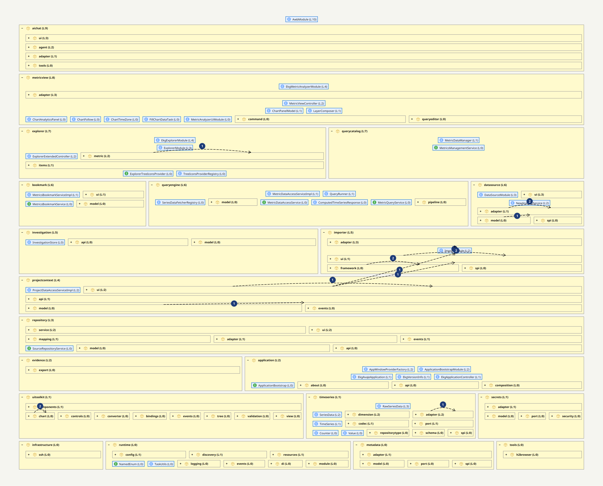
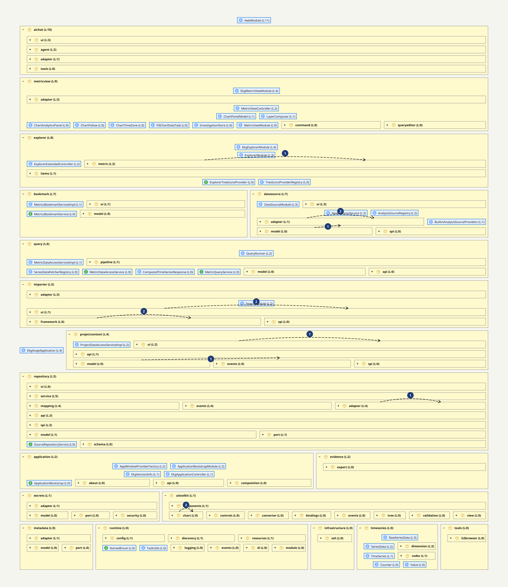

# The Components Were There. Their Code Was Everywhere.

## We built the target architecture first, moved 906 files, and learned that a picture can be clean and still be wrong

Every long-lived codebase has questions it should answer from its structure. Ours could not answer a
simple one: where do I put a new data source?

The Software-EKG workbench is a desktop application for comparing time series from software
systems. It had grown for years. It worked, built, and passed its tests. Its architecture had not
disappeared completely either: names such as `repository`, `datasource`, `explorer`, and
`metricanalyzer` were already visible in the package tree.

That was precisely why the problem was easy to underestimate. The domain components existed as
names, but the code belonging to them no longer formed coherent components. Repository behavior,
for example, was spread across at least four historical regions:

```text
repository/...                         business logic and part of the UI
project/ui/repositoryselector/...      repository selection UI
sdk/awbapi/repository/...              repository and write contracts
da/{solr,elasticsearch,clickhouse}/... repository technologies
```

The same pattern appeared elsewhere. The former SDK had grown from an extension boundary into a
second home for data models, importer infrastructure, repository contracts, UI base classes, and
runtime utilities. `common` and `da` had become further collection points. A class could have an
apparently reasonable package name and still belong to a feature whose other half lived several
branches away.

So the old structure was not simply “technical packages instead of components.” It was a mixture:
recognizable feature shells at the top, shared historical buckets at the bottom, and functional
slices crossing between them. To add or change a repository, a source, or a chart, you had to know
that history. The package tree alone did not tell you the boundary or the required interfaces.

We wanted the existing domain names to become real ownership boundaries: one visible place for
the feature, its contracts, its model, its adapters, and its UI. That meant touching nearly every
file in the workbench, and we had an AI coding partner that could do the typing. The hard part was
deciding what the structure should be, and being sure of it before 900 files moved.

So we did not start with the code. We built the target architecture first, as a JAR of dummy classes, looked at it, argued about it, and only then moved the real thing.

The pictures in this article come from [S202](https://github.com/Weigend/S202), our own open-source tool (Apache 2.0) for seeing the architecture of compiled code.



*How to read the old S202 TreeView: feature names such as `repository`, `project`, `datasource`, and
`metricanalyzer` are already present in the upper rows. But the broad `sdk`, `common`, and `da`
branches remain separate ownership centres at the bottom. `sdk` contains `awbapi`, `datamodel`, and
`importer`; `da` owns all database technologies. The feature boxes therefore do not contain the
whole feature. This structural split—not a missing package name—was the problem.*

The TreeView was more useful here than a polished component diagram. It showed both truths at
once: the intended domain vocabulary had survived, and the implementation had drifted away from
it.

## The handbook knew the architecture better than the code did

Refactorings usually begin in the package tree. You draw boxes around what is there, rename a few layers, and end up with a tidier version of the same thinking. The current implementation becomes the vocabulary of the future one.

We began with the user handbook instead, along with the screenshots, dialogs, and workflows. An analyst creates a project, connects or imports data, explores the available metrics, puts selected series into charts, adjusts queries, stores bookmarks, and exports evidence. That is the product. So we asked:

> If we designed the workbench today from what its users see, which components would we expect to find inside it?

The answer came out in plain words. A *project* is the envelope of an investigation. A *repository* is where the data lives, locally or on a server. A *data source* is what the “New Analysis” dialog offers. There are *importers*, a *metric view*, a *query engine*, *bookmarks*, and *evidence*. Below them sit things every feature needs: a runtime, a UI toolkit, storage for time series, and storage for metadata.

None of this is a class diagram. It is a vocabulary. The old source tree contained many of these
words, but did not consistently assign ownership to them. The target architecture had to turn the
vocabulary into boundaries.

The handbook also showed where the application is meant to grow. Wherever there were already several implementations of one idea (three database technologies, a handful of import formats), the target needed a visible contract with the implementations plugged in beside it.

## A drawing would have been too easy

At this point we could have drawn the boxes and arrows. We did not trust a drawing. Boxes do not have to compile. Nobody forces you to say where each existing class goes. And a drawing will never tell you that your tidy low-level contract secretly depends on a high-level feature.

So we asked the AI to build the target as real Java.

Every one of the 579 types in the workbench got a new name in the new structure. A few examples show the kind of decision each line recorded:

```text
sdk.awbapi.repository.SeriesImportService
    -> timeseries.port.TimeSeriesWriteService

project.ui.repositoryselector.RepositorySelectorPane
    -> repository.ui.RepositorySelectorPane

da.solr.SolrRepositoryClient
    -> timeseries.adapter.solr.SolrRepositoryClient
```

These are not cosmetic renames. Each line is a decision about ownership, taken from what had been
split between `sdk`, `project`, and `da`, and made explicit before a source file moved. That does not
make it right. Two of these three lines did not survive, and how we found out is the second half of
this story.

Then a generator produced an empty stand-in for each type, in its new package, with the dependencies of the real class written in as method calls. The result compiled into a JAR that did nothing at all, but had the shape of the application we wanted.

We opened that JAR in S202. It reads compiled Java and draws it in levels: whatever uses something sits above it. For the first time we could look at an architecture that did not exist yet.

## The picture argued back

The first picture was a disappointment. It was flat, with everything on one level. The stand-in classes referred to each other, but only as fields, and S202 rightly does not treat a mere reference as structure. Once the generator wrote real calls, the layers appeared.

The second picture had the opposite problem: 4,425 dependency lines, and single classes reaching out to 64 others. The generator had taken a shortcut and connected every class in one component to every contract in another. We replaced that with the dependencies the real sources actually have. The picture dropped to about 1,850 lines and became readable.

Then it started to teach us things.

**Project and repository are not the same topic.** An early version of the target had the Solr and ClickHouse repositories inside project management, because that is where their dialogs had always been. Seeing database technology inside a box called “project management” settled a discussion that words had not. Repositories got their own component.

**Nobody had been sure who owns writing data.** The service that writes time series was used by importers and data sources and implemented by repository code. We first placed it with the importer, then with the repository. Both times an arrow pointed upward in the picture. So it became a contract of the time-series component, and the arrows were gone. Remember this one.

**“Application” was two things at once.** It held the startup code, and also small helpers that everything else used, which belong at the very bottom. Once those helpers had their own `runtime` component, it settled on the lowest level.

We also learned not to trust our own clean picture. The diagram we liked was filtered: dependencies that contradicted the target were left out, to show where we wanted to go. That is useful, but at one point the filter was silently hiding 271 dependencies between components. Some were real violations in the code. Others showed that our rule for what counts as a violation was wrong. From then on we kept a second JAR with every dependency in it, as the picture we were not allowed to like too early.



*The skeleton: a JAR of stand-in classes. Components that use another component are placed above it.*

## Who did what

It would be easy to tell this as a story about AI designing an architecture. That is not what happened.

The AI did the work that needs completeness and patience. It read the handbook next to the screenshots, went through hundreds of source files, kept a mapping for every single type, generated the stand-ins, rebuilt the JAR after every change of mind, and later moved the real code and ran the tests.

The corrections that mattered came from someone who knows the product:

- “Metadata is not just bookmarks. Projects and repository configuration are stored there too.”
- “Repository and project are completely different topics.”
- “That type is not a model. It is the output of a collector.”
- “The picture is correctly layered, but too dense to explain anything.”

Each of these was one sentence in a conversation. Each became a changed mapping, a new JAR, and a new picture. The loop looked like this:

> Product knowledge → an executable hypothesis from the AI → the picture in S202 → a human judgment → the next hypothesis.

The picture was what made the loop work. Without it, a sentence like “repository belongs below project” can mean four different things. With it, we were pointing at the same box.

## Moving the real code

When the picture stopped changing, we stopped refining it.

We branched from a clean state and started at the bottom. The first commit moved just eight shared types into the new `runtime`. Everything compiled, and all 306 workbench tests passed. When we loaded the real JAR into S202, that small step was already visible: `runtime` had settled on the lowest level.



*After the first step: a small, verified code change immediately changes the picture. `runtime` appears on the lowest level, next to the still unchanged `sdk`, `common`, and `da`.*

After that, the whole mapping was applied. The migration touched 906 files: classes, tests, screen layouts, stylesheets, images, and start scripts. The old `sdk`, `common`, `da`, `metricanalyzer`, and `project` packages no longer contain a single production class. The tests still pass, 306 of them.

Three classes could not simply be moved. They did too many things, and the mapping had marked them as splits from the start. Here the method reached its limit. The skeleton could say that a class had to become two or three. Deciding which behavior goes where meant reading the real code and deciding case by case. The former chart controller, for example, became a view controller, a store for the state of an investigation, and a composer for chart layers.

Then came the comparison we had been working toward. We loaded the production JAR into S202 and put it next to the skeleton. The two pictures are not identical, because real code has more dependencies than a hypothesis. But they show the same components, with the same names, stacked in the same direction.



*After the move: the historical buckets have disappeared. Features own their model and UI, and shared
capabilities are named by purpose: `timeseries`, `metadata`, `runtime`, `uitoolkit`, and
`infrastructure`.*

An earlier version of this article ended about here.

## A clean picture is not a correct one

A package move is not a decoupling, and the new structure made the remaining work visible. "New
Analysis" still used a central list of sources. Repository administration still knew its
technologies from a closed enum. The main controller of the metric view still knew its header and
its legend too well. We replaced those with registries and narrow ports, and called it done.

Then we asked a question the picture does not answer: are the components more cohesive than before?

We took the classes that existed in both versions and measured, for each component, how many of its
dependencies stay inside. The result was sobering. Explorer and importer had clearly gained.
Repository had not:

| Component | Before | After the move | Now |
| --- | --- | --- | --- |
| Explorer | 14% | 45% | 45% |
| Importer | 34% | 49% | 50% |
| Repository | 18% | 20% | **55%** |

There were also cycles between components. The old code had none. Our move had made one visible that
used to hide inside `sdk`, and our follow-up work had added a second one, with a single class
reference. Nothing in the build had complained.



*The moved JAR with S202's violation overlay. Each dashed arrow points against the layering. Two of
them run from `projectcontext` up into `importer`: that is a cycle between components.*

## "Repository belongs in repository"

What had gone wrong did not come out of the numbers. It came from the person who knows the product,
who looked at the packages and said: the repository things do not belong in time series. And query is
wrong there too.

They were right, and it was plain once said. `timeseries` held two subjects under one name. One is
the data: a series, its values, the hosts and metrics it belongs to. The other is storage: how a
repository is searched, described, and reached. Solr, Elasticsearch, and ClickHouse had each been cut
in two, one half in `repository`, one half in `timeseries`.

Remember the service that writes series? We had moved it until no arrow pointed upward. That was the
mistake. We had let the picture choose the owner. The layering was clean because we had put a
repository contract in a low place, not because it belonged there.

The second look found more of the same kind:

- **Everything about a repository is in `repository` now.** A technology is one package.
  `timeseries` is a data model and depends on nothing but itself.
- **`investigation` was the model of a query.** Its name sounded like the product, but it held the
  objects the query engine runs. They are one component, `query`.
- **`querycatalog` was no catalog.** It wrote series, and nothing used it. It had been carried along
  faithfully, with a nice new name.
- **`api`, `spi`, and `port` had been used as decoration.** Now they say who implements what: an API
  is implemented by its own component, an SPI by others, a port by adapters.

The path of one capability shows the difference:

| Before | After the move | Now |
| --- | --- | --- |
| `sdk.awbapi.repository` | `timeseries.port` | `repository.api`, `repository.port` |
| `project.ui.repositoryselector` | `repository.ui` | `repository.ui` |
| `da.solr` and its siblings | `timeseries.adapter.solr` | `repository.adapter.solr` |
| `repository.bl`, `repository.ui` | `repository.service`, `repository.ui` | `repository.service`, `repository.ui` |



*Today, with the same overlay. Every remaining arrow stays inside its component. Between components
there is none.*

## What we got wrong, and what it did not fix

We had already released the first result. In it, the dialog that exports a chart as a picture did not
open. Its classes had moved, and its view and icons had not. All tests passed, because no test opened
that dialog, and the compiler does not look at file names in strings. The release was withdrawn.

So the build checks more than it did. One test looks up every view, stylesheet, and icon that is
written out in the sources. The architecture tests forbid cycles between components, keep the
repository technologies apart, and check what `api`, `spi`, and `port` promise. We ran the checks
for files, cycles, and interfaces against the versions that had the problem, to see them fail.

Some things did not get better. Counted over the whole application, more dependencies cross component
boundaries than before, partly because eighteen components have more boundaries than twelve.
The metric view is still the least cohesive feature. And inside some components, packages depend on
each other in circles, more of them now than before the last move.

Moving classes does not remove a dependency. It decides where you look for one.

## The method, in short

Nothing here is specific to Software-EKG or to Java:

1. **Recover the product model.** Read the handbook, screenshots, and workflows before treating package names as architecture.
2. **Give every class a destination.** Where one class has to become several, say so instead of pretending a rename is enough.
3. **Build the target as code.** Generate stand-in classes with real dependencies, in a form your analysis tool understands.
4. **Keep two pictures.** One shows the intent. The other shows every dependency, so that a filter cannot hide the inconvenient ones.
5. **Review the picture, not the plan.** Look for technology inside feature components, arrows pointing upward, and anything that sits higher or lower than you expected.
6. **Move from the bottom up.** Shared foundations first, features last, with a build and a test run after each step.
7. **Compare the result with the hypothesis.** The skeleton is a claim. The production JAR is the evidence.
8. **Measure afterwards.** Count cycles and cohesion before and after. A layered picture does not show cohesion, and a cycle of one class reference is easy to overlook.
9. **Look up what the compiler does not.** Views, stylesheets, icons, and scripts move too.
10. **Ask the person who knows the product again at the end.** Whether a component holds one subject is not in the arrows.

## What we would tell another team

Using AI to rename Java packages is not remarkable. Coding agents are good at mechanical work.

What made the difference was having something to look at before any code moved, and deriving it from the product instead of from the existing package tree. What nearly undid it was trusting that picture too long. The skeleton gave the AI something concrete to keep complete. The picture gave the human something concrete to judge. Compilation and tests kept the move itself honest.

We did not ask the AI what the system means. We asked it to make our own ideas complete enough to compile, and then looked at whether we still believed them.

So do not begin by moving code. Build a model you can see, argue with, and compile. Then build the real thing, put the two side by side, and argue once more.

*S202 is on GitHub: [github.com/Weigend/S202](https://github.com/Weigend/S202). So is the application it was used on: [github.com/Weigend/Software-EKG](https://github.com/Weigend/Software-EKG).*
