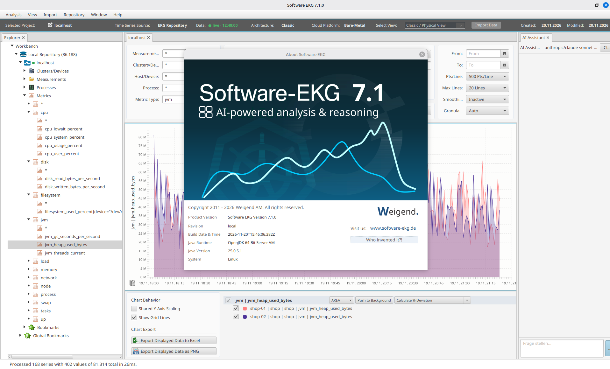

# Software-EKG Handbook

Software-EKG builds focused, reproducible time-series datasets for investigations across
otherwise disconnected sources.

This handbook describes the user-visible and deliberately extensible features of the current
Software-EKG repository. It covers the Workbench, the Collector (a standalone acquisition
process with an optional local display), their data formats and the extension contracts that are
reachable intentionally. Screens and names may still contain German text where the current JavaFX
application does.

## Choose a path

- **First use:** [Concepts and motivation](concepts.md) → [Architecture](architecture.md) →
  [Getting started](getting-started.md)
- **Collect data:** [Collector](collector.md) → [Source modules](collector-sources.md) →
  [Repositories](collector-repositories.md)
- **Analyse data:** [Workbench](workbench.md) → [Importers](workbench-importers.md)
- **Add a proprietary integration:** [Extension guide](extensions.md)
- **Look up every surface:** [Feature and configuration reference](reference.md)

## What is covered

| Surface | Handbook page |
| --- | --- |
| Product purpose, offline analysis, adapters | [Concepts](concepts.md) |
| Parts and scenarios: internal and external Collector, embedded and remote repositories, measured systems | [Architecture](architecture.md) |
| Installation, first chart with New Analysis, first Collector run | [Getting started](getting-started.md) |
| Collector CLI, YAML, scheduling, variables, service mode, display | [Collector](collector.md) |
| Mock, Unix `top`, `iostat`, `df`, Windows, JMX, Jolokia, Prometheus, logs | [Source modules](collector-sources.md) |
| CSV/archive, Solr and Elasticsearch output | [Collector repositories](collector-repositories.md) |
| Projects, repositories, New Analysis, explorer, charts, bookmarks, exports, AI Assistant | [Workbench](workbench.md) |
| Collector CSV, Prometheus, OWID, Binance and Yahoo Finance imports | [Workbench importers](workbench-importers.md) |
| New Collector sources/repositories and Workbench importers | [Extensions](extensions.md) |
| Menus, CLI, paths, settings and compatibility status | [Reference](reference.md) |

## Scope and status language

The handbook distinguishes three states:

- **Supported** means the function is connected to the current CLI or Workbench UI.
- **Legacy** means it is still readable or runnable for compatibility but is not the preferred
  path for new setups.
- **Extension point / incomplete** means code exists, but the end-to-end user workflow is not
  currently complete.

[Next: Concepts and motivation →](concepts.md)
