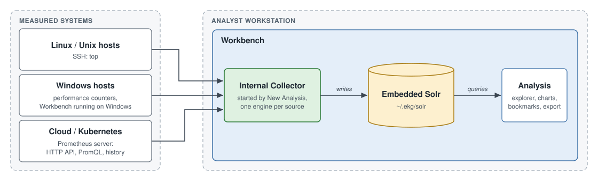
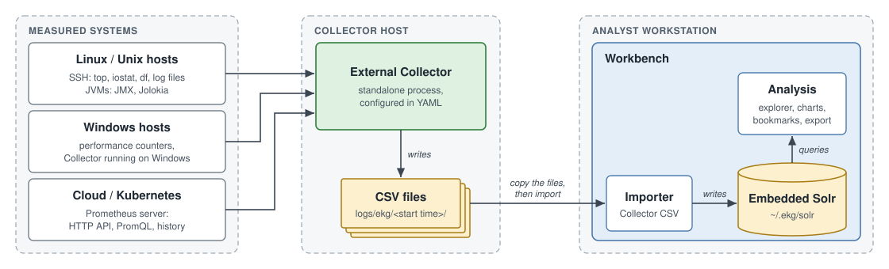
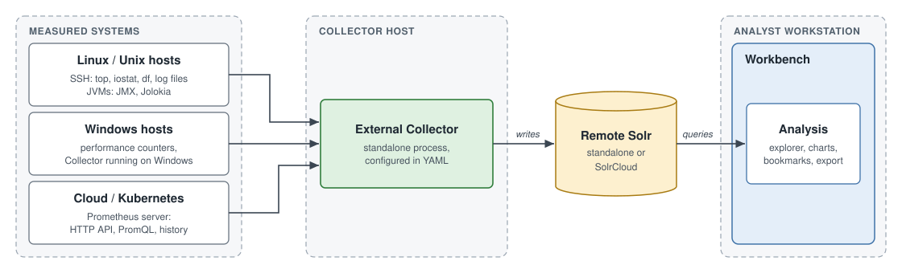
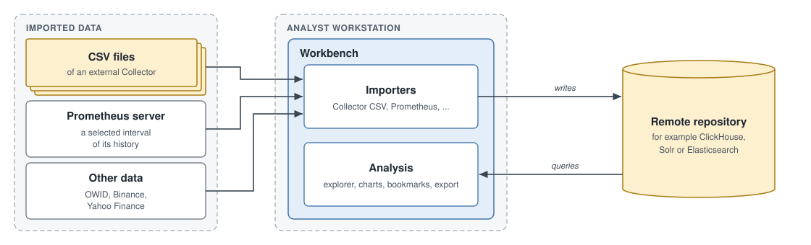

# Architecture

[Handbook home](README.md) · [Concepts](concepts.md) · [Getting started](getting-started.md) ·
[Collector](collector.md) · [Workbench](workbench.md)

Software-EKG has three kinds of parts: **Collectors** that read the systems, **repositories**
that hold what was read, and the **Workbench** that analyses it. A Collector and a repository
exist inside the Workbench and outside of it. Which of them are used makes the setup; the four
that matter are shown below, each with its picture.

## The parts

| Part | Where it runs | What it does |
| --- | --- | --- |
| Workbench | the workstation of the analyst | Projects, explorer, charts, bookmarks, export and the AI Assistant. It analyses what a repository holds. |
| Internal Collector | inside the Workbench | Collects for an analysis set up with **Analysis → New Analysis**, one engine per data source, for as long as the Workbench runs. It writes into the embedded Solr. |
| Importers | inside the Workbench | Read CSV files of a Collector, the history of a Prometheus server and other data into the repository of a project. |
| Embedded Solr | inside the Workbench, under `~/.ekg/solr` | The repository of the workstation. It holds what the internal Collector collects and what is imported into a local project. |
| External Collector | a server, a jump host, a Raspberry Pi, or a measured host itself | The standalone Collector process, configured in YAML. It runs without a Workbench, headless or with a [local display](collector.md#the-display), and writes into one repository: CSV files, a remote Solr or Elasticsearch. |
| Remote repository | a server of its own | Solr (standalone or SolrCloud), Elasticsearch or ClickHouse, registered in the Workbench with **Repository → Add...**. It is queried by one or several Workbenches. An external Collector writes into Solr and Elasticsearch, the importers write into each of them. |

The internal and the external Collector are the same engine with the same configuration model:
the Workbench compiles a data source to the configuration a standalone Collector reads. They
differ in where they run, how they are configured and where they write.

| | Internal Collector | External Collector |
| --- | --- | --- |
| Configured by | the dialog **New Analysis** | a YAML file |
| Runs | while the Workbench runs | on its own, also as a service |
| Sources | those the dialog offers: Unix by SSH and `top`, Windows performance counters, Prometheus | [all source modules](collector-sources.md) |
| Writes to | the embedded Solr | CSV files, a remote Solr or Elasticsearch |
| Reaches | what the workstation reaches | what its host reaches |

## The scenarios

| Scenario | Collector | Repository |
| --- | --- | --- |
| [The Workbench alone](#the-workbench-alone) | internal | embedded Solr |
| [An external Collector and CSV files](#an-external-collector-and-csv-files) | external | CSV files, then the embedded Solr |
| [An external Collector and a remote Solr](#an-external-collector-and-a-remote-solr) | external | remote Solr |
| [Import into a remote repository](#import-into-a-remote-repository) | none, or an external one for the files | remote, for example ClickHouse |

In all pictures the arrows show the way of the measured data. The Collectors fetch it: they
open the connection, and the measured systems send nothing by themselves.

### The Workbench alone

The Workbench collects by itself. **Analysis → New Analysis** starts the internal Collector, it
writes into the embedded Solr, and the chart follows the data. Nothing but the Workbench is
installed, and there is neither a remote repository nor a second process.

- **For:** a first look, and a few systems the workstation reaches. It is the way of
  [the first chart](getting-started.md#the-shortest-way-to-a-first-chart).
- **Limits:** it collects only while the Workbench runs, it reaches only what the workstation
  reaches, and Windows counters need a Workbench running on Windows.

### An external Collector and CSV files

The Collector runs where the systems can be reached and writes files on its own disk. They are
copied to the workstation and read with **Import → EKG Collector Logs** into the embedded Solr.
CSV is the output a Collector has unless it is told otherwise.

- **For:** systems behind a jump host or in another network zone, collections over days or
  weeks, and a case file to archive or hand over. The Collector and the Workbench need no
  connection to each other at all, so this also works across an air gap.
- **Limits:** the analysis comes after the collection, not during it, and the Collector host
  needs the disk space. See [CSV and archive](collector-repositories.md#csv-and-archive).

### An external Collector and a remote Solr

The Collector writes into a Solr server, and the Workbench queries that server directly. Nothing
is copied and nothing is imported.

- **For:** analysis while the collection runs, several analysts on the same data, and a
  repository that is to live long.
- **Limits:** a Solr server has to be operated, and both the Collector and the workstation need
  a connection to it. See [Solr](collector-repositories.md#solr).

Elasticsearch can stand in the place of the Solr: the Collector has a repository for it and the
Workbench a client.

### Import into a remote repository

An importer writes into the repository of the project it imports for. That is the embedded Solr
for a project there, as in the second scenario, and it is any remote repository the Workbench
knows for a project in it: ClickHouse, a remote Solr or Elasticsearch. The analysis then queries
that repository.

- **For:** large data sets, imported data that several analysts share, and a repository the
  Collector has no output of its own for. CSV files of an external Collector get into
  ClickHouse this way.
- **Limits:** the workstation needs a connection to the repository while importing and while
  analysing.

What is imported is described in [Workbench importers](workbench-importers.md). A Prometheus
server needs no Collector at all for this: **Import → Prometheus Data** copies a selected
interval of its history into a project.

## The measured systems

| System | How it is read | To note |
| --- | --- | --- |
| Linux / Unix hosts | by SSH: `top`, `iostat`, `df` and log files. JVMs on them by JMX or Jolokia. | No agent is installed on the host; an SSH login is enough. JMX and Jolokia need the endpoint of the JVM. |
| Windows hosts | through their performance counters | The counters are read through a native library, so the Collector that reads them runs on Windows: an external Collector on a Windows machine, or a Workbench running on Windows. It reads its own machine and other Windows hosts that allow it. |
| Cloud / Kubernetes | through the HTTP API of a Prometheus server that already collects from nodes, pods and services | The Collector reads the server, not the single systems. They are found by their labels rather than listed, and their history comes along. |

A Collector reads from a distance (`remote`) or beside the workload on the measured host itself
(`sidecar`); see [Remote and sidecar placement](collector.md#remote-and-sidecar-placement). One
Collector can read all three kinds of systems at once, and that is the point: the series of a
Linux database server, a Windows application server and the pods of a cluster end up in one
repository and one chart.

The sources are described in [Source modules](collector-sources.md), the repositories in
[Collector repositories](collector-repositories.md).

## From one scenario to the next

The scenarios are not exclusive, and an investigation often moves through them. It begins with
the Workbench alone. When the collection has to run longer than the Workbench does, or from
another place, **Analysis → Data Sources → Export Collector Config...** writes the data source
as a configuration for an external Collector. Whether that Collector then writes files or into
a remote Solr is chosen in its `collector.properties`.

Whichever way the data came, the analysis is the same: explorer, charts and bookmarks work on
the same dimensions.

[Next: Getting started →](getting-started.md)
