# Workbench Importers

[Handbook home](README.md) · [Workbench](workbench.md) · [Extensions](extensions.md)

An importer reads data that already exists somewhere into a project. The Workbench has five, in
the **Import** menu and in the context menu of a project. The first two read what software
systems measure: the CSV files of a Collector and the history of a Prometheus server. The other
three, below the line, read public data sets that have nothing to do with software.

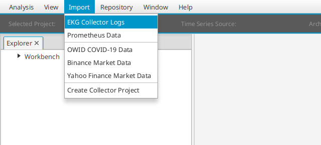

| Importer | Where the data comes from | What it reads |
| --- | --- | --- |
| [EKG Collector Logs](#ekg-collector-logs) | an external Collector | the CSV files it wrote |
| [Prometheus Data](#prometheus-data) | a Prometheus server | its HTTP API |
| [OWID COVID-19 Data](#owid-covid-19-data) | Our World in Data | a CSV file downloaded from its catalog |
| [Binance Market Data](#binance-market-data) | `data.binance.vision`, the public archive of Binance | downloaded ZIP files of trades |
| [Yahoo Finance Market Data](#yahoo-finance-market-data) | Yahoo Finance | directories written by a script that uses the Python library `yfinance` |

Only the Prometheus importer talks to a server. The other four read files: the Workbench does
not download them, it is given the place where they lie. That keeps an import reproducible, and
it works without a connection.

## The dialog

All importers share one dialog. Its upper half says where the data goes, its lower half where
it comes from. This is the one of the Collector logs:

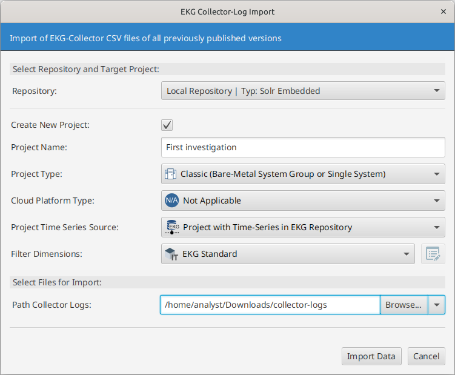

| Field | Meaning |
| --- | --- |
| Repository | The repository the project lies in: the embedded Solr (`Local Repository`) or a remote one that was added with **Repository → Add...**. See [Architecture](architecture.md#import-into-a-remote-repository). |
| Create New Project / Project Name | A new project, or without the check mark an existing one to import into. A name that is taken is marked red. |
| Project Type | Classic, Hybrid or Cloud Native: the dimensions the project has. |
| Cloud Platform Type | The platform of a project with cloud parts. |
| Project Time Series Source | Whether the series are copied into the repository, or stay in the external system and are fetched when a chart needs them. Only the Prometheus importer offers the second. |
| Filter Dimensions | The names of the dimensions: those of the importer (*Country* instead of *Host*), or the standard ones. |
| Selected Files | A file or a directory, typed or chosen with **Browse...**; the arrow beside it switches between choosing a directory and choosing files. A directory is searched with everything below it. |

**Import Data** starts the import in the background. The status bar shows its progress and ends
with `Import in series <project> successful.` The project then appears in the explorer below
its repository.

## What software systems measure

### EKG Collector Logs

**Where the data comes from.** From an external Collector with the CSV repository, which is the
one it has unless told otherwise. It writes its files to `<log directory>/ekg/<start time>/`,
one per job and day; see [CSV and archive](collector-repositories.md#csv-and-archive). Copy the
directory to the workstation. This is the way for a collection behind a jump host or across an
air gap, and for a frozen snapshot of an incident. Its dialog is the one shown
[above](#the-dialog); **Path Collector Logs** takes the directory.

The importer reads every published format: the current one with the metadata of the job in its
header, including the cloud-native dimensions, and the classic rows of Collectors before 6.1.
Host group, host, process, metric group and metric come from the files. The start time of the
Collector becomes the measurement, so that two runs stay apart.

Keep the files of a run together and do not edit separators or timestamps. Import a directory
once: importing it again can store its values a second time.

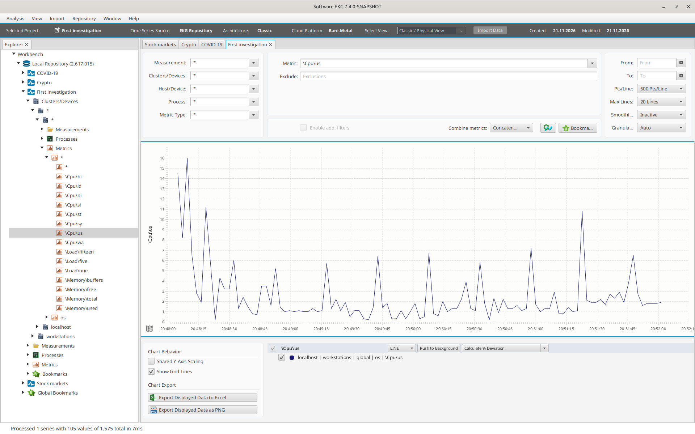

The picture shows four minutes of a host read with the source `unix`: the metrics of the file
are in the explorer, and `\Cpu\us` is in the chart.

### Prometheus Data

**Where the data comes from.** From the HTTP API of a Prometheus server. **Repository URL** is
the address of the server, such as `http://prometheus.example.org:9090`. The importer asks the
server for its metric names, for the series of each, and for their values.

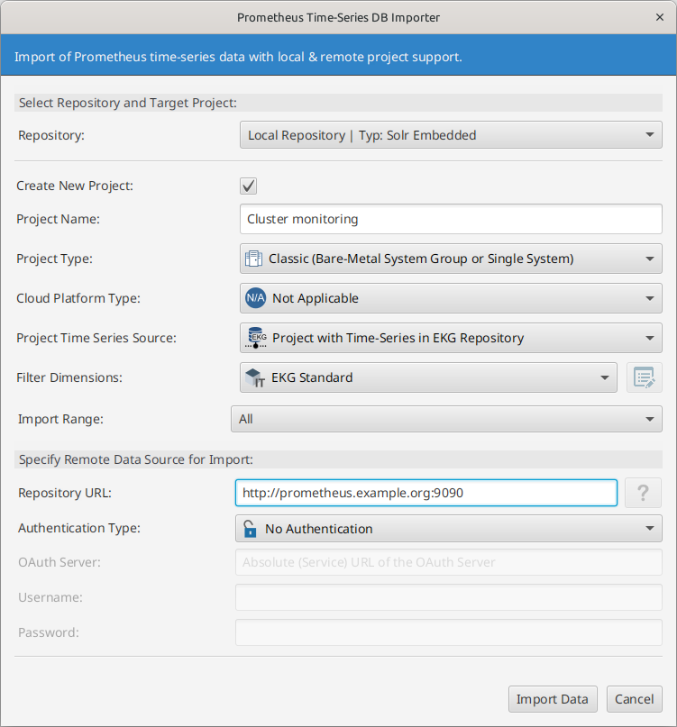

The dialog has a second part for the server:

| Field | Meaning |
| --- | --- |
| Import Range | The last 1, 2, 3, 5 or 10 days, or `All`: everything the server has. |
| Repository URL | The address of the server. It can be entered once the project is named, and **Import Data** can be pressed once it is entered. |
| Authentication Type | None, user name and password, a JWT bearer token, or OAuth2 client credentials with the address of the OAuth server. |

With **Project Time Series Source** the importer does one of two things:

- *Project with Time-Series in EKG Repository* copies the selected range into the project. The
  project is a snapshot: it does not change any more, and it can be analysed without the server.
- *Project with Time-Series in External System* stores only which series there are. Their
  values are fetched from the server whenever a chart needs them, so the project always shows
  what the server has now, and needs it to be reachable.

Use a copy for reproducibility and offline work. Use the external system when the volume makes
a copy impractical or the latest value matters.

The bundled `dimension-mapping.conf` says which Prometheus label fills which EKG dimension. A line
is `DIMENSION:label1;label2;...`, and the first label a series has is used:

```text
HOST_GROUP:role
HOST:*host;instance;host;node_name
NAMESPACE:kubernetes_namespace;namespace
SERVICE:servicename;kubernetes_name;MICROSERVICEID;MICROSERVICENAME
POD:pod_name;node
CONTAINER:container_name
MEASUREMENT:job
PROCESS:job
METRIC_GROUP:*prefix
METRIC_NAME:__name__
```

`*host` takes the host name out of a `host:port` value, and `*prefix` derives the metric group
from the prefix of the metric name (`jvm_`, `node_`). The bundled configuration area also
contains standard and regex series-filter examples (`series-filter-std.conf`,
`series-filter-regex.conf`).

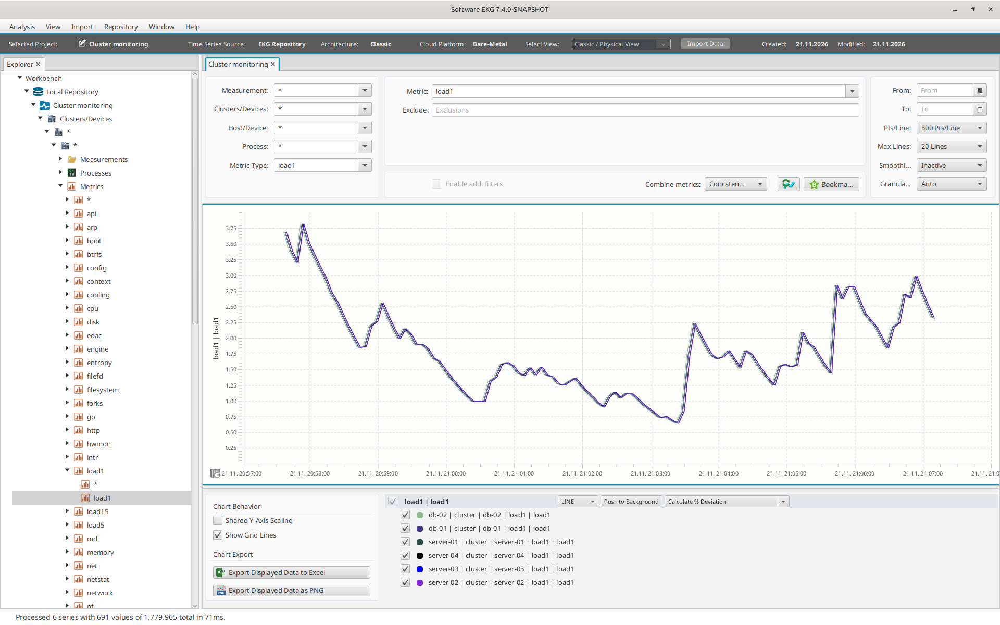

The picture shows a copy of a small server that scrapes node exporters: the hosts are the
`instance` labels, the metric groups in the explorer are the prefixes of the metric names, and
the chart shows `load1` of all hosts. A server knows many series; this one had 15,457 for 643
metric names. Choose a short range first.

The Workbench can also collect from a Prometheus server continuously, with
**Analysis → New Analysis**; see
[Data Sources and New Analysis](workbench.md#data-sources-and-new-analysis). The importer is
for a range of the past.

## Data that has nothing to do with software

The data model of Software-EKG is not bound to servers and processes: a series is a metric of
something that belongs to a group. These three importers show it with a pandemic and two
markets, and they are a quick way to try the charts without a system to measure.

### OWID COVID-19 Data

**Where the data comes from.** From [Our World in Data](https://ourworldindata.org/coronavirus),
which publishes its COVID-19 data set as one CSV file. The header of the dialog names the file
and opens it in the browser:

```text
https://catalog.ourworldindata.org/garden/covid/latest/compact/compact.csv
```

Download the file and select it. The importer also reads the classic file of the data set,
`owid-covid-data.csv`, as the GitHub repository `owid/covid-19-data` has it, and both files
compressed as `.csv.gz`. It finds the columns by their names.

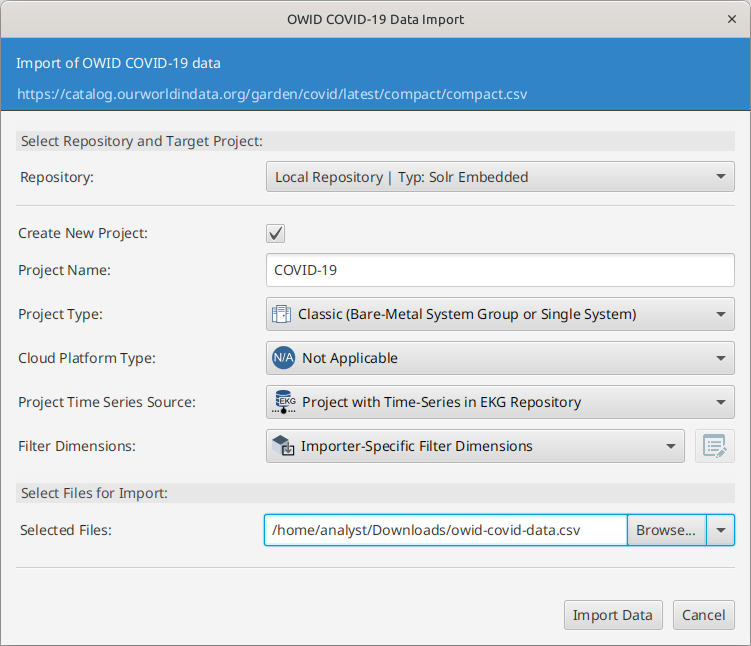

A row of the file is a country on a day, and every further column is a metric:

| In the file | In the project |
| --- | --- |
| `continent` | Continent. The world, income groups and other aggregates have none and are below `Non-Continent`. |
| `country` (classic file: `location`) | Country |
| `date` | the time of the value, a day in UTC |
| every other column with numbers | a metric, named as the column |
| the name of the column | Main category: `CASES`, `DEATHS`, `TESTS`, or `MISC` for all others |

A value of 0 is not stored, and neither is a text.

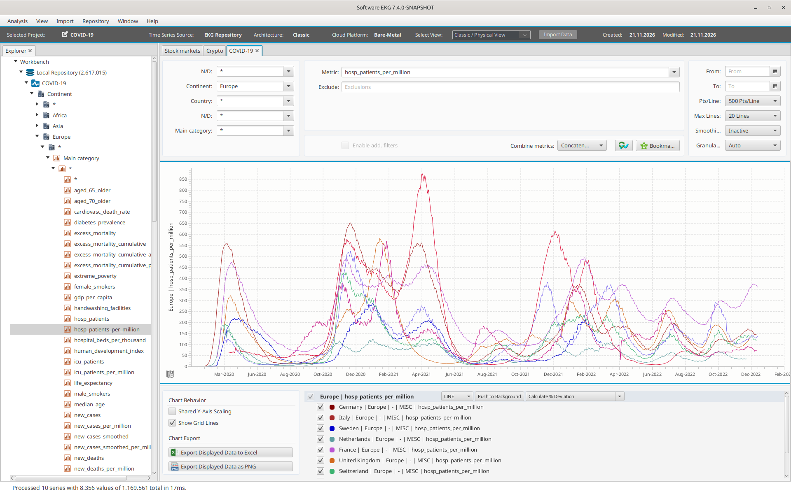

The picture shows what the data model is good for beyond software: below *Europe* the node `*`
stands for all its countries, and a double click on `hosp_patients_per_million` puts them into
one chart.

### Binance Market Data

**Where the data comes from.** From `data.binance.vision`, where the exchange Binance publishes
its market data as files. The importer reads the aggregated trades of the spot market
(`aggTrades`), one ZIP file per symbol and month:

```text
https://data.binance.vision/data/spot/monthly/aggTrades/<SYMBOL>/<SYMBOL>-aggTrades-<YYYY>-<MM>.zip
https://data.binance.vision/data/spot/monthly/aggTrades/BTCUSDT/BTCUSDT-aggTrades-2025-08.zip
```

The files can be browsed at
`https://data.binance.vision/?prefix=data/spot/monthly/aggTrades/`. Download the ZIP files,
leave them packed and keep their names: the name tells the importer the symbol and the month.
The importer parses the files; it does not download or trade.

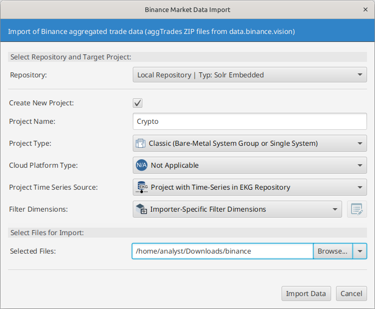

A file has one row per aggregated trade. The importer makes three series of it: `price`,
`quantity` and `volume`, which is price times quantity, each with one value per trade.

| Dimension | Value |
| --- | --- |
| Exchange | `Binance` |
| Market | `Spot` |
| Quote Asset | the currency the symbol is priced in, taken from the end of its name: `USDT` of `BTCUSDT` |
| Symbol | the symbol, `BTCUSDT` |
| Period | the month, `2025-08` |
| Category | `Market Data` |

Quote Asset and Symbol are stored in the cloud-native dimensions namespace and service.

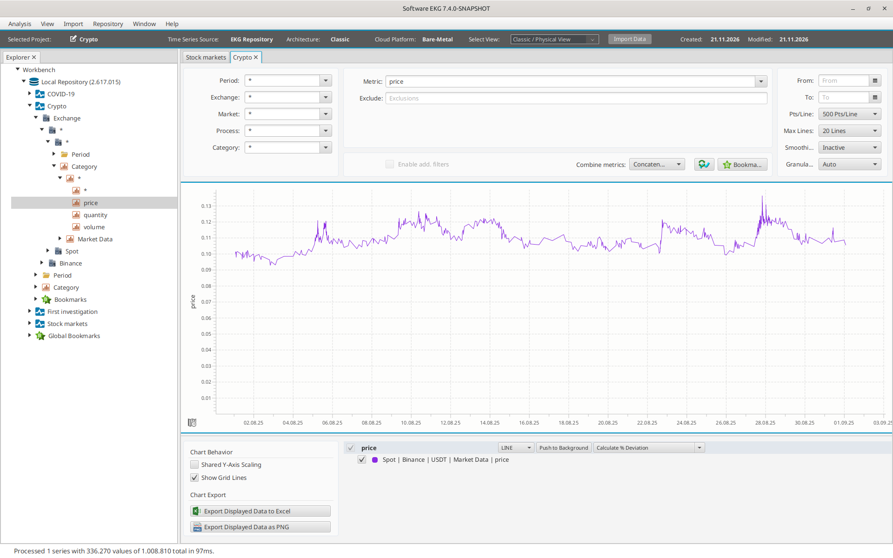

The picture shows the month of a small symbol, 336,270 trades. A month of a large one such as
`BTCUSDT` has many millions; begin with a single file.

### Yahoo Finance Market Data

**Where the data comes from.** From Yahoo Finance, fetched with the Python library
[`yfinance`](https://github.com/ranaroussi/yfinance). There is no file to download as with the
other two: a small script asks Yahoo for the symbols wanted and writes one directory per
symbol. The importer reads these directories. The Workbench itself does not talk to Yahoo.

A script as short as this writes what the importer reads:

```python
import json
import pathlib

import yfinance as yf          # pip install yfinance

for symbol in ["AAPL", "SAP.DE"]:
    out = pathlib.Path("data") / symbol
    out.mkdir(parents=True, exist_ok=True)
    ticker = yf.Ticker(symbol)

    # the daily prices of the whole history, with dividends and splits
    history = ticker.history(period="max", interval="1d", auto_adjust=False, actions=True)
    history.index = history.index.tz_convert("UTC")
    history.to_csv(out / "history_1d.csv")

    # exchange, country and kind of the value
    (out / "metadata.json").write_text(json.dumps({"info": ticker.info}, default=str))
```

Select the directory `data` in the dialog. A directory below it counts as a symbol if it has a
`metadata.json` and at least one of the files of prices or events:

| File | Content |
| --- | --- |
| `metadata.json` | The `info` of the ticker. `quoteType` becomes the Value Group (Equity, ETF, Index, Crypto, FX ...), `fullExchangeName` or `exchange` the Exchange, `country` the Country. |
| `history_<interval>.csv` | Prices of the whole history at one interval, `1d`, `1wk`, `1mo`: the columns `Open`, `High`, `Low`, `Close`, `Adj Close`, `Volume`, `Dividends`, `Stock Splits` and, if yfinance repaired values, `Repaired?`. |
| `intraday_<interval>.csv` | The same columns at an interval within the day. Yahoo keeps these for a limited time only. |
| `actions.csv`, `dividends.csv`, `splits.csv`, `capital_gains.csv` | Events of the value, as yfinance delivers them. |

The first column of every file is the time, written as `2026-11-20 05:00:00+00:00`.

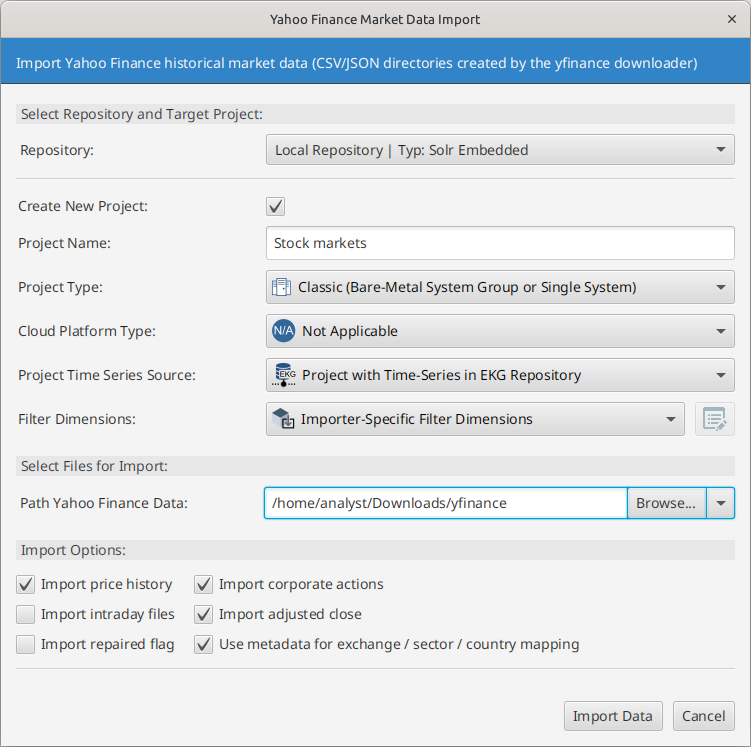

The options of the dialog choose what is read:

| Option | Effect |
| --- | --- |
| Import price history | the files `history_*.csv` |
| Import corporate actions | dividends, splits and capital gains |
| Import intraday files | the files `intraday_*.csv` |
| Import adjusted close | the column `Adj Close` as the metric *Adjusted Close* |
| Import repaired flag | the column `Repaired?` as a metric |
| Use metadata for exchange / sector / country mapping | take Value Group, Exchange and Country from `metadata.json`; without it the country is guessed from the ending of the symbol (`.DE`, `.SW`, `.T`, `.L`) |

The dimensions are Value Group, Value (the symbol), Country, Exchange, Period (`History/1d`,
`Intraday/1h`, `Corporate Actions/events`), Metric Group (`Price`, `Trading`,
`Corporate Actions`) and Metric.

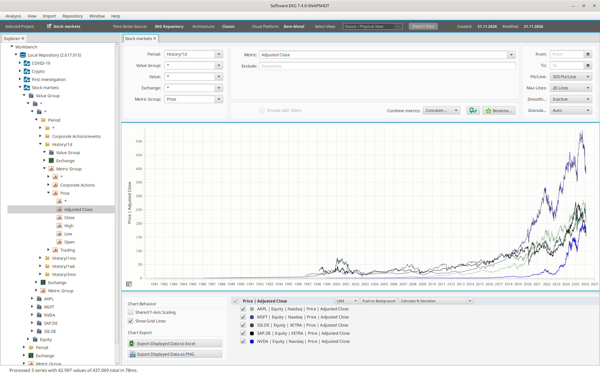

The picture shows the daily adjusted closing prices of five values: the period `History/1d`
and the metric group `Price` are chosen in the explorer, and `*` stands for all values.

## Common import workflow

1. Get the data: copy the files of the Collector, or download the files of the data set.
2. Open the importer from **Import** or the project context menu.
3. Name the project, or choose an existing one, and its repository.
4. Select the files, or enter the server and its authentication. Limit the range and the number
   of files before a large import.
5. Run the import and wait for the message in the status bar.
6. Open the project in the explorer and double-click a metric. Validate the number of series,
   the time zone, the dimensions and one known value.
7. Save a bookmark documenting the validation query.

Importers rename the dimensions they show. If a field looks surprising, check the names the
project uses before treating the imported hierarchy as wrong: the filter header of a chart
shows them.

[Next: Extension guide →](extensions.md)
