# The Workbench Window

[Handbook home](README.md) · [Workbench](workbench.md) · [Importers](workbench-importers.md) ·
[Reference](reference.md)

This page goes through the window of the Workbench part by part: the explorer, the filter
header of a chart with its wildcards, the chart itself, and the legend, where charts are pushed
to the background and brought to the front again, coloured and drawn as lines, areas, sums or
points. At the end the AI Assistant analyses the fault the pictures show.

The pictures show a sample project with generated values. *Webshop* has three web servers,
`web01` to `web03`, and a database server, measured for eight hours. Around midday `web03` goes
wrong: its response times rise, it serves fewer requests, and at 14:10 it is restarted.

## The window

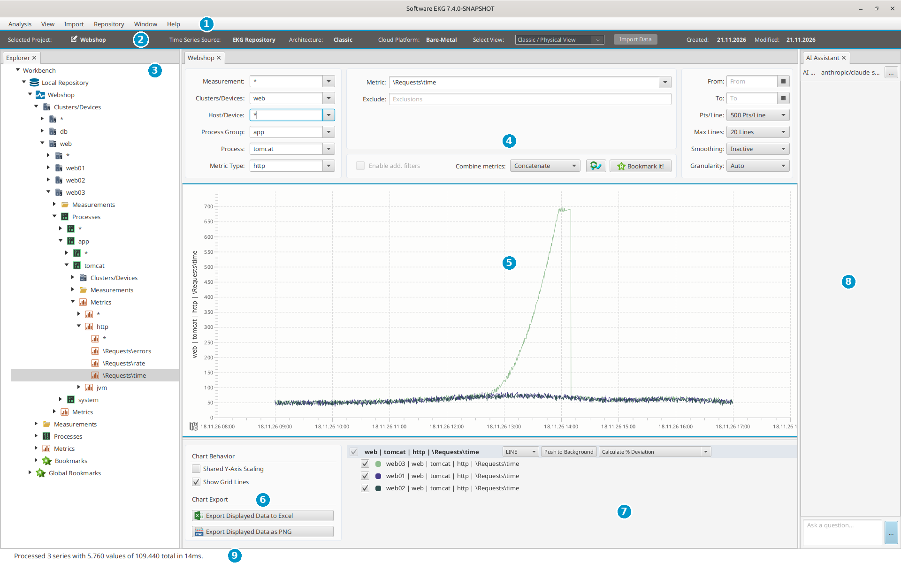

| | Part | What it is for |
| --- | --- | --- |
| 1 | Menu bar | Analyses, importers, repositories, windows. See [Workspace and menus](workbench.md#workspace-and-menus). |
| 2 | Project bar | The selected project: where its series lie, its architecture and platform, the view on it, and **Import Data** for its importers. |
| 3 | [Explorer](#the-explorer) | Repositories, projects and what is in them, as a tree. This is where a chart is opened from. |
| 4 | [Filter header](#the-filter-header) | Which series the chart shows, of which time, and what is computed from them. |
| 5 | [Chart](#the-chart) | The series over the time. Zooming, moving and reading values is done with the mouse. |
| 6 | [Chart Behavior and Chart Export](#chart-behavior-and-export) | Settings of the chart, and its export as Excel file or picture. |
| 7 | [Legend](#the-legend) | The charts of the panel and their series: visibility, colour, type, and the charts in the background. |
| 8 | [AI Assistant](#the-ai-assistant) | Answers questions about the data of the chart, by querying it. |
| 9 | Status bar | What the last query did - *Processed 3 series with 5.760 values of 109.440 total in 17ms* - and the progress of what runs in the background. |

Parts 4 to 7 together are one chart panel. It has a tab with the name of its project, and
**Window → New Chart** opens another one beside it.

The explorer, the chart panels and the AI Assistant are panes of a docking layout. The lines
between them are dragged with the mouse, and a pane is closed with the cross on its tab.
**View → Explorer** and **View → AI Assistant** bring a closed pane back, and **Window → Restore
Default Layout** puts everything where it was.

A chart panel needs a width of about 1080 pixels for its header. On a small screen, close the
AI Assistant or drag the line between it and the chart to the right.

## The explorer

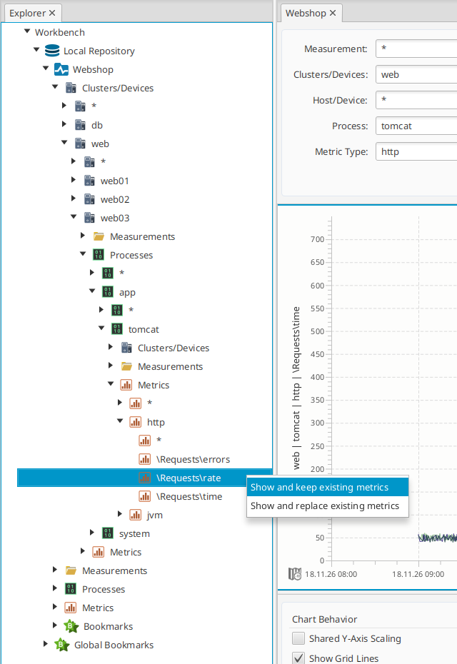

The tree begins with the repositories the Workbench knows. Below a repository are its projects,
and below a project its dimensions:

| Node | Below it |
| --- | --- |
| Clusters/Devices | the host groups, and below a host group its hosts |
| Measurements | the measurements: one for every start of a Collector or every import |
| Processes | the process groups, and below a process group its processes |
| Metrics | the metric groups, and below a metric group its metrics |
| Bookmarks | the bookmark groups of the project with their bookmarks |

The names are those the project gives its dimensions. The standard ones are shown here; a
project of an importer calls a host *Country* or *Market*, and a cloud-native project has
namespaces, services, pods and containers in the place of host groups and hosts. See
[Projects](workbench.md#projects). **Global Bookmarks**, below the repository, are bookmarks
that belong to no project: they are loaded for the project the chart shows.

Two things make the tree more than a list:

- **Every level begins with `*`.** It stands for all values of the level. Below
  *Clusters/Devices → web → \** is everything of all hosts of the group `web`.
- **The dimensions can be taken in any order.** Below a host are again *Measurements*,
  *Processes* and *Metrics*, below a process again *Clusters/Devices*, and so on. Every step
  down narrows what is left, and the tree only offers what exists for the steps taken so far.

The way to a metric is therefore a query. In the picture it is *web → web03 → app → tomcat →
http → \Requests\rate*: the rate of requests of the Tomcat on `web03`. When the metric is
opened, the [filter header](#the-filter-header) shows exactly this way, field by field, and can
be changed there.

A metric is opened in two ways:

| Action | Effect |
| --- | --- |
| Double-click, the Enter key, or **Show and replace existing metrics** in the menu of the metric | The chart shows this metric and nothing else. |
| Moving to the metric with the arrow keys | The same. Going down a list of metrics with the Down key shows one after the other. |
| **Show and keep existing metrics** in the menu of the metric | What the chart showed moves to the background, and this metric is drawn in front of it. See [Charts in the background](#charts-in-the-background). |

The other nodes have menus of their own, opened with the right mouse button:

| Node | Menu |
| --- | --- |
| Repository | **Reload Contents**; for a remote one also **Edit Repository**, **Connect** and **Remove from Explorer** |
| Project | the [importers](workbench-importers.md); **Data Sources...** for a project of an analysis started with **New Analysis**; **Delete project and its data** |
| Bookmarks, Global Bookmarks | **Create Bookmark Group** |
| Bookmark group | **Rename Group**, **Delete Group** |
| Bookmark | **Load in Chart View** - a double-click does the same - and **Delete Bookmark** |

Selecting anything below a project makes it the selected project of the project bar.

## The filter header

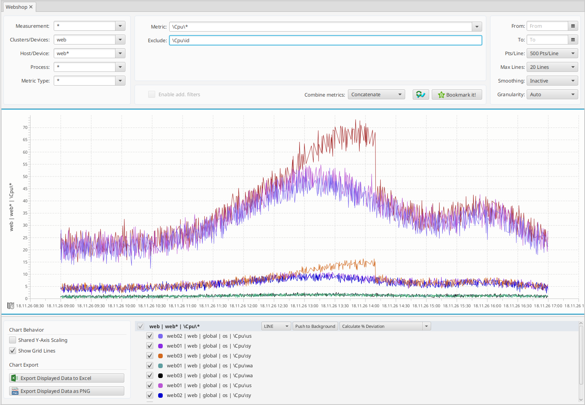

The header says what the chart shows. It has three blocks: the dimensions on the left, the
metric in the middle, and on the right the time and what is computed. Every change loads the
chart again at once; a typed value is confirmed with the Enter key.

| Field | Meaning |
| --- | --- |
| Measurement | one measurement, or `*` for all |
| Clusters/Devices | the host group |
| Host/Device | the host |
| Process Group | the process group: the level between the host and the process in the explorer, `app` and `system` in the pictures |
| Process | the process |
| Metric Type | the metric group |
| Metric | the metric |
| Exclude | metrics to leave out of what **Metric** matches |

In a cloud-native project the fields are *Namespace*, *Pod* and *Container* instead of
*Clusters/Devices* and *Host/Device*, and **Enable add. filters** adds *Measurement*, *Service*
and *Process Group*.

### Wildcards

A field takes a value or a pattern. The fields of the dimensions and the field **Metric**
understand:

| Pattern | Matches | Example |
| --- | --- | --- |
| `*` | any number of characters | `web*` - every host whose name begins with `web`; `\Cpu\*` - every metric of the CPU |
| `?` | exactly one character | `web0?` |
| `\|(a\|b)` | one of several values, each of which may be a pattern | `\|(web02\|web03)` - these two hosts |
| `-(a)` | everything but this | `-(web03)` |

A `*` alone is no restriction, and it is what a field holds until something else is chosen.

The picture above is the query *all hosts `web*`, all metrics `\Cpu\*`, but not `\Cpu\id`*. It
gives nine series: user, system and wait time of the three web servers. **Exclude** takes a
pattern as well.

A field is also a list. The arrow opens it, and it offers the values there are for what the
other fields say: in the picture below only metrics of the hosts `web*`, and `\Cpu\id` is not
among them because it is excluded. Typing narrows the list and completes the name.

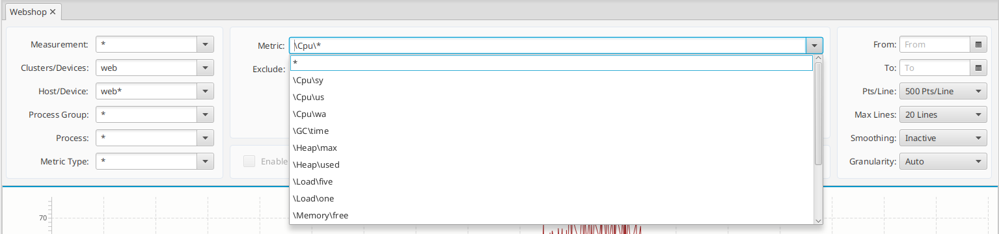

### Time and computing

| Field | Meaning |
| --- | --- |
| From, To | The days the chart begins and ends with. Empty fields mean everything the project has. |
| Pts/Line | With how many points a line is drawn at most, 500 unless changed. A series with more is reduced so that its shape remains. **Off** draws every value, **Changes Only** those at which the value changes. |
| Max Lines | How many series the chart draws at most, 20 unless changed. |
| Smoothing | A value computed for every interval of time instead of the single values: **Average**, **Min**, **Max**, **Sum**, **Median**, **Value Count** (how many values there are) or **Value Difference** (the change against the interval before). |
| Granularity | The interval of the smoothing: seconds to half years, or **Auto**, which chooses one that fits the time shown. |
| Combine metrics | What becomes of several series. **Concatenate**, the standard, joins the parts a series has in several measurements to one line. **Sum** and **Average** make one series of all, per second, minute, hour, day or month. **Inactive** leaves every part as it is. |

The lists **Smoothing** and **Combine metrics** say what their modes do. Every entry of the open
list has a tooltip, and so has the list itself for the mode that is chosen.

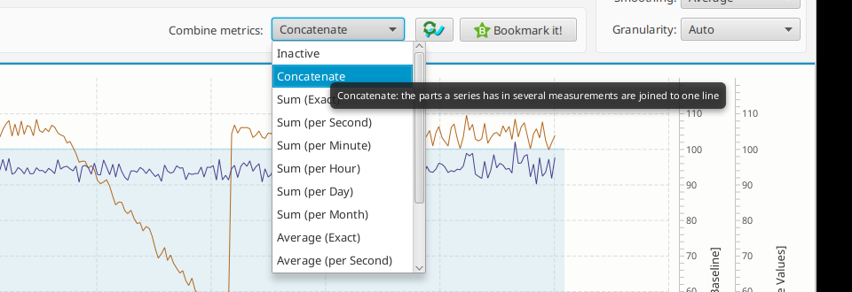

Reducing the points does not lose anything: zooming in loads the interval again, and the 500
points are then spent on it alone.

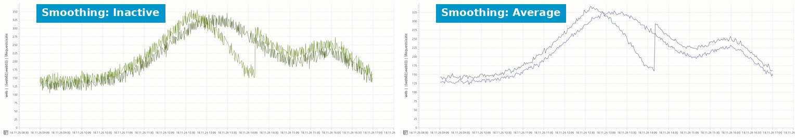

Which computation fits which kind of series is said in
[Smoothing and aggregation](workbench.md#smoothing-and-aggregation).

The button with the two arrows loads the chart again. **Bookmark it!** stores the query; see
[Bookmarks](workbench.md#bookmarks).

## The chart

The time runs along the lower axis and the values along the left one, whose label is the query
of the header. The small symbol at the lower left corner chooses the time zone of the time
axis: that of the computer unless changed, UTC, Europe/Berlin, or a fixed offset to GMT. The
data is not changed by it. The pictures of this page were taken in the time zone
Europe/Berlin.

| Mouse | Effect |
| --- | --- |
| Move | A cross of two thin lines follows the pointer, to read time and value off the axes. |
| Shift and move | A small window shows the time under the pointer and the value of every series the pointer is on. |
| Drag from the upper left to the lower right | Zooms into the rectangle. The interval is loaded again, so a line that was reduced shows its detail. |
| Drag from the lower right to the upper left | Back to everything. |
| Alt and drag | Moves what is shown, in both directions. |
| Ctrl, Alt and drag up or down | Stretches or compresses the axis of the values. |
| Mouse wheel | The same in steps. |
| Alt and drag on a line of a chart in the background | Moves that chart up or down, to lay its line over another one. |
| Double-click | Opens the chart in a window of its own, which can be made as large as the screen. Closing the window puts the chart back. |

Some Linux desktops use the Alt key and dragging to move windows. The chart does not get the
gesture then; the key is changed in the settings of the desktop.

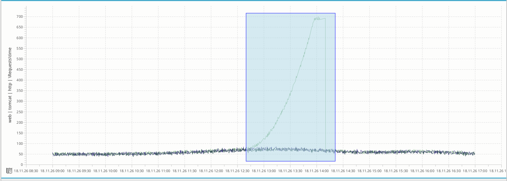

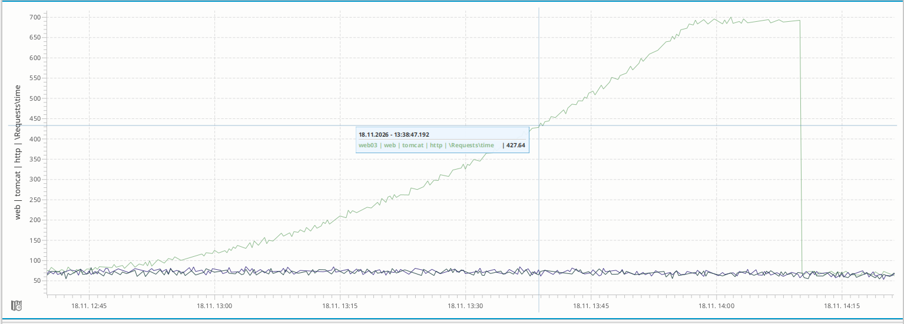

A chart of a project that is being collected follows the new values. If it shows everything, it
grows with them; if it is zoomed in at the newest values, the shown interval moves along; and
if it shows an earlier time, it stays where it is.

## The legend

Below the chart, to the right, is the legend. It has a block for every chart of the panel: a
bar for the chart, and a line for each of its series.

| In the bar of a chart | Effect |
| --- | --- |
| Check box | Shows or hides a chart in the background with all its series. |
| List with **LINE** | The [type](#chart-types) of the chart. |
| **Push to Background** | Moves the chart to the [background](#charts-in-the-background). |
| **Calculate % Deviation** | [Compares](#percentage-deviation) the charts in the background with this one. |
| **Bring to Front** | Makes a chart in the background the one in front again; what is in front goes to the [background](#charts-in-the-background) in exchange. |
| **Remove** | Takes a chart in the background out of the panel. |

| In the line of a series | Effect |
| --- | --- |
| Check box | Shows or hides the series. |
| Coloured field | Opens the [colours](#colours). |
| Name | A click draws the series bold, in the chart and in the legend; another click undoes it. |

### Colours

A chart that is alone in its panel gives its series the colours of a palette in their order.
A chart that is opened in front of others gets colours that differ as much as possible from
theirs, so that front and background can be told apart without doing anything. A click on the
coloured field of a series opens a palette, and **Custom Color...** below it any other colour.

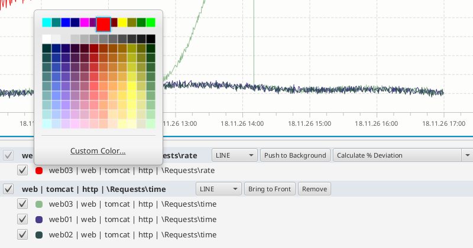

A series keeps its colour as long as it is shown, also when the chart is loaded again, zoomed
or exchanged with one in the background. Series that have the same name in one chart share a
colour: it is changed at the first of them, and the others show a lock.

### Chart types

Every chart has a type, chosen in the bar of the chart in the legend. The chart in front and
each chart in the background have their own, so a line can be drawn in front of an area.

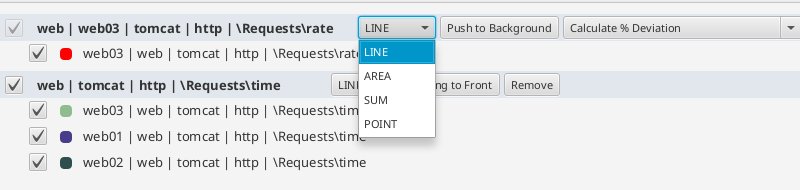

| Type | Draws | For |
| --- | --- | --- |
| LINE | a line for each series | nearly everything; the standard |
| AREA | the lines with the area below them filled, each one transparent | a single series, or a level such as memory in use |
| SUM | the series stacked on each other, so that the upper edge is their sum | parts of a whole: the requests of all servers, the CPU time by kind |
| POINT | a point for every value and no line | values that are single events, and series with gaps |

The picture shows the rate of requests of the three web servers in all four types. In SUM the
total can be read at the upper edge - about 1000 requests per second at the peak - and the dent
of `web03` is in it.

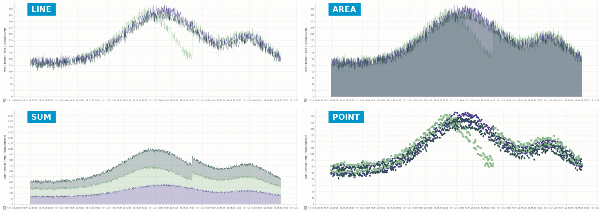

A [bookmark](workbench.md#bookmarks) remembers the type of its chart.

### Charts in the background

A chart panel has one chart in front. The filter header belongs to it, and every change of the
header loads it again. Behind it there can be any number of further charts, which stay as they
are. This is how series of different queries get into one picture.

A chart is pushed to the background in two ways:

- **Push to Background** in the legend. The chart in front becomes one in the background, and
  the place in front is empty until the header or the explorer fills it.
- **Show and keep existing metrics** in the menu of a metric in the [explorer](#the-explorer).
  It pushes what is shown and puts the metric in front in one step.

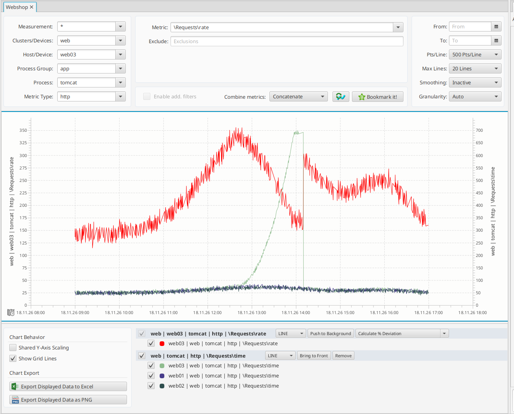

In the picture the response times of the three servers were shown first. Then the rate of
requests of `web03` was opened with **Show and keep existing metrics**; its red is the colour
it got by itself. The two belong together: the fewer requests the server answers, the longer it takes.

A chart in the background

- keeps its own axis of values, drawn on the right, so that 300 requests per second and 700
  milliseconds can share a picture. **Shared Y-Axis Scaling** gives all charts the scale of the
  one in front, which is what is wanted when they have the same unit;
- shares the time axis with the chart in front, and zooms and moves with it;
- has its own type, colours and check boxes in the legend;
- follows new values as the chart in front does, if its project is being collected.

**Bring to Front** exchanges a chart in the background with the one in front. The chart comes
back with its series, their colours and its type, and the filter header shows its query again,
which can then be changed. What was in front is in the background now, and can be brought back
the same way.

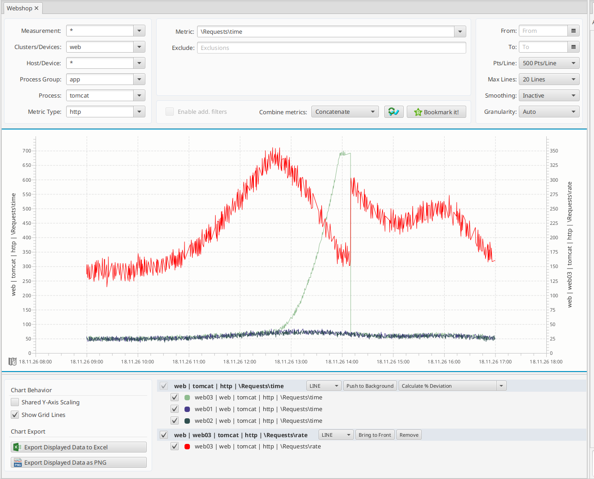

This is the picture before with the two charts exchanged: the header shows `\Requests\time`
of all hosts again, and the axis of the response times is the one on the left.

**Remove** takes a chart in the background out of the panel.

### Percentage deviation

**Calculate % Deviation** takes the chart in front as the measure of 100 percent and shows the
charts in the background as percentages of it. The chart in front must have exactly one series,
and there must be at least one chart in the background.

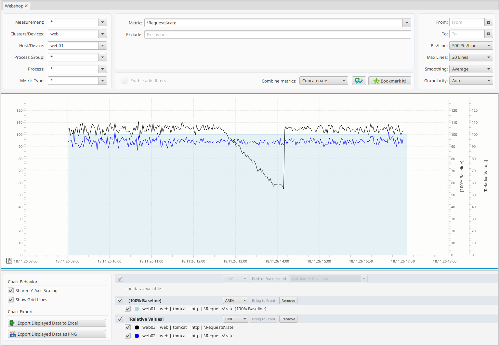

The picture came about like this:

1. The rate of requests of `web02` and `web03` is shown, with the host `|(web02|web03)`, and
   pushed to the background.
2. The host is changed to `web01`. Its series is now in front.
3. **Calculate % Deviation**.

The result is two charts in the background. *[100% Baseline]* is the measure as an area, and
*[Relative Values]* has the other series in percent of it: `web02` constantly a little below
`web01`, `web03` above it until it falls to 55 percent. The place in front is empty afterwards.
The two charts are calculated, not queried; **Bring to Front** is not available for them,
because the header would have no query to show.

The series are compared interval by interval, so they should have their values at the same
times. Smoothing all of them with the same granularity, as here with **Average**, does that.

The arrow beside the button offers **Combine Charts**. It puts the series of the chart in front
and of all charts in the background into one chart in the background, with one axis.

### Chart Behavior and export

| Control | Effect |
| --- | --- |
| Shared Y-Axis Scaling | All charts of the panel get the scale of the chart in front instead of their own. |
| Show Grid Lines | The grid behind the chart. |
| Export Displayed Data to Excel | Writes the values of all series shown, of the chart in front and of those in the background, into an Excel file. |
| Export Displayed Data as PNG | Writes the chart as a picture, in a size that can be chosen. |

See [Export](workbench.md#export).

## The AI Assistant

The pane on the right takes questions about the data in plain words. The assistant does not
see the picture of the chart: it asks which project, filters and time zone the chart panel in
use has, and then queries the series it needs itself, also others than those shown.

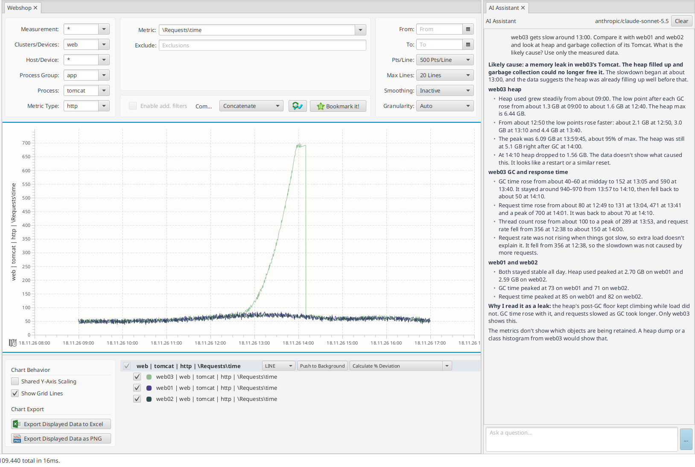

In the picture the chart shows the response times of the three web servers, and the question
was:

> web03 gets slow around 13:00. Compare it with web01 and web02 and look at heap and garbage
> collection of its Tomcat. What is the likely cause? Use only the measured data.

To answer it, the assistant read the heap, the garbage collection times, the threads and the
rate of requests of all three servers, none of which is in the chart, and compared them. Its
conclusion is a memory leak in the Tomcat of `web03`: the heap that remains after a garbage
collection rises while the load does not, the collections take longer, and the requests with
them. That is what the sample data was made to show. It also says what the data cannot tell:
which objects fill the heap.

Three things to know:

- The times the assistant names are those of the chart: it works in the time zone chosen at the
  lower left corner of the chart.
- The answer is a hypothesis with numbers to check, not a measurement. The chart panel beside
  it is where they are checked.
- The names of the metrics and the values the assistant queries are sent to the service that
  runs the model. What it needs, and what to mind, is described in
  [AI Assistant](workbench.md#ai-assistant).

[Next: Workbench importers →](workbench-importers.md)
