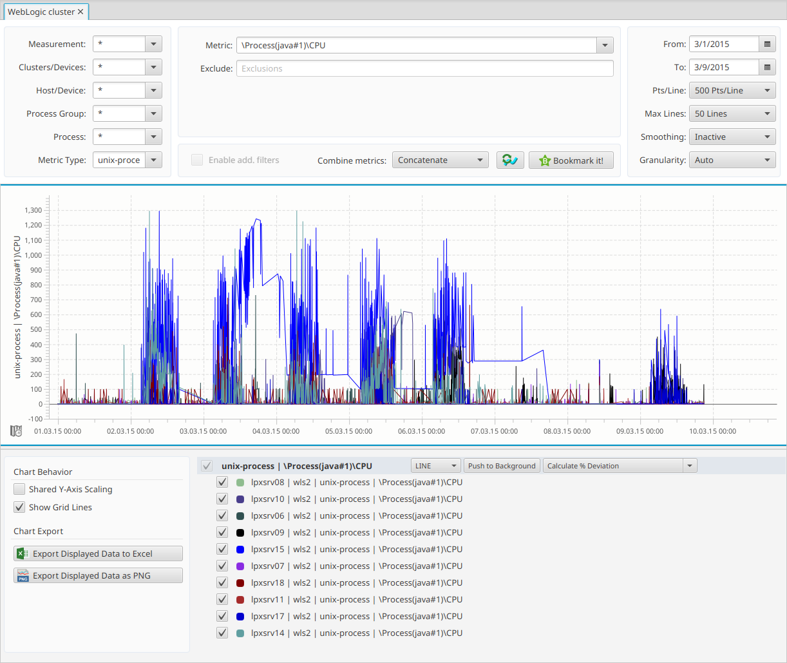

# Positionierung Software-EKG

[English](positioning.md) | **Deutsch**

Stand: 23.11.2026. Dieses Dokument hält fest, wofür das Software-EKG da ist und wofür nicht. Es ist das Ergebnis einer Diskussion, kein Umbauplan: Was daraus gebaut oder gestrichen wird, ist noch nicht entschieden.

## Position

Das Software-EKG ist ein diagnostischer Rekorder und eine Workbench für die dynamische Analyse komplexer, verteilter Systeme: Zur Fehlersuche zeichnet es das Laufzeitverhalten ihrer Server, Prozesse und Anwendungen auf und legt die Verläufe über Tage, Wochen oder Releases übereinander. So werden Anomalien im Verbund erkennbar, die im Monitoring nicht auffallen, weil jedes System für sich unauffällig ist. Ein Software-Notarzt stellt es für einen konkreten Einsatz zusammen, vergleicht lokal und abseits der Produktionssysteme, beginnt mit einem groben Überblick und grenzt Systeme, Zeiträume und Metriken ein, bis der entscheidende Unterschied sichtbar wird. Aussagekräftige Ansichten hält er als Bookmarks fest; sie werden zu Belegen für den Befund in der zum Einsatz passenden Präsentation oder Dokumentation. Ein eingebauter AI-Agent hilft ihm, seine Hypothesen anhand von Logs, Release-Plänen und Dokumentation zu prüfen.

Der Kern ist der Vergleich, nicht die automatische Erkennung von Anomalien. Erfahrene Analysten finden darin Muster, nach denen sie vorher nicht gesucht haben, und viele davon liegen innerhalb aller Grenzwerte:

- Warum steigt der Heap bei drei von fünfzig Systemen stetig?
- Warum tritt ein Lastmuster alle vierzehn Tage auf?
- Warum hat sich das Verhalten nach einem bestimmten Release verändert?
- Warum zeigen zwei eigentlich gleiche Systeme unterschiedliche Verläufe?

Der AI-Agent senkt die bisherige Einstiegshürde. Er arbeitet nicht so umfassend, dass man ihm die ganze Analyse überlassen könnte. Er ist ein Sparringspartner: Er hilft, Hypothesen zu dem zu bilden, was auffällt, und Fragen und Hypothesen anhand der Daten zu verifizieren.

## Für wen

Das Software-EKG bleibt ein Instrument für Performance-Analysten, Architekten und andere Experten, die historische Systemdaten untersuchen. Erfahrene Nutzer erkennen in dichten Kurvenbildern Muster aus Übung. Für Einsteiger bleiben dieselben Bilder ohne Unterstützung oft nur Kurven. Ohne einen Experten an der Seite waren die meisten Nutzer in widersprüchlichen Situationen überfordert, weil das Werkzeug keinerlei Erklärung für die Situation bot. Der AI-Agent ist der Sparringspartner, der bisher fehlte: Er hilft, Hypothesen zu bilden und zu verifizieren; die fachliche Entscheidung bleibt beim Menschen.

Ein Kunde brachte die bisherige Hürde sinngemäß auf den Punkt: „Viele besitzen ein EKG. Aber es gibt nur wenige Chefärzte, die daraus wirklich etwas ableiten können.“ Der AI-Agent ersetzt den Chefarzt nicht und automatisiert nicht die fachliche Verantwortung. Er gibt allen anderen einen Sparringspartner für ihre Fragen und Hypothesen.

Es bleibt ein Experteninstrument, jetzt mit Unterstützung für Einsteiger und mit Verifikation, die Fehldiagnosen vermeidet: Befunde, die eine andere Ursache haben als die naheliegende. Geht der Speicher aus, ist oft nicht der Heap zu klein konfiguriert. Es kann normal sein, weil mehr Benutzer auf dem System sind, oder abnormal: ein Memory Leak oder Speicher, der sich mit der Zahl der Nutzer vervielfacht. Es liefert oft nur die erste Symptomanalyse. Beides gehört zur Position und wird nicht kaschiert.

Ein typischer Einsatz geht über organisatorische Grenzen. An großen verteilten Anwendungen sind verschiedene Lieferanten, Provider und Betriebsteams beteiligt. Jeder sagt, bei ihm funktioniere alles, und trotzdem steht der Kunde im Wald, denn die Anwendung funktioniert nicht, ist instabil oder fällt sporadisch aus. Das Software-EKG legt die Messwerte aller Beteiligten auf eine Zeitachse, unabhängig davon, aus wessen Monitoring sie stammen. Das ist auch die Daseinsberechtigung des externen Collectors: In Firmenkontexten ist ein Direktzugriff oft problematischer, als irgendwo einen Collector in Java laufen zu lassen und die Daten auf einen Share zu legen. Das Ergebnis ist keine Schuldzuweisung, sondern eine begründete Frage an das richtige Team.

## Was das Tool nicht ist

- Kein Dashboard.
- Kein Alerting.
- Kein Live-Monitoring. Eine laufende Anzeige bestätigt höchstens, dass Daten ankommen.
- Kein Anomalie-Detektor, sondern ein Anomalie-Verifizierer mit Hypothesenbildung. Der Mensch bemerkt, was auffällt; der Assistant hilft, Hypothesen zu bilden und an den Daten zu prüfen.
- Kein Werkzeug, das die Ursache verspricht. Das EKG zeigt, seit wann, wo und im Takt womit etwas auffällig ist. Bei der Ursache hilft der Agent.
- Kein Ersatz für Wissen über die Architektur. Wer nicht weiß, wie die Anwendung wirklich aufgebaut ist, kommt oft nicht bis zur Ursache, und eine AI kann das nicht besser. Sie kann die richtigen Fragen stellen. Werden sie beantwortet, ist der Fall klar; weiß niemand, was im System vorgeht, bleibt er offen.

## Der Ablauf

1. **Sammeln.** Daten werden eingesammelt und lokal gespeichert, im eingebetteten Solr oder in ClickHouse. Die Auswertung findet auf dem eigenen Rechner statt, nicht auf den Produktionssystemen. Mit Verbindung importiert die Workbench aus Prometheus, einmalig oder als Delta-Import. Weitere Quellen liefert der Collector, unter anderem Systemmetriken und Logs per SSH.
2. **Vergleichen.** Der Analyst legt viele Zeitreihen übereinander, etwa den belegten Heap von 50 Systemen, verändert das Zeitfenster und nimmt weitere Systeme dazu. Eine klare Frage hat er am Anfang oft nicht; sie entsteht beim Vergleichen.
3. **Bookmark.** Er hält die Ansicht fest, in der ihm etwas auffällt. Entscheidend sind drei Angaben: welcher Server, welcher Zeitraum und womit er vergleicht. Die Hypothese kann im Bericht oder in der Präsentation entwickelt werden, die diese Belege verwendet.
4. **Prüfen.** Der eingebaute AI-Agent gleicht die Hypothese mit den Rohdaten ab. Er hat Lesezugriff auf Logs, Release-Pläne und andere Dokumentation und sucht Belege ebenso wie Gegenbelege. Ein Agent, der nur bestätigt, würde den Bestätigungsfehler des Analysten automatisieren. Die Prüfung arbeitet durch Ausschluss: Zeigen Logs und GC-Metriken, dass auf dem auffälligen Server nicht mehr läuft als auf den anderen, scheidet die Last als Erklärung aus, und die Vermutung rückt zum Java-Prozess selbst. Einen Teil der Fragen grenzt schon das Tool ein, für den Rest braucht es Logs und andere Informationen. Wo auch die nicht reichen, formuliert der Agent die Fragen an die Menschen, die das System kennen.
5. **Weitergeben.** Das Bild der im Bookmark festgehaltenen Ansicht und bei Bedarf die exportierten Werte gehen in ein Analysedokument oder eine Präsentation. Eine AI kann daraus das Dokument entwerfen; die Workbench muss dafür kein Autorenwerkzeug werden.

## Ein Beispiel

Das Bild zeigt die CPU-Last des WebLogic-Java-Prozesses auf zehn Knoten eines Clusters über eine Woche im März 2015, per Wildcard in einer Ansicht.

**Was man sieht.** Die Anwendung wird nur tagsüber genutzt, von Montag bis Freitag. Nachts gibt es einzelne Spitzen, am Wochenende weniger. Und ein Server liegt die ganze Woche deutlich über den anderen.

**Was das Bild nicht sagt.** Warum das so ist. Es liefert aber die drei Angaben, auf die es ankommt: welcher Server, welcher Zeitraum und womit man ihn vergleicht, hier mit den zehn anderen Knoten im selben Zeitraum.

**Was vorab feststeht.** Der Collector stellt sicher, dass auf jedem Host der richtige WebLogic-Prozess unter derselben Nummer erfasst wird. Die Linien sind also vergleichbar; ein Messfehler scheidet als Erklärung aus. Ohne diese Zusicherung wäre das Übereinanderlegen wertlos.

**Die Fragen, die bleiben.**

| Frage | Wo sie sich prüfen lässt |
| --- | --- |
| Bekommt der Server mehr Last als die anderen? | Im Tool, wenn Requests oder Sessions je Knoten erfasst sind; sonst in den Access-Logs |
| Ist der Java-Prozess krank, etwa durch Dauer-GC oder hängende Threads? | Heap- und GC-Verlauf im Tool; Meldungen in den Logs |
| Hat der Knoten eine Sonderrolle, etwa Batch-Jobs oder einen Singleton-Dienst? | Cluster-Konfiguration und Scheduler |
| Ist der Knoten anders aufgesetzt, etwa mit anderem Release-Stand oder anderen Startparametern? | Release-Plan und Startparameter |

**Die Auflösung.** Die Ursache war das Load Balancing im Client, einer nativen Java-Anwendung, das nicht richtig funktionierte. Die erste Frage traf also die Richtung: Der Server bekam mehr Last. Die Ursache lag aber nicht auf den Servern, sondern im Client.

**Was das Beispiel zeigt.**

- Das Bild führt zum richtigen Server und zur richtigen Frage. Die Antwort steht in keiner Zeitreihe; sie braucht Wissen über die Architektur, hier darüber, dass der Client selbst verteilt.
- Das Ergebnis der Analyse ist deshalb oft keine Antwort, sondern eine begründete Frage an die richtigen Leute: dieser Server, dieser Zeitraum, dieser Unterschied zu den anderen – was verteilt hier die Last? Ohne jemanden, der die Architektur kennt, kommt weder ein SRE noch eine AI weiter.
- Ein Teil der Fragen lässt sich im Tool eingrenzen, der andere nur mit Logs, Konfiguration und Dokumentation. Das ist die Arbeit für den Agenten.
- Ein Sprachmodell, dem nur dieses Bild vorlag, erkannte den Wochenrhythmus, den Ausreißer und zwei nächtliche Plateaus. Den Server konnte es anhand der Linienfarbe nicht sicher benennen. Zum Bild braucht ein Agent deshalb je Serie ein paar Kennzahlen.

## Worauf das technisch beruht

| Eigenschaft | Umsetzung in Version 7 |
| --- | --- |
| Lange Zeiträume aus der Produktion anzeigen | Jede Serie liegt als Binärblock mit Start, Ende und Dimensionen im Speicher ([schema.xml](../workbench/src/main/solr/ekgdata/conf/schema.xml)); Solr oder ClickHouse als spaltenorientierte Ablage |
| Datenmenge je Zoomstufe begrenzen | Vektorisierung bei der Anzeige: Value-Change behält bei konstantem Verlauf nur die Wechselpunkte, LTTB und Douglas-Peucker reduzieren auf eine feste Punktzahl je Serie ([simplification](../workbench/src/main/java/io/softwareecg/awb/metricanalyzer/bl/visualisation/simplification/)) |
| Viele Serien in einem Bild | Wildcards auf Host, Namespace, Service, Pod, Container und weiteren Dimensionen |
| Rohdaten statt verdichteter Schritte | Der Prometheus-Import holt die Samples über einen Bereichsselektor |
| Agent an den Daten | AI-Chat mit Werkzeugen für Chart-Ausschnitt, Metrikliste, Zeitreihenabfrage und SSH-Kommandos ([tools](../workbench/src/main/java/io/softwareecg/awb/aichat/bl/tools/)) |
| Stellen festhalten und weitergeben | Bookmarks und Bookmark-Gruppen, Export als PNG und Excel |

Die Technik ist das Mittel, nicht die Position. Der Kern ist eine vom Menschen geführte vergleichende Analyse mit AI-Unterstützung beim Bilden und Prüfen von Hypothesen.

Das gilt auch für die lokale Datenhaltung. Fachlicher Kern ist die vergleichende, explorative Analyse historischer Systemdaten. Dass der Bestand lokal und vom Produktionsbetrieb entkoppelt liegt, ist der Architekturansatz dafür: Er macht Untersuchungen wiederholbar, belastet die Produktion nicht mehrfach und lässt die Kontrolle über die Daten beim Analysten.

## Abgrenzung

Das EKG optimiert den interaktiven Vergleich vieler Zeitreihen über lange Zeiträume, nicht die laufende Überwachung eines Systems.

| Werkzeug | Optimiert für | Das EKG dagegen |
| --- | --- | --- |
| Grafana | Dashboards und Alarme auf dem laufenden System | Auswertung danach, lokal, mit vielen Serien in einem Bild |
| Prometheus und Langzeitspeicher wie Thanos oder Mimir | Sammeln, Aufbewahren und Abfragen | ein lokaler Bestand, der für den interaktiven Vergleich aufbereitet ist |
| AI-SRE-Agenten (Datadog, Grafana, Dynatrace und andere) | einen Vorfall selbstständig eingrenzen, sobald ein Alarm aufgeht | Der Mensch bemerkt und entscheidet; der Assistant hilft, Hypothesen zu bilden, und prüft sie an den Daten |
| Notebook oder Coding-Agent auf exportierten Daten | eine konkrete Frage mit Code beantworten | Navigation zwischen hunderten Serien ohne Programmierung, in einem wachsenden Bestand |

Die Abgrenzung beruht auf dem Zweck, nicht auf Schwächen der anderen Werkzeuge. Die folgenden Angaben vom November 2026 sind Voreinstellungen und Einzelbefunde, keine grundsätzlichen Grenzen, und können sich ändern:

- Grafana fordert standardmäßig etwa [einen Wert je Pixel](https://grafana.com/docs/grafana/latest/panels-visualizations/query-transform-data/) an. Explore zeigt zunächst [20 Serien](https://raw.githubusercontent.com/grafana/grafana/main/public/app/features/explore/Graph/GraphContainer.tsx); der Rest lässt sich einblenden.
- Prometheus bewahrt standardmäßig [15 Tage](https://prometheus.io/docs/prometheus/latest/storage/) auf. Länger geht per Einstellung oder mit einem Langzeitspeicher.
- Im Benchmark [OpenRCA 2.0](https://arxiv.org/abs/2606.27154) fanden elf Modelle die exakte Ursache in 20,7 % von 500 Fällen. Das ist ein Testaufbau und sagt nichts über jeden einzelnen Agenten.

Nicht belegt ist, dass das EKG für diese Art der Auswertung besser ist als die Alternativen. Das kann nur ein reproduzierbarer Vergleich zeigen.

## Was fehlt

- **Quellen des Agenten.** Er erreicht heute die Zeitreihen und per SSH die Systeme. Release-Pläne und Dokumentation erreicht er noch nicht.
- **Das Bild für den Agenten.** Der Agent bekommt heute Messwerte als Text. Ein Chart kann er nicht anfordern, obwohl genau das die Stärke des Werkzeugs ist: Der belegte DB-Pool von 100 Servern ist als Rohdaten sehr viel, als Bild ein einziges.
- **Kontext neben dem Bild.** Ein Screenshot vermittelt das Muster, exakte Seriennamen, Filter und Werte lassen sich aus Farben und Pixeln aber nicht immer sicher zurückgewinnen. Wird dieser bereits im Bookmark vorhandene Kontext zusammen mit dem PNG weitergegeben, werden externe AI-gestützte Präsentationen und Berichte zuverlässiger, ohne einen Dokumenteditor einzubauen.
- **Zeitgesteuerter Import aus Prometheus.** Dafür braucht der Collector eine eigene Prometheus-Quelle. Der Collector bleibt optional, würde aber die Langzeitsicht auf Prometheus liefern.

## Offen

Die Position ist eine überprüfbare Hypothese, kein Beweis. Sie ist zu prüfen, bevor Version 7 größer umgebaut wird.

> Kann ein erfahrener Analyst mit dem Software-EKG in einem großen historischen Datenbestand relevante Zusammenhänge entdecken, die er mit anderen Werkzeugen nicht oder erst erheblich später gefunden hätte?

Lautet die Antwort nachweisbar Ja, gibt es einen belastbaren Produktkern. Wenn nicht, ist die Position grundsätzlich zu überdenken.

- **Warum eine eigene Anwendung?** Ein guter Analyst könnte Daten aus Prometheus exportieren und mit Python oder einem Coding-Agenten untersuchen. Drei mögliche Antworten, bisher Behauptungen:
  - Interaktionsgeschwindigkeit: zwischen hunderten Serien navigieren, Zeitfenster ändern und vergleichen, ohne zu programmieren.
  - Wiederholbarkeit: Ein wachsender lokaler Bestand mit einheitlichen Dimensionen erlaubt es, frühere Untersuchungen fortzusetzen.
  - Untersuchungskontext: Charts, Hypothesen, Belege und Agentenrecherche bleiben zusammen.
- **Der Vergleich dazu.** Der Bestand kommt ohne vorgegebene Frage, denn die Behauptung ist, dass der Analyst Muster findet, nach denen niemand gefragt hat. Gemessen wird, was entdeckt wird und wie lange es dauert. Damit sich Oberfläche und AI-Unterstützung getrennt beurteilen lassen, braucht es fünf Arme:

  | Arm | Zeigt |
  | --- | --- |
  | Analyst mit EKG | Ausgangspunkt |
  | Analyst mit Grafana | Wirkung der Oberfläche ohne Agent |
  | Analyst mit EKG und Agent | Wirkung des Agenten im EKG |
  | Analyst mit Grafana und vergleichbarem Agenten | Wirkung der Oberfläche mit Agent |
  | AI-Agent allein mit denselben Rohdaten und Werkzeugen | was ohne Analyst gefunden wird |

  Zwei Einschränkungen gehören dazu. Wer einen Bestand einmal untersucht hat, kennt die Muster; jeder Arm braucht deshalb einen eigenen, vergleichbaren Bestand oder einen anderen Analysten. Und ein Analyst, der das EKG seit Jahren bedient, ist in Grafana nicht gleich geübt. Mit einer Person ist das Ergebnis eine Fallstudie, kein Beweis.
- **Ein billiger erster Schritt.** Ein alter Fall mit bekanntem Ergebnis: die damaligen Rohdaten einem Agenten allein geben und prüfen, ob er die Befunde von damals findet.
- **Wer erkennt die Muster?** Heute bemerkt sie der Mensch; der Agent hilft, Hypothesen dazu zu bilden und sie zu verifizieren. Dafür arbeitet er mit den Metriken und abgefragten Werten; künftig soll er auch dasselbe Bild anfordern können, das der Mensch sieht: per Wildcard gefiltert, im richtigen Zeitraum. Zu klären ist, wie zuverlässig ein Modell ein dichtes Bild mit 100 Linien liest und die auffälligen Serien beim Namen nennt; vermutlich braucht es zum Bild eine kurze Liste der Ausreißer. Beim Menschen bleibt die Entscheidung, welche Beobachtung für den Fall interessant ist und welcher Zusammenhang untersucht wird.
- Wo Release-Pläne und Dokumentation typischerweise liegen und wie der Agent lesend darauf zugreift.
- Welche vorhandenen Funktionen unter dieser Position wegfallen können.
