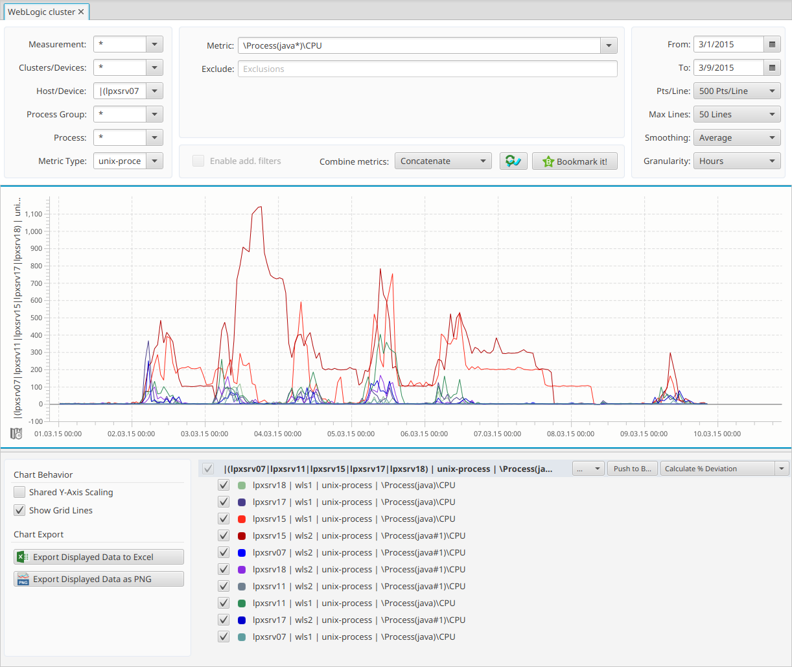

# Positioning of Software-EKG

**English** | [Deutsch](positioning.de.md)

As of 23 November 2026. This document records what Software-EKG is for and what it is not for. It is the result of a discussion, not a plan for a rebuild: what will be built or removed as a consequence has not been decided yet.

## Position

Software-EKG is a diagnostic recorder and workbench for the dynamic analysis of complex, distributed systems: for troubleshooting, it records the runtime behaviour of their servers, processes and applications and lays the curves on top of each other across days, weeks or releases. This reveals anomalies in the interplay of the systems that monitoring does not catch, because each system on its own looks normal. A software emergency doctor configures it for one concrete assignment, compares locally and away from the production systems, begins with a broad view and narrows systems, periods and metrics until the decisive difference is visible. Useful views are preserved as bookmarks and become evidence for findings in the presentation or document appropriate to the assignment. A built-in AI agent helps to check the analyst's hypotheses against logs, release plans and documentation.

The core is comparison, not automatic anomaly detection. Experienced analysts find patterns they were not looking for, and many of them lie within all thresholds:

- Why does the heap grow steadily on three out of fifty systems?
- Why does a load pattern occur every fourteen days?
- Why did the behaviour change after a particular release?
- Why do two systems that should be identical show different curves?

The AI agent lowers the previous barrier to entry. It is not comprehensive enough to be handed the whole analysis. It is a sparring partner: it helps to form hypotheses about what stands out and to verify questions and hypotheses against the data.

## Who it is for

Software-EKG remains an instrument for performance analysts, architects and other experts who investigate historical system data. Experienced users recognise patterns in dense charts through practice. To beginners, the same pictures often remain just curves without support. Without an expert at hand, most users were overwhelmed in contradictory situations, because the tool offered no explanation for the situation. The AI agent is the sparring partner that was missing: it helps to form hypotheses and to verify them; the professional decision remains with the human.

A customer summed up the previous barrier, paraphrased: “Many have an ECG. But there are only a few chief physicians who can really draw conclusions from it.” The AI agent does not replace the chief physician and does not automate professional responsibility. It gives everyone else a sparring partner for their questions and hypotheses.

It remains an expert instrument, now with support for rookies and with verification that avoids misdiagnoses: findings whose cause is a different one than the obvious. When memory runs out, the cause is often not a heap that is configured too small. It can be normal, because more users are on the system, or abnormal: a memory leak, or memory that multiplies with the number of users. It often delivers only the first analysis of symptoms. Both are part of the position and are not glossed over.

A typical assignment crosses organisational boundaries. Large distributed applications involve different suppliers, providers and operations teams. Each of them says that everything works on their side, and yet the customer is left stranded, because the application does not work, is unstable or fails sporadically. Software-EKG puts the measurements of all parties on one time axis, independent of whose monitoring they come from. This is also the reason for the external collector: in corporate contexts, direct access is often more problematic than running a collector in Java somewhere and putting its data on a share. The result is not blame but a well-founded question to the right team.

## What the tool is not

- Not a dashboard.
- Not alerting.
- Not live monitoring. A live display confirms at most that data is arriving.
- Not an anomaly detector, but an anomaly verifier with hypothesis formation. The human notices what stands out; the assistant helps to form hypotheses and to check them against the data.
- Not a tool that promises the cause. Software-EKG shows since when, where and in step with what something is conspicuous. The agent helps with the cause.
- Not a substitute for knowledge of the architecture. If you do not know how the application is really built, you often will not get to the cause, and an AI cannot do better. It can ask the right questions. If they are answered, the case is clear; if nobody knows what is going on in the system, it stays open.

## The workflow

1. **Collect.** Data is collected and stored locally, in the embedded Solr or in ClickHouse. The analysis takes place on your own machine, not on the production systems. With a connection, the workbench imports from Prometheus, once or as a delta import. The collector supplies further sources, among them system metrics and logs via SSH.
2. **Compare.** The analyst puts many time series on top of each other, for example the used heap of 50 systems, changes the time window and adds further systems. Often there is no clear question at the start; it emerges while comparing.
3. **Bookmark.** The analyst preserves the view in which something stands out. Three facts are decisive: which server, which period, and what to compare with. The hypothesis may be developed in the report or presentation that uses this evidence.
4. **Verify.** The built-in AI agent checks the hypothesis against the raw data. It has read access to logs, release plans and other documentation and looks for evidence as well as counter-evidence. An agent that only confirms would automate the analyst's confirmation bias. The check works by elimination: if logs and GC metrics show that no more is running on the conspicuous server than on the others, load is ruled out as an explanation, and suspicion moves to the Java process itself. Some of the questions are already narrowed down by the tool; the rest needs logs and other information. Where even those are not enough, the agent formulates the questions for the people who know the system.
5. **Hand over.** The picture of the bookmarked view and, where needed, its exported values go into an analysis document or presentation. An AI can draft that document from the evidence; the Workbench does not need to become a document-authoring system.

## An example

The picture shows the CPU load of the two WebLogic instances wls1 and wls2 on five nodes of a cluster from 1 to 9 March 2015, as hourly means, selected by wildcards into one view.

**What you see.** The application is only used during the day, from Monday to Friday. The load is distributed wrongly on two levels. On Tuesday, wls2 on lpxsrv15 gets more than three times as much as wls1, from 8 to 20 o'clock on average 690 against 190 percent CPU: on that day the WebLogic load balancer does not distribute properly between the two instances. From Wednesday on both run level. But the node lpxsrv15 as a whole carries 36 to 59 percent of the CPU load of all ten nodes of the cluster on every day, and its instances do not come to rest at night and on Saturday either, when all others are at zero. The distribution in front of it, onto the nodes, is wrong all week.

**What the picture does not say.** Why this is so. But it gives the three facts that matter: which node, which period, and what to compare it with, here the other instances in the same period.

**What is established beforehand.** The collector ensures that on every host each WebLogic instance is recorded under the same name: wls1 as java, wls2 as java#1. The lines are therefore comparable; a measurement error is ruled out as an explanation. Without this assurance, putting the curves on top of each other would be worthless.

**The questions that remain.**

| Question | Where it can be checked |
| --- | --- |
| Does the node receive more load than the others? | In the tool, if requests or sessions per node are recorded; otherwise in the access logs |
| Are the Java processes sick, for example because of continuous GC or hanging threads? | Heap and GC curves in the tool; messages in the logs |
| Does the node have a special role, for example batch jobs or a singleton service? | Cluster configuration and scheduler |
| Is the node set up differently, for example with a different release level or different start parameters? | Release plan and start parameters |

**The resolution.** The cause of the load on lpxsrv15 was the load balancing in the client, a native Java application, which did not work properly. So the first question pointed in the right direction: the node did receive more load. But the cause was not on the servers, it was in the client. The uneven split between wls1 and wls2 on Tuesday is a second finding, which lasted only one day.

**What the example shows.**

- The picture leads to the right node and to the right question. The answer is not in any time series; it takes knowledge of the architecture, here the fact that the client itself distributes the load.
- The result of the analysis is therefore often not an answer but a well-founded question to the right people: this node, this period, this difference from the others – what distributes the load here? Without someone who knows the architecture, neither an SRE nor an AI gets any further.
- Some of the questions can be narrowed down in the tool, the others only with logs, configuration and documentation. That is the work for the agent.
- A language model that was given only an earlier version of this picture, with wls2 alone and without hourly means, recognised the weekly rhythm, the outlier and two plateaus at night. It could not reliably name the server from the colour of the line. In addition to the picture, an agent therefore needs a few key figures per series.

## What this is based on technically

| Property | Implementation in version 7 |
| --- | --- |
| Display long periods from production | Each series is stored as a binary block with start, end and dimensions ([schema.xml](../workbench/src/main/solr/ekgdata/conf/schema.xml)); Solr or ClickHouse as column-oriented storage |
| Limit the amount of data per zoom level | Vectorisation at display time: value change keeps only the change points where the curve is constant, LTTB and Douglas-Peucker reduce to a fixed number of points per series ([simplification](../workbench/src/main/java/io/softwareecg/awb/metricanalyzer/bl/visualisation/simplification/)) |
| Many series in one picture | Wildcards on host, namespace, service, pod, container and further dimensions |
| Raw data instead of condensed steps | The Prometheus import fetches the samples via a range selector |
| Agent on the data | AI chat with tools for chart section, metric list, time series query and SSH commands ([tools](../workbench/src/main/java/io/softwareecg/awb/aichat/bl/tools/)) |
| Record places and pass them on | Bookmarks and bookmark groups, export as PNG and Excel |

The technology is the means, not the position. The core is human-guided comparative analysis with AI support for forming and checking hypotheses.

This also applies to local data storage. The functional core is the comparative, exploratory analysis of historical system data. Keeping the data locally and decoupled from production operations is the architectural approach to it: it makes investigations repeatable, does not load production several times and leaves control over the data with the analyst.

## Differentiation

Software-EKG optimises the interactive comparison of many time series over long periods, not the ongoing monitoring of a system.

| Tool | Optimised for | Software-EKG, by contrast |
| --- | --- | --- |
| Grafana | Dashboards and alerts on the running system | Analysis afterwards, locally, with many series in one picture |
| Prometheus and long-term storage such as Thanos or Mimir | Collecting, retaining and querying | A local data set prepared for interactive comparison |
| AI SRE agents (Datadog, Grafana, Dynatrace and others) | Narrowing down an incident autonomously as soon as an alert fires | The human notices and decides; the assistant helps form hypotheses and verifies them against the data |
| Notebook or coding agent on exported data | Answering a specific question with code | Navigation between hundreds of series without programming, in a growing data set |

The differentiation is based on purpose, not on weaknesses of the other tools. The following statements from November 2026 are default settings and individual findings, not fundamental limits, and may change:

- By default, Grafana requests about [one value per pixel](https://grafana.com/docs/grafana/latest/panels-visualizations/query-transform-data/). Explore initially shows [20 series](https://raw.githubusercontent.com/grafana/grafana/main/public/app/features/explore/Graph/GraphContainer.tsx); the rest can be shown on request.
- By default, Prometheus retains [15 days](https://prometheus.io/docs/prometheus/latest/storage/). Longer is possible by configuration or with long-term storage.
- In the benchmark [OpenRCA 2.0](https://arxiv.org/abs/2606.27154), eleven models found the exact cause in 20.7 % of 500 cases. That is one test setup and says nothing about each individual agent.

It has not been shown that Software-EKG is better for this kind of analysis than the alternatives. Only a reproducible comparison can show that.

## What is missing

- **Sources of the agent.** Today it reaches the time series and, via SSH, the systems. It does not yet reach release plans and documentation.
- **The picture for the agent.** Today the agent receives measurements as text. It cannot request a chart, although that is exactly the strength of the tool: the used DB pool of 100 servers is a lot as raw data, and a single picture as a chart.
- **Context beside the picture.** A screenshot communicates the pattern, but exact series names, filters and values are not always recoverable from colours and pixels. Passing that existing bookmark context alongside the PNG would make external AI-assisted presentations and reports more reliable without adding a document editor.
- **Scheduled import from Prometheus.** For that the collector needs its own Prometheus source. The collector remains optional, but would provide the long-term view of Prometheus.

## Open

The position is a testable hypothesis, not a proof. It has to be tested before version 7 is rebuilt on a larger scale.

> Can an experienced analyst use Software-EKG to discover relevant relationships in a large historical data set that they would not have found with other tools, or only considerably later?

If the answer is demonstrably yes, there is a robust product core. If not, the position has to be reconsidered fundamentally.

- **Why a separate application?** A good analyst could export data from Prometheus and examine it with Python or a coding agent. Three possible answers, so far assertions:
  - Interaction speed: navigating between hundreds of series, changing time windows and comparing, without programming.
  - Repeatability: a growing local data set with uniform dimensions makes it possible to continue earlier investigations.
  - Investigation context: charts, hypotheses, evidence and agent research stay together.
- **The comparison for it.** The data set comes without a given question, because the claim is that the analyst finds patterns nobody asked about. What is measured is what is discovered and how long it takes. So that the user interface and the AI support can be assessed separately, five arms are needed:

  | Arm | Shows |
  | --- | --- |
  | Analyst with Software-EKG | Starting point |
  | Analyst with Grafana | Effect of the user interface without an agent |
  | Analyst with Software-EKG and agent | Effect of the agent in Software-EKG |
  | Analyst with Grafana and a comparable agent | Effect of the user interface with an agent |
  | AI agent alone with the same raw data and tools | What is found without an analyst |

  Two limitations belong to it. Whoever has examined a data set once knows the patterns; each arm therefore needs its own comparable data set or a different analyst. And an analyst who has used Software-EKG for years is not equally practised in Grafana. With one person, the result is a case study, not a proof.
- **A cheap first step.** An old case with a known result: give the raw data from back then to an agent alone and check whether it finds the findings of that time.
- **Who recognises the patterns?** Today the human notices them; the agent helps to form hypotheses about them and to verify these. For that it works from metrics and queried values; in future it should also be able to request the same picture the human sees: filtered by wildcard, in the right period. What has to be clarified is how reliably a model reads a dense picture with 100 lines and names the conspicuous series; it probably needs a short list of the outliers in addition to the picture. The human retains the decision which observation matters to the case and which relationship is investigated.
- Where release plans and documentation typically live and how the agent gets read access to them.
- Which existing functions can be dropped under this position.
